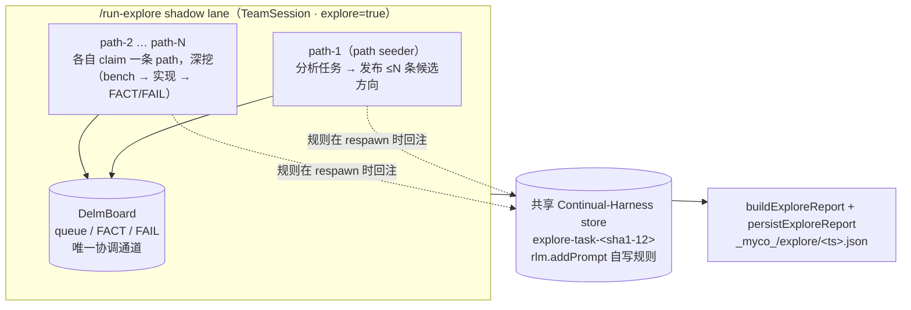
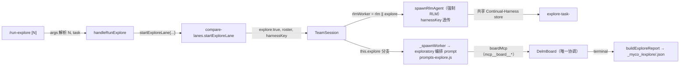

# myco — run-explore：N 路路径探索（foraging）子系统

> 状态：**已实现并提交**（`c41f0d3 run any explore` 及更早的 explore lane）。
> 本文件描述 *现状* 的 API 面与配置流，并作为**后续遗留问题**的载体。
>
> **本期实现（run-explore 只做这个）：§5.1 同动作循环检测 + 注入提示语纠正、
> §5.2 交互步骤 ledger（部分目标可达性验证）—— 已落地并测试。**
> **尚待实现：§5.3「更聪明 role-agent」策略切换编排；以及 §6 —— n2 也要加
> 同一机制，明确列入遗留，**不在本期实现（n2 暂不动）**。**

## 核心思想（Thesis）

run-explore 是 myco team-lane 家族里的一条**独立子 lane**：对「硬
算法设计」类任务，不再像 `/run-n2` 那样让两个 worker 收敛到**同一条**
解法，而是让 **N 个 explorer**（`path-1`..`path-N`）各**深挖一条**候选解法
路径（不同的算法族 / 表示 / 架构方向），各自产出**可测量的证据**，最后
团队收敛到最好的一条（或混合体）。

它复用了与 `/run-n2`、`/run-experts` **完全相同**的 Delm board 协议
（协作核心 `QUEUE_POLICY / BOARD_COMMANDS / WAITING / apply 冲突保护` 从
`prompts-n2-shared.js` 原样复用），但编排 prompt 换成 `prompts-explore.js`
的 `explorerPrompt()`，并且 **explorer 被强制跑在 RLM 引擎上**（自演进走
`rlm.addPrompt` 通道，需要一个**共享的 Continual-Harness store key**）。



**为什么 N 路深挖 + board，而不是单个 agent？** 单一 agent 面对硬算法题时
容易陷在一条思路上空转（见 §3 死锁/空转局限）。N 路并行把「不同解法方向」
摊开，用 peer 的 `FACT`/`FAIL` 笔记（带测量数字）互相**尽早杀死死胡同**，
并用共享自演进 harness 把跑出过的规则沉淀给同类任务。

---

## §1 设计公理（Design axioms）

1. **board 是 explorer 之间唯一的连接。** 所有协调——谁 claim 哪条 path、
   发现了什么、什么已完成——都在 append-only board 事件日志里。复用
   `prompts-n2-shared.js` 的队列策略 / apply 冲突保护，语义与 n2 完全一致。
2. **append-only + 派生视图。** 队列（`item→claim→done`）、笔记
   （`FACT`/`FAIL`）、状态全部从日志回放派生；`apply` 跨作者文件保护强制。
3. **一条 path = 一个实现 assignment，不是调研。** 深挖纪律要求先造
   *最小可测量 benchmark*，再实现该方向最强版本；死路要带着测量数字以
   `done + FAIL note` 关闭，而不是默默放弃。
4. **去中心化收敛。** 当所有 path done 且无开放项时，**第一个注意到的**
   explorer `reserve` 集成项，产出 SOLUTION 对比文档（集成项本身是实现，
   不违反队列策略）。
5. **强制 RLM 自演进。** explore worker 即使会话未开 `/rlm` 也走
   `spawnRlmAgent`——自演进（`rlm.addPrompt`）只在 RLM kernel 存在，而
   探索正需要积累经验；**board 协议保持优先**（n2 addendum 已声明）。
6. **与单 agent / n2 相同事件面。** lane 通过 `_bridge` 汇入主会话时间线，
   事件带 `worker` 标记；UI 用 `state-update`（`team-info` / `board` /
   `team-lane-end`）驱动分栏。

---

## §2 API 面（API surface）

### 2.1 入口：`/run-explore` slash 命令（`server/src/slashcmds.js`）
`handleRunExplore(ctx)` 的输入/输出契约：

| 项 | 说明 |
|---|---|
| **输入 `args`** | 可选前导 N + 任务文本：`/run-explore [N] <task>`。前导 token 若为 `1..3` 位数字则解析为 N，否则视为任务文本 |
| **默认 / 上界** | `EXPLORE_DEFAULT_PATHS = 4`；`EXPLORE_MAX_PATHS = 512`；N 须 `2..512`（`1` 与 `513` 被拒），N 后须跟任务文本 |
| **输出 `ctx.reply`** | 用法提示（无参时）；`session not running` 守卫；N 越界 / 裸 N 的报错；启动确认 `▶ /run-explore 已启动`；完成 `✅ ... 报告已写入 _myco_/explore/<ts>.json` |
| **副作用** | `startExploreLane(...)` 建 lane → `startProgressHeartbeat(...)` 驱动滚动进度 → `onLaneTerminal` 时 `buildExploreReport` + `persistExploreReport` |

### 2.2 lane 装配：`startExploreLane`（`server/src/compare-lanes.js:613`）

输入：

```js
{ cwd, user, task, dir, mainSession, mainSessionId, nPaths }
```

装配步骤：
1. `shadowId = '<mainSessionId>-cmp-explore'`；`roster = ['path-1'..'path-N']`；
2. `new TeamSession(shadowId, { cwd, user, task, eventsDir: dir, roster, explore: true,
   harnessKey: exploreHarnessKey(task) })` —— **`explore:true` 触发 explorer
   编排 prompt + 强制 RLM**；`harnessKey` 由 `exploreHarnessKey(task) =
   'explore-task-' + sha1(task).slice(0,12)` 稳定派生（同任务→同 store→跨
   worker、跨未来同文本任务共享自演进规则）；
3. `_bridge(lane, mainSession, mainSessionId, null, laneMeta)` 汇入主会话；
4. 发 `state-update {kind:'team-info', mode:'agent-n2', teamLane:true, laneId, ...}`
   让前端建分栏；
5. `_registerLane` + `onLaneTerminal`；
6. `lane.dispatchTask(task)` 广播给全部 explorer。

输出（返回值）：

```js
{ lane, id: shadowId, laneId, roster,
  boardFile: '<dir>/board.jsonl', dir, startedAt, harnessKey }
```

### 2.3 运行期环境输入/输出
每个 explorer 是一个 RLM worker（`spawnRlmAgent`），其**输入**：

- 编排 systemPrompt：`explorerPrompt({task, actor, roster, workspace, nPaths})`
  （`prompts-explore.js`）——由 `PATH_LEAD`（seeder）或 `PATH_MEMBER` + `PATH_DISCIPLINE`
  + `WAITING` + `PATH_CONVERGE` + `BOARD_COMMANDS` 拼接；
- 追加 `rlmN2Addendum()`（board 优先声明）；
- 自己的 `boardMcp`（`mcp__board__*` 工具，actor 在闭包绑定）；
- 共享 `harnessKey` 透传给 `spawnRlmAgent`，接共享 Continual-Harness store；
- `rlmSpawn {parentSessionId, depth:1, maxDepth:3}`（kernel 子 agent 深度护栏）；
- 每个 explorer 的**输出**（持久化件）：
  - `events-<actor>.jsonl` —— 该 explorer 的 agent 事件流（`tool_use` /
    `tool_result` / `turn_result` …）；
  - `board.jsonl` —— 共享看板日志；
  - 终端汇总：`buildExploreReport()` → `persistExploreReport(cwd, report)`
    → `_myco_/explore/<ts>.json`。

### 2.4 报告输出形状（`buildExploreReport`）
```jsonc
{
  "task": "...",
  "startedAt": "...",
  "explore": { "id": "...", "dir": "...", "harnessKey": "explore-task-<sha>", "roster": ["path-1", ...] },
  "timing": { "explore": <ms> },
  "summary": {
    "paths": [ { "actor": "path-1", "items": [{ "id","subject","state","summary" }] } ],
    "failNotes": [ { "actor","type":"FAIL","scope","text" } ],
    "metrics": { /* measureLane: toolUse 计数、每 actor event 统计 */ },
    "queue": [ { "id","subject","state","owner" } ]
  }
}
```

### 2.5 关键常量 / env 旋钮
| 符号 | 值 / 位置 | 含义 |
|---|---|---|
| `EXPLORE_DEFAULT_PATHS` | 4（slashcmds.js） | 默认 N |
| `EXPLORE_MAX_PATHS` | 512（slashcmds.js） | N 上界 |
| `exploreHarnessKey` | `explore-task-<sha1-12>` | 共享自演进 key |
| `STALL_NUDGE_MS` / `STALL_FAIL_MS` | `5m` / `8m`（team-session.js，可 env 覆盖） | team 级 stall 看门狗（只做「nudge→fail」，**不是**动作级策略切换） |

---

## §3 配置流（Configuration flows）

`/run-explore` 的配置如何流向 `TeamSession` 与各 worker：



三条同源的配置轴：

1. **模式开关**：`opts.explore`（`team-session.js` `_spawnWorker` 里第一优先级）决定
   prompt 来自 `prompts-explore.js`（而不是 `prompts-team.js` / `prompts-n2.js`）。
   `rlmWorker = this.rlm || this.explore` 决定强制 RLM。
2. **N 与 roster**：`nPaths` → `roster ['path-1'..'path-N']` → `_spawnWorker` 每个 actor
   一份 explorer prompt；`path-1` 是 seeder（`PATH_LEAD`，`nPaths` 注入为 `__N__`），
   其余是 member。
3. **共享 harness**：`harnessKey = exploreHarnessKey(task)` 使自演进规则**跨 worker 且
   跨未来同文本任务**累积——这是 run-explore 区别于其它 lane 的「记忆」机制。

> 与 `/run-n2` 的字节级隔离：`/run-n2`（`TeamSession` 不带 `opts.explore`）保持
> `prompts-n2.js` 的 `STARTUP_A/B` 逐字节不变，`explore` 分支是**纯增量**。

---

## §4 局限：foraging（run-explore）的死锁 / 空转

run-explore 的协作机制已实现，但存在一个**已知局限**：explorer **可能在原地
反复执行同一动作而空转 / 死锁**，目前**没有**针对它的策略级兜底。这本质上是
「**下一步目标（agent goal）内容对 lane 层不可见**」导致的。

### 4.1 根因（目标不可见 → 空转判不定）
- **goal → actor → created/generated target**：agent 的目标（goal）需要通过
  actor（角色 agent）动作才会产生/成型目标（target）。run-explore lane 层本身
  **无法拿到 agent goal 内容**——goal 实质上是**被捕获在 n2 引擎内部**的。
- 因此在 lane 层，`seek / use / browse` 这类**交互步数**取不到，`agent goal`
  内容也取不到。无法据此判断「agent 是否真的在朝目标推进，还是原地打转」。
- 更具体的关联（遗留问题背景）：早前为 **n2** 引入过一个 idempotency /
  expire 机制（`n2_idempotency_key`）。**run-explore 复用了 n2 之后**，explore
  lane 因**未把该 key 传递到位**，导致「top up（补给/注入提示语）」跑偏——
  explore 拿不到 agent goal，进而在 seek/use/browse 阶段卡死。
- **循环依赖（判定）**：*actor 牵扯到 goal，是因为 goal 需要 actor 才能动作；
  actor 需要 goal 才能形成——没有 actor 就没 goal → 死锁。*

### 4.2 约束：不能加时间硬限
不能靠「超过 X 秒就判死」的时间硬限解决（误杀慢而有效的探索——实测 n2 的成功
回答中位数 ~298s / p90 ~676s，硬限会杀死仍在产出的团队）。

### 4.3 已落地的兜底（粗粒度）
`team-session.js` 的 **stall 看门狗**只提供团队级 liveness 信号：无任何
agent-event 达 `STALL_NUDGE_MS`（5m）→ nudge 一次「继续」；仍静默到
`STALL_FAIL_MS`（8m）→ `team-failed`。这是**「整体无声」**才触发，**不能**
识别「agent 有声但反复做同一动作」的空转，也**不做任何策略切换**——只
提醒/判失败，不改变 agent 的思路。

---

## §5 策略切换机制：分层演进 →「更聪明的 role-agent」

要真正化解 §4 空转，方向是引入一个**策略切换机制（strategy-switching
mechanism）**。分层演进，**§5.1 + §5.2 已在 run-explore 落地**，**§5.3
尚未实现**。

### 5.1 第一层（最小、无硬限）：动作级循环检测 + 纠正 —— **已实现**
- **检测**：对每个 explorer，`server/src/explore-loop-detect.js` 的
  `ExploreLoopDetector` 记录其**交互动作流（tool_use / tool_result /
  turn_result）**，当**同一动作（同名 tool_use）连续 ≥ threshold（默认 10，
  env `MYCO_EXPLORE_LOOP_THRESHOLD` 可覆盖）且其间无成功结果**时，判定该
  explorer **陷入原地循环**。成功结果 / `turn_result` / board 提交会清零该
  同动作 streak（合法高频读 board 不算循环）；出错结果**不**清零（重复失败
  正是卡死信号）。
- **纠正**（非时间硬限）：detector 返回决策，`TeamSession._applyStrategySwitch`
  通过**注入提示语**（`worker.write`，与 stall nudge / idle kick 同一通道）让
  它**换思路**——读 board、贴 note 说明缺什么输入、做一步不同的可度量动作。
  **deny** 是备选，未启用（注入提示语对拦断的 lane 最无侵入）。
- 目的：**不死锁、不加时间硬限**，主动打断重复，而不是默默空转。
- 护栏：每 worker 有**冷却**（`MYCO` 默认 60s，避免重复轰炸）与 **hard cap**
  （最大切换次数，`maxSwitches=5`——cap 是次数不是时间）。

### 5.2 第二层（目标可达性验证）：记录 agent interactive steps —— **已实现**
即便 `agent goal` 内容在 lane 层不可见，`ExploreLoopDetector` 也**记录每个
explorer 的 interactive steps（tool_use / tool_result 成败 / turn_result）**：
- `flushLedger(dir)` 持久化到 `<dir>/steps-<actor>.jsonl`（既有 events-*.jsonl
  之外的**结构化、可计数**账本）；
- `reportSummaries()` 给出**按动作（tool）的调用数 / 出错数**、工具总次数、
  步数、turn 数——在拿不到 goal 时仍能**验证部分目标达成**；
- 这些进了 `/run-explore` 报告（`summary.interactiveSteps` /
  `summary.strategySwitches`），完成行也显示「策略切换 N 次」。
- 非 explore lane（n2 / experts / 单 agent）**零额外状态**（`this.explore` 才
  构造 detector），n2 路径逐字节不变。

### 5.3 第三层（最终方向）：更聪明的 role-agent —— **尚未实现**
与其在 lane 层做脆弱的启发式计数，更长远的做法是把**策略切换本身升级成一个
role-agent（更聪明的角色 agent）**：一个能读懂 explorer 动作流、判断「当前
策略是否在该路径上收敛」、并在原地循环时**主动切换策略 / 换角色 / 换子目标**
的编排角色。它把「目标→动作→策略」的循环依赖显式建模，让 goal 不再被锁在
n2 引擎内部不可见，而是可被编排层 **part 化（goal @ part，part per goal）**
地、**粒度**地看到每条路径的局部达成。

---

## §6 遗留问题（followup）：**n2 也要加** —— **不在本期实现（n2 暂不动）**

> ⚠️ **这是本文件最重要的遗留标记。**
> 用户明确指示：**「后面记得 n2 要加（这个是遗留问题）」「n2 暂时不动」**——
> **n2（`/run-n2`，`prompts-n2.js` / `startN2Lane`，同一 TeamSession/Delm 家族）
> 也要获得同样的策略切换机制**。本期**只做 run-explore**（§5.1 + §5.2 已实现），
> **n2 的该机制是后续（followup）**，**不在本期实现、n2 暂不动**。

具体登记：
- **run-explore 现状**：§5.1（同动作循环检测 + 注入提示语纠正）+ §5.2
  （交互步骤 ledger）**已实现**（`server/src/explore-loop-detect.js` +
  `team-session.js` 探针 + 报告集成）；**§5.3 未实现**。
- **n2 的待办**：为 n2 lane 增加与 run-explore 相同的：
  1. 动作级「同一动作 >10 次」循环检测 + 纠正（deny / 注入提示语换思路）；
  2. agent interactive steps 记录，支持**部分目标达成验证**（goal @ part）；
  3. 更长远的「更聪明 role-agent」策略切换编排。
- **实现顺序建议**：先 5.1+5.2（最小、无硬限），再演进 5.3；n2 与 run-explore
  共享 `team-session.js` 骨架，**机制应抽成共享能力**（detector 已独立成模块，
  n2 落地时只需在 `this.explore || this.n2` 时也构造它），避免两处各写一遍。

---

## §7 测试与纪律（现状回归面）

触碰本子系统需保持绿的测试（均被 `./test/test.sh` 的 `test/*.test.js` glob
自动发现）：

- `test/explore-lane.test.js` —— TeamSession explore 模式：roster `path-1..N`
  共享一 board、seeder/member prompt、强制 RLM、`harnessKey` 透传、非 explore
  团队 n2 回归保持逐字节一致。
- `test/explore-prompts.test.js` —— `explorerPrompt` 拼接契约。
- `test/slash-run-explore.test.js` —— `/run-explore` 解析 + 守卫 + 装配（默认
  N=4、前导 N 解析、N 越界拒绝、session-not-running 守卫、数字型任务文本不误
  判为 N）。
- **`test/explore-loop-detect.test.js`（13 例）** —— §5.1/§5.2 策略切换 +
  步骤 ledger：同动作 ≥threshold 触发、成功结果/board 进展/turn_result 清零、
  出错结果不 清零、冷却与 maxSwitches、`flushLedger` 写 `steps-<actor>.jsonl`、
  `reportSummaries` 按动作计数、TeamSession 注入提示语、以及 **n2 团队不构造
  detector（n2 逐字节不变）** 的回归守卫。
- 复用 n2 家族：`test/board.test.js`、`test/team-session.test.js`、
  `test/team-runqueue.test.js`、`test/explore-lane.test.js`。

`test/test.sh` 还钉了三条静态守卫：`team-session.js` 含 `ExploreLoopDetector`
（explore-only 布线）、`explore-loop-detect.js` 含 `DEFAULT_LOOP_THRESHOLD = 10`
（无时间硬限）、含 `flushLedger`（步骤 ledger 持久化）。触碰该机制时保持这些
守卫 + `explore-loop-detect.test.js` 为绿。
