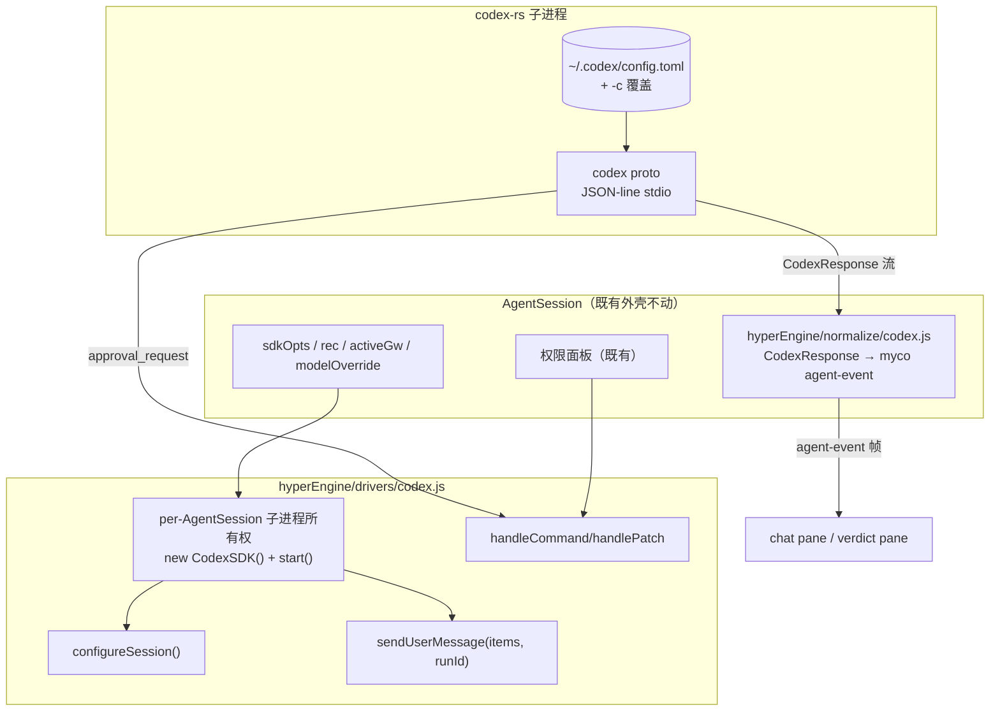

# hyperEngine Driver —— codex（codex-js-sdk / codex-rs）

> 状态：**设计方案（未实现）。** hyperEngine 引擎注册/选择/调度层的一个引擎驱动。
> 依据仓库：https://github.com/kachurun/codex-js-sdk.git （`codex-js-sdk@1.0.2`，MIT，
> ESM+CJS）。本文所有 API 均来自其真实源码 `src/{CodexSDK,types,config,index}.ts`、
> `README.md`、`example/test.ts`（clone 于 /tmp/refsdk/codex-js-sdk，直接通读）。

---

## 1. codex-js-sdk 真实能力盘点（调研结论）

codex-js-sdk **不是 HTTP 客户端，也不是进程内库**——它 `spawn` 原生 Rust `codex` 二进制
（来自 `@openai/codex@native`，codex-rs），以 `codex proto` 子命令跑 **JSON-line IPC**
（stdin/stdout）。这是四个引擎里唯一的**子进程驱动**形态，生命周期模型与 claude（库
调用）/ dsh（进程内 runtime）都不同。

### 1.1 `CodexSDK` —— 唯一的类

```ts
new CodexSDK(options?: CodexProcessOptions)
// CodexProcessOptions:
{
  cwd?: string,          // codex 子进程工作目录（相对 process.cwd() 解析）
  env?: ProcessEnv,      // 传给子进程的完整 env；缺省 process.env（整传，不是叠加）
  apiKey?: string,       // 缺省取 OPENAI_API_KEY
  config?: ConfigOverrides,  // 覆盖 ~/.codex/config.toml；configToArgs() 摊平成 -c k=v CLI 参数
  logLevel?, codexPath?  // 自定义二进制路径；缺省 PATH 里的 'codex'
}
```

方法：`start()`（幂等；进程退出不自动重启，需显式 `restart()`）、`stop()`/`restart()`、
`abort(requestId)`（对某次 run 发 `interrupt` op）、
`configureSession(options) → Promise`（resolve 于 `session_configured`；**设
instructions/model/provider 的唯一途径**）、`sendUserMessage(items, runId?) → runId`
（items = text / image_url / local_image）、`handleCommand(callId, approved, forSession?)` /
`handlePatch(...)`（审批回执）、`sendRaw(msg)`（逃生舱）、
`onResponse(cb) → unsubscribe` / `onError(cb)`。

启动固定参数 `['-a=never', '--skip-git-repo-check', …-c overrides, 'proto']`——驱动无法
改动这些 flags（除非 sendRaw/分叉 SDK）。

### 1.2 wire 协议（16 类入站 msg）

`CodexResponse = { id, msg }`，**id 是 run id 不是 call id**（审批 op 的 call id 在 `op.id`
里）。`msg.type` 全集：

`agent_reasoning`（text）· `agent_message`（message）· `task_started` ·
`task_complete`{last_agent_message?} · `session_configured`{session_id, model} ·
`exec_command_begin`{call_id, cmd[], cwd} · `exec_command_end`{call_id, stdout, stderr,
exit_code} · `exec_approval_request`{cmd[], cwd, reason?} ·
`apply_patch_approval_request`{changes: Record<path, FileChange>} · `patch_apply_begin/end`
· `mcp_tool_call_begin/end`{call_id, server, arguments} · `background_event` · `error` ·
`get_history_entry_response`。

### 1.3 模型/网关注入面（关键：不止 env）

- `config`（ConfigToml 子集）经 `configToArgs()` 摊平为 `-c key.subkey=value` CLI 参数：
  `model`、`model_provider`、`approval_policy`、`sandbox_permissions[]`、
  `model_providers{name, base_url, env_key, wire_api:'chat'|'responses'}`、`instructions`、
  `cwd`、`history{persistence:'none'|'save-all'}`、`mcp_servers` 等。
- **多 provider 支持**：自定义 `model_providers` + `model_provider` 选择器可以把 codex
  指向 Anthropic（`base_url https://api.anthropic.com/v1`，`env_key ANTHROPIC_API_KEY`，
  `wire_api:'chat'`——README 示例即此）→ 与 myco 的网关（activeGw）模式同构。
- API key 由**子进程**从 env 按 provider 的 `env_key` 读取 → myco 注入 key = 传好
  `options.env`，不需要新的 key 通道。
- `configureSession` 默认值（省略时）：provider OpenAI（api.openai.com/v1，OPENAI_API_KEY，
  RESPONSES wire）、model `o4-mini`、reasoning LOW、approval UNLESS_ALLOW_LISTED、
  sandbox `DISK_WRITE_CWD`。

### 1.4 会话模型与硬限制

- **一个 codex 子进程 = 一个会话**；`session_id` 随 `session_configured` 到达；无多会话
  API、**无 resume-by-id API**——会话存活期 = 子进程存活期。
- 历史可选落盘：`history.persistence='save-all'` 写 history.jsonl；`add_to_history` /
  `get_history_entry_request` 原生 op 存在，但 SDK 层没有 restore 接口。
- **无 token 级流式**：`agent_message` 是完整消息块，没有 partial-text 增量事件。
- 审批是**推式**：`exec_approval_request` / `apply_patch_approval_request` 事件 +
  `handleCommand` / `handlePatch` 回执；decision ∈ `approved | approved_for_session |
  denied | abort`。

---

## 2. 驱动定位

```
hyperEngine/
  drivers/
    codex.js      # 本设计：Driver 契约的 codex 实现（壳 → 真实），kind = 'child-process'
```

- **壳阶段**：`overlay()` 只注入命名空间 env（`MYCO_ENGINE='codex'`），执行仍走 claude
  code——与其它壳驱动一致。
- **真实阶段**：`overlay()` 需要同时携带 **env（key）+ engineOptions（config 覆盖）**，
  外加 `openSession()` 拥有子进程生命周期。§4–§6 为真实阶段设计。
  方法名统一对齐主文档 §5.2（唯一命名基准）：`openSession`/`sendTurn`/`approve`/`abort`/`close`；
  早前本文曾用 `createSession`/`send`，现同一口径。
- 对统一 Driver 契约的反哺：codex 证明 `overlay()` 不能只回 `{env, model}`，需要
  `{ env?, model?, engineOptions? }`（core-architecture 设计已采纳此扩展）；且 Driver 需要
  `kind: 'query' | 'client' | 'child-process' | 'in-process'` 标签，供调度层区分生命周期
  语义（见 core-architecture）。

---

## 3. Driver 契约下的 codex 形态

```js
{
  name: 'codex',
  label: 'Codex (codex-rs)',
  kind: 'child-process',
  capabilities: { resume: false, interrupt: true, approvals: true, eventStream: true, streaming: false },
  available(opts) -> bool,
  overlay(opts) -> { env?, model?, engineOptions? },   // 壳阶段只填 env；真实阶段三样都填
  // 统一 EngineDriver 接口（主文档 §5.2 为唯一命名基准）：
  openSession(opts) -> EngineSession                   // 真实阶段：new CodexSDK + start() + configureSession()
  sendTurn(text, { signal } = {}) -> AsyncIterable<EngineEvent>  // 真实阶段：sendUserMessage + onResponse
  approve(id, ok) -> void                              // handleCommand / handlePatch（§5.2 审批桥）
  abort(runId?) -> void                                // abort(runId) 细粒度 / stop() 进程级
  close() -> void                                      // stop()
}
```

### 3.1 `available()`（探测）

| 检查 | 依据 | 缺省 |
|---|---|---|
| `codex` 二进制可解析（`codexPath` 或 PATH） | `spawn('codex', …)` | 缺 → `false`（否则随机选中即炸出失败进程） |
| `--version` 探活（一次性 spawn，超时 2s） | 真实可执行性 | 失败 → `false` |
| provider 所需 key 存在：`OPENAI_API_KEY` 或目标网关 env_key | README §prereq | 缺 → `false` |
| Node 环境可 spawn 子进程 | 子进程驱动 | 容器禁 spawn → `false` |

探测结果可短缓存（如 30s），但**每次 spawn 现算默认路径**；`claude` 恒真保底不变式不变。

### 3.2 `overlay()`（壳阶段 → claude code 注入路径）

```js
// drivers/codex.js —— 壳阶段实现（设计）
overlay({ sdkOpts, modelOverride, activeGw, user, worker }) {
  return { env: { MYCO_ENGINE: 'codex', MYCO_ENGINE_SESSION_HINT: 'codex-js-sdk@1.0.2' } };
}
```

零影响不变式同 dsh：开关 off 时 dispatch 恒 claude，`overlay` 不被调用。

### 3.3 `overlay()`（真实阶段 → engineOptions 承载 config）

| myco 侧输入 | codex 注入面 | 说明 |
|---|---|---|
| `activeGw`（base_url + key env 名） | `engineOptions.config = { model_providers: { myco: { base_url, env_key, wire_api } }, model_provider: 'myco' }` | 与 myco 网关模式同构；Anthropic 网关 → `wire_api:'chat'` + `ANTHROPIC_API_KEY` |
| `modelOverride` / 网关默认模型 | `engineOptions.config.model` | overlay 的 `model` 字段仅用于 UI 徽标；真实路由走 config |
| 网关 key 值 | `env[env_key]` | 子进程按 env_key 读取 |
| 会话 cwd | `engineOptions.config.cwd`（+ CodexSDK ctor `cwd`） | 对齐 `options.cwd` |
| myco 权限策略 | `engineOptions.config.approval_policy` + `sandbox_permissions` | 默认 `unless-allow-listed` + `disk-write-cwd`；与 myco allowlist 语义在 §5 桥接 |
| 历史持久化 | `engineOptions.config.history = { persistence: 'save-all' }` | 补偿无 resume（见 §6 审计） |

---

## 4. 真实阶段：会话装配与生命周期



### 4.1 所有权：一个 AgentSession = 一个 CodexSDK = 一个子进程

- spawn（`pickEngine()` 选中 codex）时 `new CodexSDK({ cwd: options.cwd, env: {…process.env, [env_key]: gwKey}, config })` + `start()`；AgentSession 销毁时 `stop()`。
- **不做进程池**：单进程 = 单会话，池化没有复用收益，只增加孤儿进程风险。关闭挂进
  AgentSession 既有 teardown 路径（新增一行），容器 shutdown 兜底 `stop()`。
- 子进程意外退出：`onError` 收到后驱动进入 `degraded`，当前轮以 `engine-error` 帧收尾；
  **不自动重启**（SDK 语义如此），下一轮 spawn 由 myco 既有 respawn 逻辑重掷引擎。

### 4.2 初始化顺序（一次）

1. `start()` → 2. `configureSession({ model, provider 信息, approval_policy, sandbox,
cwd })` → 等 `session_configured`（拿 `session_id`，写审计事件）→ 3. 首条
`sendUserMessage`。

`instructions`（系统提示）只能在此设置——myco 的 CLAUDE.md / persona 注入点要在这一步
展开，**之后无法换**（换 = restart，会话历史断）。

### 4.3 每轮对话与中断

- `sendTurn(text)` → `sendUserMessage([{type:'text',text}], runId)`，runId 由驱动生成并
  记账（per-turn）。`task_complete` / `error` 事件到达即本轮收尾。
- 中断：myco abortController → `abort(runId)`（`interrupt` op）。**无全局 cancel**——
  驱动必须按 runId 追踪，乱序 abort 无害（SDK 对未知 id 的 interrupt 由子进程忽略）。

---

## 5. 事件归一化与审批桥

### 5.1 `CodexResponse` → myco agent-event 映射表（设计契约）

| codex `msg.type` | myco agent-event | 备注 |
|---|---|---|
| `task_started` | `turn-start` | 轮次开始 |
| `agent_reasoning` | `assistant-reasoning` | myco 若无此帧则并入 `assistant-delta`（reasoning 前缀），设计上单独帧 |
| `agent_message` | `assistant-message` | **整块到达**（无增量）→ myco 打字机粒度退化为消息级，帧上标 `meta.streaming:false` |
| `task_complete` | `turn-end` + `result` | `last_agent_message` 做 `_persistAssistantTextToRecChat` 镜像 |
| `exec_command_begin` / `end` | `tool-use` / `tool-result` | call_id 直传；`exit_code`→isError |
| `patch_apply_begin` / `end` | `tool-use` / `tool-result`（工具名 `edit`） | stdout/stderr/success 映射 |
| `mcp_tool_call_begin` / `end` | `tool-use` / `tool-result` | server+tool 合成展示名 |
| `exec_approval_request` | `permission-request` | **推式**：立即转 myco 权限面板 |
| `apply_patch_approval_request` | `permission-request` | 同上，changes 渲染成 diff 卡片 |
| `session_configured` | `engine-ready`（审计用） | 记 session_id/model |
| `error` | `engine-error` | 本轮收尾 + degraded 标记 |
| `background_event` / `get_history_entry_response` | `engine-raw`（透传） | 不 crash、不吞，落 events.jsonl 可查 |
| 未知类型 | `engine-raw` | 前向兼容，永不 throw |

规则与 dsh 相同：normalize 纯函数、可独立单测、`meta.srcId`（run id）/ `meta.callId`
保留、myco `meta.seq` 仍由服务器 `allocSeq` 分配。

### 5.2 审批桥（推式 → myco 面板）

- codex 的审批是**事件 + 回执**：收到 `*_approval_request` → 驱动转 myco 权限面板
  （既有 canUseTool 等价 UI）→ 用户选择映射：
  - 允许 → `handleCommand/handlePatch(callId, true, false)`（`approved`）
  - 本会话允许 → `(callId, true, true)`（`approved_for_session`）
  - 拒绝 → `(callId, false)`（`denied`）
  - 中断 → 先 `abort(runId)` 再 `denied`
- **无面板可用（headless/只读）→ 立即 `denied`**——fail-closed，与 dsh 桥一致。
- codex 启动即 `-a=never`（永不自动批准），所以**每个需要审批的操作都会推事件**——
  面板压力可能高于 claude 路径；设计上允许 `engineOptions.config.approval_policy` 调成
  `auto-edit`（自动放行 edit 类）以贴近 myco 默认体验，**默认值取 `unless-allow-listed`**
  保持保守。

---

## 6. 与调度层的接口 + 硬限制的显式声明

- 选择粒度同其它引擎：**spawn 时 `pickEngine()` 一次、会话内粘住**（子进程不可中途换，
  与「无热切换」不变式一致）。
- **`capabilities.resume = false` 必须被调度层尊重**：
  - myco 的 claude 会话有 `resume(sessionId)` 能力；codex 会话 respawn 后**从零开始**。
  - 调度层对 codex 会话的 respawn 语义 = 新会话（历史仅存 myco 侧 `rec.chat` /
    `events.jsonl`，不回灌 codex）——文档显式声明，不伪装 resume。
  - 补偿：`history.persistence='save-all'` 保留 history.jsonl 供人工审计。
- 团队 worker：各自 `pickEngine()`，可 `claude + codex` 组合；每个 codex worker 一个子
  进程，关闭路径同 §4.1。
- 审计：`engine-picked` 事件（同 dsh 设计）记 `{ engine:'codex', codexSessionId, runIds }`。

---

## 7. 风险与边界

| 风险 | 设计应对 |
|---|---|
| 原生二进制依赖（`@openai/codex@native`），容器里可能没有 | `available()` 探测；没有即不进候选集，随机不受影响 |
| 子进程泄漏（会话多、崩溃路径多） | per-AgentSession 所有权 + teardown 单点 + 容器 shutdown 兜底 + 孤儿进程对账日志 |
| 无 resume | `capabilities.resume=false` 显式声明；respawn=新会话；history 落盘仅审计 |
| 无 token 流式 | 帧标 `meta.streaming:false`，chat pane 按整块渲染（已有整块 assistant-message 渲染路径，无 UI 改动） |
| `-a=never` + 推式审批的面板压力 | `approval_policy` 可调；默认保守；批量审批 UI 是后续扩展点（本次不做） |
| config 摊平 `-c k=v` 的类型陷阱（非字符串 JSON 化） | engineOptions 构造收在驱动单文件内 + 单测锁定 `configToArgs` 输出形状 |
| SDK 固定 flags（`-a=never` 等）不可改 | 已在设计中接受为常量；若未来需要改，走 `sendRaw` 或分叉 SDK（显式列出，不做） |

---

## 8. 测试计划（新增，镜像 hyperEngine 测试表）

| 测试 | 断言 |
|---|---|
| `codex-driver-shell` | 壳阶段 `overlay()` 只加 `MYCO_ENGINE=codex` env，不动 model；开关 off 时不被调用 |
| `codex-available-gating` | 无 `codex` 二进制 / 无 key / 探活超时 → `available()=false`；`pickEngine` 不产出 codex |
| `codex-normalize-map` | 16 类 `msg.type` 全覆盖：已知→对应 myco 帧，未知→`engine-raw`，不 throw |
| `codex-normalize-streaming-flag` | `agent_message` 帧带 `meta.streaming:false` |
| `codex-approval-bridge` | 推式请求→面板决策映射四分支（approved / for_session / denied / abort）；无面板→`denied` |
| `codex-engineoptions` | `activeGw`+`modelOverride` → `configToArgs` 形状锁定（`-c model=… -c model_provider=… -c model_providers.myco.base_url=…`） |
| `codex-lifecycle` | spawn→start→configureSession→send→task_complete→stop 全链；子进程退出→`degraded`+`engine-error` 帧，不自动重启 |
| `codex-no-resume` | respawn 后新 session_id ≠ 旧值；myco 侧历史不回灌 |

> 离线跑法：`codexPath` 指向测试 stub（一个回放 JSON-line 脚本的假二进制），不依赖真实
> codex / API key；normalize 单测用录制的事件 fixture，纯函数零 IO。
