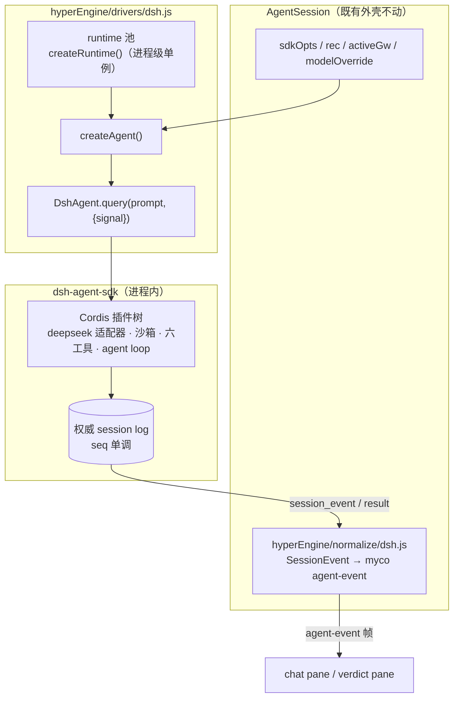

# hyperEngine Driver —— dsh（DeepSeek Harness Agent SDK）

> 状态：**设计方案（未实现）。** hyperEngine 引擎注册/选择/调度层的一个引擎驱动。
> 依据仓库：https://github.com/salathleizhang/dsh-agent-sdk.git （`dsh-agent-sdk@0.1.0-rc.1`，
> 本文所有 API 均来自其真实源码 `src/{index,agent,runtime,spine,types}.ts`、`README.md`、
> `docs/architecture.md`、`tests/agent-sdk.spec.ts`）。

---

## 1. dsh SDK 真实能力盘点（调研结论）

dsh-agent-sdk 是**进程内嵌入、插件化**的 coding-agent 运行时，构建在 DeepSeek Harness
（Cordis 插件树）之上。它**不是 CLI**，没有 `spawn` 子进程协议——所有调用都是
`async generator` 流，这一点与 claude / opencode / codex 的驱动形态都不同。

### 1.1 三个入口层级

| 入口 | 语义 | 资源生命周期 |
|---|---|---|
| `query(options: OneShotQueryOptions)` | 一次性：fresh runtime + agent，跑一个 prompt | 迭代结束自动 dispose；提前 return 会 cancel 并排空 |
| `createRuntime(options: RuntimeOptions)` | 进程级可复用 runtime（Cordis 插件树） | 宿主调 `runtime.close()` |
| `runtime.createAgent(options: CreateAgentOptions)` | 可复用会话（`DshAgent`），一次只允许一个活跃 query | 宿主调 `agent.close()` |

myco 的 AgentSession 是**多轮、长寿命**的会话 → 驱动采用
`createRuntime() + createAgent()` 的**可复用形态**，而非一次性 `query()`。

### 1.2 关键配置面（设计映射的输入）

```ts
// RuntimeOptions —— 进程级
{
  deepseek?: DeepSeekConfig | false,   // 默认 deepseek 适配器；false = setup 里自注册
  codingTools?: CodingToolsOptions | false,
  spine?: AgentSpineOptions,           // persona / toolOrder / maxParallelToolCalls / workspaceContext…
  runtimeSetup?: (ctx: Context) => …   // 进程级可信插件挂载点
}
// CreateAgentOptions —— 会话级
{
  cwd: string,                         // 绝对路径，写进 durable session header
  sessionId?: string,                  // 缺省 UUID；可由 myco 传入 session id
  provider?: string,                   // 默认 'deepseek-official'
  model?: string,                      // 默认 'deepseek-v4-pro'
  maxTokens?: number,
  tools?: readonly ToolDefinition[],   // defineTool() 定义的 agent 级工具
  setup?: AgentSetup
}
// CodingToolsOptions —— 工具与沙箱
{
  sandboxMode?: 'workspace-write' | 'danger-full-access' | …,  // 默认 workspace-write
  workspaceRoot?: string,              // 默认 process.cwd()；myco 必须显式传会话 cwd
  onApproval?: (req: ApprovalRequest) => ApprovalOutcome | Promise<ApprovalOutcome>,
                                      // 缺失 = fail closed（拒绝升级）
  bash?: …, files?: …, search?: …
}
// QueryOptions —— 每次 prompt
{ signal?: AbortSignal }               // abort → agent.cancel({ kind: 'user' })
```

### 1.3 事件流（权威 session log）

`DshAgent.query(input, { signal })` 产出 `AgentStreamEvent` 联合：

- `{ type: 'session_event', sessionId, event: SessionEvent }` —— **逐一转发权威会话日志事件**，
  SDK 不翻译 payload。测试中确认的事件类型集合：
  `turn/start`、`user/message`、`assistant/chunk`（流式增量）、`assistant/message`（整条）、
  `tool/call`、`tool/result`、`turn/end`。
- `{ type: 'result', result: QueryResult }` —— 区间收尾，含 `sessionId`、`reason`
  （`TurnEndReason`，如 `{ kind: 'completed' }` / `max-tokens`）、最后一条
  `AssistantMessage`、拼接后的纯文本 `text`、区间内全部 `events`（带单调 `seq`）。

事件以 `seq` 单调递增、会话日志为权威历史（模型可见历史 = session log，不是宿主拼接）。
SDK 明确要求：**对未知的未来 `SessionEvent` 变体按宿主自己的兼容策略处理** → 我们的
normalizer 必须对未知 `event.type` 走「透传为原始帧 + 不 crash」分支。

### 1.4 审批（Approvals）与安全

- 默认 `workspace-write`：文件与进程操作被限制在 `codingTools.workspaceRoot`。
- 模型请求一次性越权（如 `danger-full-access`）时：**宿主没提供 `onApproval` 就 fail
  closed**。`ApprovalRequest` 含 agent、tool 标识、call id、人读 reason——**不含工具参数**，
  UI 需用 call id 关联事件流里已出现的 `tool/call`。
- `codingTools: false` 全关六个内置工具（`bash/read/write/edit/glob/grep`）；
  `spine.toolBash: false` 只关 bash。

### 1.5 其它事实

- 认证：默认 DeepSeek 适配器需要 **`DEEPSEEK_API_KEY`** 环境变量（README 明示）。
- 内置工具集实测为 `['bash','read','write','edit','glob','grep']`。
- `defineTool({ name, description, parameters, output: { schema, render }, execute })`
  注册自定义工具；`runtimeSetup`（进程级）/ `createAgent({ setup, tools })`（agent 级）两个
  挂载点，随各自生命周期被 Cordis 自动 dispose。
- 复用型 agent 一次只允许一个活跃 query；`agent.cancel()` 保留会话；`agent.close()` 销毁。
- Node 要求 `^22.19.0 || >=24.0.0`。

---

## 2. 驱动定位

```
hyperEngine/
  drivers/
    dsh.js        # 本设计：Driver 契约的 dsh 实现（壳 → 真实）
```

- **壳阶段（本仓库当前落地形态）**：`overlay()` 只注入命名空间 env
  （如 `MYCO_ENGINE='dsh'`），实际执行仍走 claude code——与既有「壳驱动」约定一致。
- **真实阶段（落地 dsh 后端时）**：`overlay()` 之外补 `openSession()`，把 AgentSession
  的迭代循环接到 `DshAgent.query()` 流上。§4–§6 即真实阶段的完整设计。
  方法名统一对齐主文档 §5.2（唯一命名基准）：`openSession`/`sendTurn`/`approve`/`abort`/`close`；
  早前本文曾用 `createSession`/`send`，现同一口径。

---

## 3. Driver 契约下的 dsh 形态

hyperEngine 统一 Driver 契约（见 registry-interface 设计）：

```js
{
  name: 'dsh',
  label: 'DSH (DeepSeek Harness)',
  available(opts) -> bool,
  overlay(opts) -> { env?: {...}, model?: string },          // 壳阶段注入点
  // 真实阶段追加（统一 EngineDriver 接口，主文档 §5.2 为唯一命名基准）：
  openSession(opts) -> EngineSession,                        // createRuntime() + createAgent({...})
  sendTurn(text, { signal } = {}) -> AsyncIterable<EngineEvent>,  // agent.query(text, { signal })
  approve(id, ok) -> void,                                   // onApproval(request) resolve（fail-closed）
  abort() -> void,                                           // QueryOptions.signal.abort() / break
  close() -> void,                                           // agent.close() + runtime.close()
}
```

### 3.1 `available()`（探测，不落影响）

| 检查 | 依据 | 缺省 |
|---|---|---|
| `DEEPSEEK_API_KEY` 存在（或 `activeGw` 解析出的 key） | README §Requirements | 缺 → `false`，不进候选集 |
| Node 版本 `^22.19 \|\| >=24` | package.json `engines` | 不满足 → `false` |
| `require.resolve('dsh-agent-sdk')` 可解析 | 依赖未安装即壳 | 失败 → `false` |

`available()` 只读不写、探测结果**每次 spawn 现算**（不缓存失效态）；`claude` 恒真，
候选集永不为空 → 随机永不落空的不变式保持。

### 3.2 `overlay()`（壳阶段 → claude code 注入路径）

```js
// drivers/dsh.js —— 壳阶段实现（设计）
overlay({ sdkOpts, modelOverride, activeGw, user, worker }) {
  // 只加命名空间 env，不动 model —— 执行仍是 claude code SDK。
  return { env: { MYCO_ENGINE: 'dsh', MYCO_ENGINE_SESSION_HINT: 'dsh-agent-sdk@0.1.0-rc.1' } };
}
```

零影响不变式：开关 off 时 `overlay` 根本不会被调用（dispatch 恒 claude + 恒等 overlay）。

---

## 4. 真实阶段：会话装配（`openSession`）



### 4.1 进程级 runtime：单例 + 懒建

- `drivers/dsh.js` 模块内持有一个 `AgentRuntime` 单例，**首个 dsh 会话时懒建**，进程退出
  （`server/src/index.js` 的既有 shutdown 钩子处新增一行）时 `close()`。Cordis 插件树是
  进程级共享面，per-session 建树会重复挂载沙箱/适配器，浪费且无必要。
- runtime 选项固定为：

```js
createRuntime({
  deepseek: {},                    // 默认 DeepSeek 适配器；env 提供 DEEPSEEK_API_KEY
  codingTools: {
    sandboxMode: 'workspace-write',
    workspaceRoot: undefined,      // per-agent 覆盖（见下）
    onApproval: dshApprovalBridge, // §5：接到 myco 权限面板
  },
  spine: { persona: 'myco' },      // 部署级系统提示，其余默认
})
```

  注意：`workspaceRoot` 在 `codingTools`（runtime 级）上，但 myco 的 cwd 是 **per-session**
  的。因此 `createAgent()` 前若 cwd 与 runtime 建树时的 `workspaceRoot` 不同，需要
  （a）按 cwd 分组多 runtime，或（b）`createAgent({ cwd })` + 沙箱策略接受 agent 级收敛。
  设计取 **(a) 按 workspaceRoot 分组的 runtime 池**（Map<root, AgentRuntime>）——与 SDK
  「`workspaceRoot` 是沙箱 fallback」的语义一致，且不改 dsh 内部。

### 4.2 会话级 agent：字段映射

| myco 侧输入 | dsh `createAgent` 字段 | 说明 |
|---|---|---|
| `rec.id` / `sessionId` | `sessionId: String(rec.id)` | 复用 myco 会话身份，便于审计对齐 |
| `options.cwd`（会话工作区绝对路径） | `cwd` | 必传（dsh 要求绝对路径） |
| `activeGw` 解析的 provider | `provider` | 网关指向 DeepSeek 官方时 `deepseek-official`；其它网关 → 非 dsh 候选（`available()` 内排除） |
| `modelOverride` 或网关默认 | `model` | dsh 默认 `deepseek-v4-pro` |
| `sdkOpts.maxTokens` | `maxTokens` | 直传 |
| （无） | `tools: []` | myco 的 MCP/自定义工具暂不注入 dsh；`defineTool` 桥接是后续扩展点 |

- **`DEEPSEEK_API_KEY` 注入**：镜像 `activeGw` 的 env 注入模式——驱动从网关配置取 key，
  写进 dsh 进程可见的 env（`createRuntime` 前 `process.env` 叠加，或经 dsh 适配器 config
  显式传 key，优先后者以避免进程全局污染）。
- **模型经 env/配置注入，不新增直连**：dsh 路径的「模型选择」落在 `provider`/`model`
  两个既有 config 字段上；不新写任何 HTTP/SDK 模型直连。

### 4.3 每轮对话（`sendTurn`）

```
AgentSession.write(text)
  → dshDriver.sendTurn(text, { signal: this.abortController.signal })
  → agent.query(text, { signal })   // 一次一活跃 query，天然匹配 myco 单轮串行
```

- abort：`signal` abort → SDK 内部 `agent.cancel({ kind:'user' })` 并排空——与 myco
  「停止按钮 → abortController」既有路径零改造对齐。
- 多轮：`DshAgent` 是**可复用会话**（测试证实第二次 prompt 续同一 session log），
  myco 的对话历史不需要宿主重放——权威历史在 dsh session log 里。但 `_myco_/events.jsonl`
  / `rec.chat` 持久化照旧由 myco 侧记录 normalized 事件（myco 是 UI 侧唯一事实源）。

---

## 5. 事件归一化（`hyperEngine/normalize/dsh.js`）

dsh `SessionEvent` → myco agent-event 帧的映射表（设计契约，未实现）：

| dsh `event.type` | myco agent-event | 备注 |
|---|---|---|
| `turn/start` | `turn-start` | 轮次开始，驱动 UI spinner |
| `user/message` | `user-echo` | myco 已自持久用户输入，此处可跳过（去重） |
| `assistant/chunk` | `assistant-delta` | 流式增量 → chat pane 打字机 |
| `assistant/message` | `assistant-message`（结构化） | content blocks：text / reasoning / tool-call 分发 |
| `tool/call` | `tool-use` | call id = dsh `CallId`；`ApprovalRequest.callId` 与之对齐 |
| `tool/result` | `tool-result` | `isError` 直传；render 由驱动拼 `tool-result` 卡片 |
| `turn/end` | `turn-end` | `reason.kind`：`completed`→正常；`max-tokens`→截断标记 |
| `result` | `result`（终帧） | 用 `result.text` 做 `_persistAssistantTextToRecChat` 镜像 |
| **未知类型** | `engine-raw`（透传帧） | SDK 明示「未来变体按宿主兼容策略」；normalizer 永不 throw |

规则：

1. **normalize 是纯函数**：`(dshEvent) -> mycoFrame | null`，无副作用、无 IO——可独立
   单测（用 dsh 仓库 `tests/` 里的事件样本做 fixture）。
2. **单调 seq 保序**：dsh `seq` 保留进帧的 `meta.srcSeq`；myco `meta.seq` 仍由服务器
   `allocSeq` 分配——chat 持久化契约（chronological + `_resortChatPaneByTs`）不被破坏。
3. **权限事件桥**：`onApproval(request)` 不在事件流里，是**回调**。桥接设计：驱动把
   `request`（callId/toolName/reason）转成 myco 的 `canUseTool` 等价物 → 走既有权限面板
   （verdict/permission UI）→ 用户选择回填 `ApprovalOutcome`。**取值集为
   `'allowed-once' | 'rejected' | 'cancelled' | 'unavailable'`**（npm
   `@deepseek-ai/dsh-user-approval@0.0.1-rc.1` 的 `types.d.ts` 实测——注意**没有**
   `approved` / "always allow" 档：dsh 审批只有「单次放行」，无会话级/永久放行）。
   **没有面板可用（headless / 只读 viewer）时返回 `'rejected'`** —— 与 dsh fail-closed
   语义一致（面板消失/不可达对应 `'unavailable'`，由 SDK 侧按 fail-closed 处理）。

---

## 6. 与调度层的接口（per-AgentSession 随机）

- dsh 的选择粒度与其它引擎一致：**spawn 时 `pickEngine()` 一次**。选中 dsh 后，
  `AgentSession` 的一整段生命周期固定走 dsh 驱动（dsh 复用型 agent 不允许并发 query，
  中途换引擎会破坏 session log 连续性——**不做热切换**）。
- 团队 worker 粒度：`TeamSession` 的 worker-A/B 各自 `pickEngine()`，可出现
  `claude + dsh` 组合；dsh 侧即各自 `createAgent()`（同一 runtime 池），互不干扰。
- 审计：spawn 时的选择写一条 `engine-picked` 进 `_myco_/events.jsonl`（既有事件通道，
  新增 kind），记录 `{ sessionId, worker?, engine:'dsh', dshSessionId }`——弥补原设计
  「随机不落库、无法复现」的开放问题，不改 sessions.json 结构。

---

## 7. 风险与边界

| 风险 | 设计应对 |
|---|---|
| dsh 仅 DeepSeek 适配器（默认），模型面与 claude 网关不同 | `available()` 按 `activeGw` 目标过滤：网关非 DeepSeek 时 dsh 不进候选集，随机不受影响 |
| 复用 agent 单活跃 query | myco AgentSession 本就单轮串行；团队 worker 各自 agent，无冲突 |
| runtime 泄漏（多 root 池） | 池键 = workspaceRoot；`server` shutdown 钩子统一 `close()`；对账日志 |
| Node 版本门槛（≥22.19） | `available()` 探测；不满足时壳阶段照旧、真实阶段不可选 |
| 权限语义差异（dsh 只对「一次性越权」回调） | 日常 `workspace-write` 内操作无回调，与 myco allowlist 语义不同——设计上**明示**：dsh 引擎的权限面板只出现于越权请求；文档标注，不伪装成 claude 等价物 |
| API 仍在 rc（0.1.0-rc.1） | 驱动内做 capability 探测（导出面 typeof 检查），未知事件透传不 crash |

---

## 8. 测试计划（新增，镜像 hyperEngine 测试表）

| 测试 | 断言 |
|---|---|
| `dsh-driver-shell` | 壳阶段 `overlay()` 只加 `MYCO_ENGINE=dsh` env，不动 model；开关 off 时不被调用 |
| `dsh-normalize-map` | 七类已知 `SessionEvent` → 对应 myco 帧；未知 type → `engine-raw` 透传，不 throw |
| `dsh-normalize-seq` | `meta.srcSeq` 单调保留；服务器 `meta.seq` 独立分配 |
| `dsh-approval-bridge` | 无面板 → `'rejected'`（fail closed）；有面板 → 用户决定回填 `ApprovalOutcome ∈ {'allowed-once','rejected','cancelled','unavailable'}`；断言不产出集合外的值（如 `approved`） |
| `dsh-available-gating` | 缺 `DEEPSEEK_API_KEY` / 网关非 DeepSeek / Node 不达标 → `available()=false`，`pickEngine` 不产出 dsh |
| `dsh-runtime-pool` | 同 root 复用 runtime；不同 root 各建；shutdown 全部 close |

> 离线跑法：dsh 仓库测试自身的 `MockAdapter`（`tests/mock-adapter.ts` 脚本化响应）证明
> 了适配器可注入——我们的驱动测试同样用 `runtimeSetup` 注册 mock 适配器，
> `deepseek: false`，不需要真实 API key。
