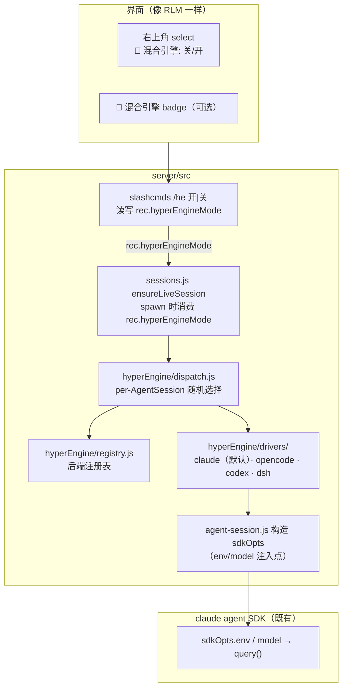

# myco hyperEngine —— 引擎后端注册 / 选择 / 调度（混合引擎模式）

> 状态：**设计方案（未实现）。** 在 **`server/src/hyperEngine/`** 下新增**混合引擎模式**模块，
> 由 `server/src/index.js` / `sessions.js` / `agent-session.js` 通过 `require` + **会话级
> 开关**接入；开关像 **RLM 一样**在**界面右上角**提供，用户点选即生效。
> （本设计原名 HyperSdk，按 2026-10 评审决议更名为 **hyperEngine**：它是一个「引擎后端」
> 注册/选择/调度层，不是一个新的 SDK。）
>
> 核心承诺：
> - **开关没开时，现有逻辑一点不能影响** —— 默认固定 `claude`（claude agent SDK，即
>   claude code SDK，两者为同一产品的新旧命名），行为与现状逐字节一致。
> - **开关开启后**：四个引擎后端（`claude` / `opencode` / `codex` / `dsh`）在**每个
>   AgentSession**（主会话 + 团队每个 worker）启动时**任意（随机）选一个**。四者分属
>   **三种传输形态**（进程内流式 / 子进程协议 / HTTP+SSE），见 §1.2。
> - 模型一律**经 env 注入 claude code**，不新增任何模型直连逻辑。
> - **不用 env 开关** —— 开关是界面上的会话级 flag（镜像 `rec.rlm` 的 `/rlm on|off` + 右上角 select）。

---

## 1. 背景与目标

### 1.1 现状

myco 所有模型调用最终收敛到 **claude agent SDK（`@anthropic-ai/claude-agent-sdk`，旧名
claude code SDK）**：
- `server/src/agent-session.js` 每次迭代构造 `sdkOpts`（含 `env`、`model`、`settings`、
  `abortController`…），其中 `activeGw` 是**会话级**的「选网关」叠加（`this.activeGw`，
  读取自 `rec.activeGw`，迭代构造时快照为 `this._activeGwAtIteration` 以检测 mid-flight
  切换）。注意：`/model` 的 `modelOverride` 已**退役**出模型解析路径（`sdkOpts.model` 现
  仅由 `gw.model` 或系统 `ANTHROPIC_MODEL` 决定，`agent-session.js:658-660`；字段仍随
  spawn 传递、`setModel` 持久化路径 `:1058-1066` 保留）。hyperEngine 镜像的是
  **「spawn 期注入的会话级叠加」这一模式**，而非 modelOverride 的具体语义。
- `server/src/local-claude.js` 的 `callLocalClaude()` 走同一个 SDK，`_resolveGateway()` 把
  网关解析成 `gwEnv` + `model` 灌进 `options.env`。
- `server/src/team-session.js` 的多 worker（run-n2 / 专家团）由 `AgentSession` 驱动，
  每个 worker 一个 AgentSession。

**关键既有机制（我们要镜像、不改）**：会话级 flag（如 `rec.rlm`）由界面 select +
`/rlm on|off` 切换，落库后**在 spawn 时被消费**——`sessions.js` 的 `ensureLiveSession`
根据 `isRlmEffective(rec)` 选不同的 spawn 分支，`TeamSession` 则把 `rlm` flag 透传给两个
worker。`activeGw` 同理是**每次 spawn 时注入到 sdkOpts** 的会话级叠加（`modelOverride`
字段的解析语义已退役，见上；但其「spawn 期注入」的模式仍是本设计的原型）。

### 1.2 四个候选引擎后端（参考仓库实测调研）

本设计的引擎后端来自四个真实存在的 SDK 仓库，各自 API 形态已逐一核对（下表为
2026-10 调研结论，作为 driver 契约设计依据）：

| 后端 | 仓库 | SDK 包 | 调用形态 | 会话/运行时模型 | 配置注入方式 | 一轮结束信号 | 取消 | 权限回调 | 可用性探测（`available()`） |
|---|---|---|---|---|---|---|---|---|---|
| `claude`（默认） | `anthropics/claude-agent-sdk-typescript` | `@anthropic-ai/claude-agent-sdk` | `query({ prompt, options })` async-iterable 流式消息 | 无显式 session 对象，靠 `resume`/`sessionStore` 串接 | `options.env` / `options.model` / `options.settings`（**myco 现状即此**） | `result` 消息（`subtype:'success'`，带 `usage` / `total_cost_usd`） | `options.abortController` | `canUseTool(name, input)` 回调 + hooks | 恒 true（进程内，无外部依赖） |
| `opencode` | `anomalyco/opencode-sdk-js`（即 sst/opencode-sdk-js） | `@opencode-ai/sdk` | REST client：`new Opencode()` → `client.session.create()/chat(id,{...})`；SSE 事件流 `client.event.list()` | 显式 `Session` 资源（create/list/abort/revert/share） | `baseURL`（默认 `process.env['OPENCODE_BASE_URL']` ?? `http://localhost:54321`），需本地 opencode server | SSE `session.idle` 事件 | `client.session.abort(id)` / SSE `controller.abort()` | 无进程内回调——server 侧决策（`SessionChatParams.tools` 门控 + SSE `permission.updated` 事件），myco 只读展示 | `OPENCODE_BASE_URL` 可达（HTTP probe） |
| `codex` | `kachurun/codex-js-sdk` | `codex-js-sdk` | 子进程驱动：`new CodexSDK({ cwd, config })` → `start()` → `sendUserMessage(items)`，`onResponse(cb)` 收 `CodexResponse` | 进程内 `emitter` 分发，`configureSession()` 改运行中会话 | spawn `codex` CLI，`config` 对象经 `configToArgs()` 平铺成 `-c key=value` 参数；`env` 默认继承 `process.env` | `task_complete` 消息（带 `last_agent_message`） | `abort(requestId)` 细粒度 / `stop()` 进程级 | 审批消息（`exec_approval_request` / `apply_patch_approval_request`）+ 按 callId 应答 `handleCommand` / `handlePatch` | `codex` CLI in PATH + `OPENAI_API_KEY`（或 provider `env_key` 指向的变量存在） |
| `dsh` | `salathleizhang/dsh-agent-sdk` | `dsh-agent-sdk` | 进程内 runtime：`createRuntime()` → `runtime.createAgent({ cwd })` → `agent.prompt(text)`；一次性 `query(options)` async-generator | `AgentRuntime`（可复用）+ `DshAgent`（单 prompt 串行，`close()` 释放） | `createRuntime({ codingTools: { workspaceRoot, onApproval } })`；`DEEPSEEK_API_KEY` env；`defineTool()` 注册自定义工具 | 终值 `result` 项（`QueryResult`，带 `reason` / `text`） | `QueryOptions.signal` AbortSignal / 提前 break 迭代器 | `onApproval(request) -> 'allowed-once' \| 'rejected' \| 'cancelled' \| 'unavailable'` 回调，**无 handler = fail-closed 拒绝** | `DEEPSEEK_API_KEY` 存在 + Node `^22.19 \|\| >=24` 版本探测 |

关键差异（决定 driver 契约为什么长成 §5 的样子）：

1. **claude agent SDK 是唯一「env 注入模型」形态**：`query()` 直接吃 `options.env` /
   `options.model`，模型与网关靠环境变量（`ANTHROPIC_BASE_URL` / `ANTHROPIC_AUTH_TOKEN` /
   `ANTHROPIC_MODEL` 等）注入。myco 的 `sdkOpts.env` 注入路径即为此设计。
2. **opencode-sdk-js 是 HTTP client**：它不管理模型进程，只连一个已运行的 opencode
   server（`OPENCODE_BASE_URL`）。driver 化它 = 配置一个 base URL + session 生命周期映射。
3. **codex-js-sdk 是 CLI 子进程**：模型选择走 `config.model` / `config.model_provider`
   （TOML 覆盖，`-c` 参数化），沙箱/审批是第一类配置（`sandbox_permissions` /
   `approval_policy`）。
4. **dsh-agent-sdk 是进程内 runtime**：模型路由（DeepSeek）、工具沙箱（`workspace-write`
   默认收敛到 `workspaceRoot`，越权默认 fail-closed）、审批回调
   （`onApproval(request) -> 'allowed-once' | 'rejected' | 'cancelled' | 'unavailable'`，request 含
   toolName/callId/reason）都在
   `createRuntime()` 选项里，事件流为 `AgentStreamEvent`（`session_event` / `result` 两类）；
   一个 agent 同时只允许一个活动 query。
5. **审批模型三档不一**：codex 有显式应答 API（`handleCommand` / `handlePatch`），dsh 有
   `onApproval` 回调，opencode 无显式审批 API（依赖其服务端配置 + `permission` 事件）。
   driver 需声明能力（`capabilities.permission`，见 §5.2），权限 UI 按能力降级（见 §6）。
6. **claude agent SDK 自带 SessionStore 契约**（`SessionKey` + `SessionStoreEntry[]` +
   `append()`），可作为跨引擎事件落盘（`events.jsonl`）格式的参考。

### 1.3 目标

新增 **hyperEngine**：一个「引擎后端」注册 / 选择 / 调度层，作为**又一个会话级叠加**，
沿 RLM / activeGw / modelOverride 的既成模式接入，**不动既有逻辑**。

1. **引擎后端注册**：`claude`（默认）+ `opencode` + `codex` + `dsh` 登记进注册表，各带
   可用性探测与「注入到 sdkOpts」的实现（driver 契约按 §1.2 四个真实 SDK 的形态定义）。
2. **引擎后端选择（界面开关）**：像 RLM 一样，用户在界面右上角开关选中「混合引擎」。
   - 关（默认）= 固定 `claude`，逻辑零影响。
   - 开 = 四个引擎任意选。
3. **调度（随机，per-AgentSession）**：开关开启时，**每个 AgentSession（含团队每个
   worker）在 spawn 时随机**选一个引擎后端，把该后端的环境/模型叠加注入其 `sdkOpts.env`。
4. **模型经 env 注入 claude code**：无论选哪个后端，都走既有 `sdkOpts.env` / `options.env`
   注入路径，不新增直连。
5. **不用 env 开关**：只有界面上的会话级 flag，无 `HYPER_*` 环境变量开关。

### 1.4 非目标

- 不做真实 opencode / codex / dsh 后端调用（本仓库无 opencode server / codex CLI /
  DeepSeek key 的部署假设）——它们作为**可注册的壳**存在，开关开启时也会被随机选中，
  但当前转发到 claude code，落地真实后端时只填壳的注入逻辑（driver 契约已按真实 SDK
  形态定型，见 §5）。
- 不做多 agent / 多专家 / 聚合判官等复杂运行形态编排。
- 不改 `agent-session.js` / `local-claude.js` / `team-session.js` / `sessions.js` 的**既有分支**。

---

## 2. 设计原则

1. **加法不做减法**：既有文件不删不改其**默认路径**；hyperEngine 通过「新增一个可选的
   spawn 分支 / sdkOpts 叠加」接入，默认分支逐字节保留。
2. **复制 RLM / activeGw 的既成模式**：会话 flag → 界面 select → 落库 → spawn 时消费 → 注入
   sdkOpts。这是项目里已被验证、且天然支持「开关没开零影响」的模式。
3. **复用，不重复**：引擎后端的「注入」复用 `sdkOpts.env` 构造逻辑，不重写 SDK 调用。
4. **开关默认关 = 原逻辑**：`rec.hyperEngineMode === 'on'` 才走随机；否则与不接 hyperEngine
   完全一致。
5. **per-AgentSession 任意选**：随机粒度是「每个 AgentSession（每个 worker）一个选择」，
   与 RLM 的会话级叠加同层，但这次选择是**逐个会话**的。

---

## 3. 总体架构



> 新增的只有：界面开关 + 一个倒计时式的注册/调度层 + 每个 AgentSession spawn 时的一次
> 随机选择。**SDK 调用链（`query()`）与默认 sdkOpts 不变。**

---

## 4. 会话级开关（镜像 RLM，不用 env）

### 4.1 数据

- 新会话字段：`rec.hyperEngineMode`，取值 `'off' | 'on'`，**缺省 `off`**，随会话存盘持久化
  （与 `rec.rlm` 一致，存在 `/data/sessions.json`）。
- 导出辅助函数（放在 `hyperEngine/` 或沿用 `sessions.js` 的小 helper，镜像
  `isRlmEffective(rec)` 的写法），供 UI 帧与 spawn 读取：
  ```js
  isHyperEngineOn(rec) -> rec.hyperEngineMode === 'on'
  ```

### 4.2 界面（像 RLM）

- 在 `#chatpane-topctl-row` 里，RLM 开关旁新增一个 `<select id="hyper-engine-select">`：
  `<option value="off">🔀 混合引擎: 关</option><option value="on">🔀 混合引擎: 开</option>`。
- 等价命令：`/he on` / `/he off`（owner+admin，镜像 `/rlm session on|off` 的
  `slashcmds.js` `/rlm` 处理器，:3360 附近）。
- 切换时经 WS 帧 `state-update`（新 `kind:'hyper-engine-mode-changed'`）广播，attach 时按
  `rec.hyperEngineMode` 回放，UI 选中态与服务器一致——**照搬 RLM 的 `rlm-mode-changed` +
  `_refreshRlmSwitch` 那套接线**（实测点位：广播 `attach.js:2110`；处理器
  `web/public/app.js:10421`；刷新函数 `_refreshRlmSwitch` `app.js:10519`）。
- 只读 viewer 隐藏该开关（镜像 RLM 的 read-only 处理）。

### 4.3 打开时的语义

开关 `on` 只意味着「允许随机选择引擎后端」，**不改变任何其它行为**（权限、tools、对话流都
照旧）。关闭时 `isHyperEngineOn(rec) === false`，spawn 走既有分支，零影响。

---

## 5. 引擎后端注册（Registry）

### 5.1 Driver 契约（按 §1.2 四个真实 SDK 形态定型）

```js
// hyperEngine/drivers/<name>.js —— 每个后端导出：
{
  name: 'claude' | 'opencode' | 'codex' | 'dsh',
  label: '…',
  available: () => bool,      // 该后端是否可被选中（默认全 true；真实后端可按其可用性门控）
  // 注入：把一个后端的选择翻译成对 sdkOpts 的 env/model 叠加
  // opts = { sdkOpts, modelOverride, activeGw, user, worker? }
  //   -> 返回新的 sdkOpts 或要并入 sdkOpts.env 的对象；缺省返回空（= 不动）
  overlay(opts) -> { env?: {...}, model?: string }
}
```

> **overlay env 语义约束（实测）**：claude agent SDK 的 `options.env` 是**整体替换**
> 子进程环境、不与 `process.env` 合并（0.3.x 破坏性变更，官方文档同口径；叠加个别变量
> 需 `env: { ...process.env, X }`）。myco 现状构造 `sdkOpts.env` 时本就先展开
> `process.env`，所以 `overlay()` 的 `env` 返回值**只作为增量并入已展开的
> `sdkOpts.env`**（§7.2 的 `Object.assign(sdkOpts.env, ov.env)`），**绝不允许**驱动返回
> 「只有几个新变量的裸 env」直接当 `sdkOpts.env` 用——那会让子进程丢掉
> `PATH`/`HOME`/鉴权变量。回归测试行见 §10 `overlay-env-merge`。

- **`claude`（默认）**：`overlay()` 返回空——即「什么都不改，走默认 claude agent SDK +
  现有 gateway/model 注入」。**开关关闭时恒选它 → 零影响**。对应 §1.2 的
  `query({ prompt, options })` 形态，myco 全部现状注入逻辑即它的实现。
- **`opencode`（壳）**：`overlay()` 当前也返回空（或预留一个命名空间 env 前缀），即当前仍
  走 claude code。落地真实后端时按 `@opencode-ai/sdk` 的形态注入：
  `env.OPENCODE_BASE_URL`（client 默认 `http://localhost:54321`）+ session 映射
  （myco AgentSession ↔ opencode `Session` 资源：`create/abort/chat`）。
- **`codex`（壳）**：同上。落地时按 `codex-js-sdk` 形态注入：spawn `codex` CLI 于 worker
  cwd，`config` 平铺为 `-c key=value`（如 `model` / `model_provider` /
  `approval_policy` / `sandbox_permissions`），`env` 继承现有 `sdkOpts.env`。
- **`dsh`（壳）**：同上。落地时按 `dsh-agent-sdk` 形态注入：`DEEPSEEK_API_KEY` env +
  `workspaceRoot`（取 AgentSession cwd）+ `onApproval` 桥接到 myco 权限流；事件流
  `AgentStreamEvent` 映射到 myco 的 message 消费循环。
- `available()` 默认 true，使开关开启时能真正「四个引擎任意选」演示完整链路；真实后端
  落地时改为按 §1.2 的部署前提门控（opencode server 可达 / codex CLI in PATH /
  `DEEPSEEK_API_KEY` 存在）。

### 5.2 两阶段 Driver 契约（env overlay → 运行时适配器）

四个 SDK 的差异维度（进程模型、事件流方向、权限回调）**无法只靠 env 表达**——
codex 的审批是「消息 + 按 callId 应答」，dsh 的审批是「回调 + fail-closed」，
opencode 根本没有进程内审批回调。因此 driver 契约分两阶段，**本设计只落地阶段一**：

```js
// 阶段一（本设计落地）：env overlay（现状不变）
overlay(opts) -> { env?, model? }

// 阶段二（真实后端落地，仅接口预留、不实现）：
{
  name, label,
  available(),
  overlay(opts),                       // 兼容旧路径
  // 运行时适配（把各 SDK 归一到 §6 的 EngineEvent）：
  capabilities: {
    streaming: 'iterator' | 'sse' | 'callback',
    cancel: 'abortController' | 'sessionAbort' | 'killProcess' | 'break',
    permission: 'canUseTool' | 'serverConfig' | 'approvalMessage' | 'onApproval',
    multiWorker: true | false,         // opencode server 可共享；codex/dsh 需 per-worker 实例
    resume: true | false,
  },
  // —— 统一 EngineDriver 接口（方法级，四个后端同一形状）——
  // 会话生命周期：open 一次 → 多轮 sendTurn → approve 响应审批 → abort/close 收尾
  openSession(cfg)  -> Promise<EngineSession>,
  //   cfg = { rec, worker?, cwd, env, model, systemPrompt? }（来自 spawn 上下文）
  //   claude:  query({ options:{ resume } })        —— 迭代器本身就是会话
  //   opencode: client.session.create() + init(id,{modelID,providerID})
  //   codex:    new CodexSDK({cwd,env,config}).start()
  //   dsh:      runtime.createAgent({ cwd, provider, model })
  sendTurn(text)    -> AsyncIterable<EngineEvent>,   // 一轮：发 prompt，产出归一事件直到 done/error
  approve(id, ok)   -> Promise<void>,   // 审批应答：codex handleCommand/handlePatch(id,ok)；
                                        //   dsh onApproval resolve；claude canUseTool resolve；
                                        //   opencode capabilities.permission==='server' → 仅转发 UI 状态
  abort()           -> Promise<void>,   // 本轮取消：claude abortController.abort()；opencode
                                        //   session.abort(id)；codex abort(requestId)；dsh signal.abort()
  close()           -> Promise<void>,   // 资源释放：codex stop()；dsh agent.close()+runtime.close()；
                                        //   opencode session.delete(id)（可选）；claude 迭代器 return()
}
```

各后端 `capabilities` 取值（按 §1.2 实测定型）：
`claude` = iterator / abortController / canUseTool / resume✓；
`opencode` = sse / sessionAbort（`client.session.abort(id)`）/ serverConfig / multiWorker✓；
`codex` = callback（`onResponse`）/ killProcess（细粒度 `abort(requestId)`）/ approvalMessage
（`handleCommand` / `handlePatch` 按 callId 应答）/ per-worker 实例；
`dsh` = iterator（仅 2 外层型）/ break（`QueryOptions.signal` AbortSignal）/ onApproval
（fail-closed）/ 单 agent 串行（团队两 worker 需两个 agent 实例）。

接口映射速查（EngineDriver 方法 → 各 SDK 原生 API，阶段二落地依据）：

| 方法 | claude | opencode | codex | dsh |
|---|---|---|---|---|
| `openSession` | `query({ options:{ resume } })` | `session.create()` + `session.init(id,{modelID,providerID})` | `new CodexSDK({cwd,env,config}).start()` | `createRuntime()` + `runtime.createAgent({cwd,provider,model})` |
| `sendTurn` | 流式输入 `q.streamInput()` 或新 `query({prompt})` | `session.chat(id,{modelID,providerID,parts})` | `sendUserMessage(items, runId)` | `agent.query(input,{signal})` |
| `approve` | `canUseTool` resolve | `permission.updated` 状态转发（server 端决策） | `handleCommand(callId, ok)` / `handlePatch(callId, ok)` | `onApproval` 返回值 resolve（fail-closed） |
| `abort` | `abortController.abort()` | `session.abort(id)` / SSE `controller.abort()` | `abort(requestId)` / `stop()` | `QueryOptions.signal.abort()` / break |
| `close` | 迭代器 `return()` | `session.delete(id)`（可选） | `stop()`（进程级） | `agent.close()` + `runtime.close()` |
| 事件流 | `SDKMessage` 迭代器 | `event.list()` SSE 直到 `session.idle` | `onResponse(cb)`（需桥接 EventEmitter → 迭代器） | `AgentStreamEvent` 迭代器（`session_event` + `result`） |

> **命名对齐说明（已收口）**：本表（§5.2）是统一 `EngineDriver` 接口的**唯一命名基准**。
> 各驱动子文档（claude/opencode/codex/dsh-driver.md）与 `dispatch-and-team.md` 已按
> 本表收口到 `openSession` / `sendTurn` / `approve` / `abort` / `close`（与 claude-driver
> 的收口 commit f5b641d 同口径）；驱动子文档中的方法挂载面（注册条目 §3.1、§4 会话装配、
> §4.3 每轮对话）使用同一套方法名。接口语义：open 一次 → 多轮 turn → approve/abort/close。

### 5.3 注册

```js
// hyperEngine/index.js 顶层注册四个后端到 registry。
// 开关关闭时 dispatch 恒返回 'claude'，后端候选集不影响任何行为。
```

---

## 6. 事件归一化（EngineEvent）——四后端事件模型的统一出口

开关开启后，四后端的事件流形态完全不同（见 §1.2）。为避免 myco 消费循环（chat 卡片、
tool-call 卡片、权限弹层、`events.jsonl` 持久化）出现四套分支，hyperEngine 在 driver 之上
定义**统一事件**，driver 负责把各自 SDK 的原生事件翻译过来：

```js
// hyperEngine/events.js —— 归一化事件（所有 driver 的唯一出口形态）：
// EngineEvent =
//   | { kind:'text_delta',       text }                    助手增量文本
//   | { kind:'tool_call',        id, name, args }          工具调用开始
//   | { kind:'tool_result',      id, ok, summary }         工具调用结束
//   | { kind:'approval_request', id, name, reason }        需要人工审批
//   | { kind:'done',             finalText }               本轮完成
//   | { kind:'error',            message }                 本轮失败
```

各后端的翻译映射（按 §1.2 实测 API）：

| 后端 | 原生事件 | → EngineEvent |
|---|---|---|
| `claude` | `SDKMessage` 流（`assistant` 块、`tool_use`/`tool_result`、`result`）| 直接透传 myco 现有消费循环，**无需翻译**（现状即归一形态的源头）|
| `codex` | `CodexResponse.msg.type`：`EXEC_APPROVAL_REQUEST` / `APPLY_PATCH_APPROVAL_REQUEST` / `TASK_COMPLETE` / `ERROR` | `approval_request` / `done` / `error`；应答回路 `handleCommand(id, ok)` / `handlePatch(id, ok)` |
| `dsh` | `AgentStreamEvent`：`session_event`（工具/沙箱动作）+ 终值 `result` | `session_event` → `tool_call`/`tool_result`/`approval_request`；`result` → `done`；应答回路 `onApproval(request)` |
| `opencode` | SSE `client.event.list()` 增量（message/tool/permission 事件）| 文本增量 → `text_delta`；工具事件 → `tool_call`/`tool_result`；`session.idle` → `done` |

- **审批能力探测**：driver 声明 `capabilities.permission`（§5.2 四档）——codex
  （`approvalMessage`）与 dsh（`onApproval`）可桥接 myco 权限 UI；opencode（`serverConfig`）
  审批在其服务端，myco 只展示不代答。
- **claude 恒等路径不受影响**：`claude` driver 不经翻译层（现状消费循环原样保留），
  事件归一化只在壳后端真实落地时启用——零影响承诺（§8）仍然成立。

---

## 7. 调度（Dispatch，随机，per-AgentSession）

### 7.1 `hyperEngine/dispatch.js`

spawn 时调用一次；完整决策序（开关 → 粘性印记 → 可用性门控 → 随机 → 兜底）：

```js
// 在 spawn 一个 AgentSession（或团队的一个 worker）时调用一次：
function pickEngine({ rec, worker }) {
  // 1) 开关没开 -> 'claude'（固定默认，原逻辑；零影响的第一道门）
  if (!isHyperEngineOn(rec)) return registry.get('claude');
  // 2) 已有粘性印记（rec.hyperEngine / rec.hyperEngineWorkers，respawn 复用不重摇；
  //    codex 无 resume，重摇 = 上下文丢失）且印记引擎仍 available -> 复用
  //    （印记不可用时回退 claude 并重印记——宁降级不启动必然失败的进程。
  //     印记结构与写入时机见 dispatch-and-team.md §3）
  // 3) 无印记 -> 先按 available() 过滤（§1.2 部署前提门控），再随机选一个
  const cands = registry.candidates().filter(d => d.available());
  if (!cands.length) return registry.get('claude');  // 兜底：永不落空（不变式 5）
  return cands[Math.floor(rng() * cands.length)];
}
```

- **随机粒度 = 一个 AgentSession 一次**（spawn-once-sticky）：主会话 spawn 时选一次；
  `TeamSession` 的 `worker-A`/`worker-B` 各自 spawn 时各选一次——即 **每个
  AgentSession 任意选**，团队内两个 worker 可以不同引擎（`claude + opencode` 组合等）。
  同一 AgentSession 的后续迭代不重摇（claude `resume` 要求引擎稳定，codex/dsh 无跨进程
  resume）——「随机 per-AgentSession」指 spawn 定一次、终身粘。
- `rng` 可注入（`Math.random` 默认；测试用固定种子）。
- 缺省 `Math.random` 均匀随机；`registry.candidates()` 顺序稳定，随机是纯函数可测。
- **选择结果记入事件流（审计）**：每次 pick 后向该 AgentSession 的 `eventsFile` 写一帧
  `{ type:'engine-selected', engine: drv.name, worker, mode: rec.hyperEngineMode, ts }`
  ——复现/审计「这轮对话用了哪个后端」有据可查，UI 可据此显示当前引擎 badge。印记
  （`rec`）管 **respawn 粘性**，事件帧管 **轮次审计**，两者互补。

### 7.2 注入点（不改既有默认分支）

镜像 `activeGw`/`modelOverride` 的注入方式——**新增一个可选的叠加步骤**，关闭时该步骤为
恒等：

```js
// agent-session.js 构造 sdkOpts 处（现有代码）：
const sdkOpts = { /* ...既有的 env/model/settings... */ };

// hyperEngine 叠加（可选，默认恒等）：
if (hyper.isHyperEngineOn(rec)) {
  const drv = hyper.pickEngine({ rec, worker });
  const ov = drv.overlay({ sdkOpts, modelOverride, activeGw, user, worker });
  if (ov.env)      Object.assign(sdkOpts.env, ov.env);
  if (ov.model)    sdkOpts.model = ov.model;
}
```

- `hyper.isHyperEngineOn(rec)`（读取 `rec.hyperEngineMode === 'on'`）为 false 时，整个叠加
  块不执行 → **sdkOpts 与现状逐字节一致，零影响**。
- 该叠加放在 `agent-session.js` 的既有 `sdkOpts` 构造**之后**（或由 `sessions.js` spawn 时传入
  一个 `hyperEngine` 字段给 AgentSession，`agent-session.js` 只在 `options.hyperEngine` 存在时
  叠加）。两种都是「新增字段 + 可选分支」，不动既有默认值。
- `local-claude.js` 的一次性调用同理：若所在会话开启，`_resolveGateway` 之后叠加一次
  `overlay()` 到 `options.env`。

### 7.3 接线点位（主文档摘要；逐 spawn 路径的完整时序契约见 `dispatch-and-team.md`）

spawn 选择发生在**调用方**（一次性定值 + 粘性印记落库），注入发生在 **AgentSession**
（消费方）——两个角色分开，才能做到「每个 AgentSession 一次」而不是每轮迭代重选：

- `sessions.js#ensureLiveSession`（:1267 入口）——RLM 分支（:1329 `isRlmEffective(rec)`）
  与默认 `spawnAgent` 分支（:1356）的 opts 各新增可选字段：
  `hyperEngine: isHyperEngineOn(rec) ? hyper.pickEngine({ rec, worker: null }) : null`。
  `null` 时下游叠加块整体短路。**不新增 spawn 分支**——engine 选择是「每 AgentSession
  一次的值」，不是「另一条 spawn 链」。
- `agent-session.js`——构造函数读 `opts.hyperEngine` 存 `this.hyperEngine`；在既有
  `sdkOpts` 构造（:480 `const sdkOpts = {`）与 `_validateSdkOpts`（:681）之间叠加
  `this.hyperEngine.overlay(...)`（仅 `this.hyperEngine` 非空时；claude 驱动恒等，
  壳驱动只注入观测命名空间 env 如 `MYCO_ENGINE=<name>`，**不触碰 `ANTHROPIC_*`**）。
  `query()` 调用点 :685。
- `team-session.js#_spawnWorker`（`common` 选项 :202，worker spawn :242）——按 `actor`
  **逐 worker 独立 pick**：
  `hyperEngine: isHyperEngineOn(rec) ? hyper.pickEngine({ rec, worker: actor }) : null`，
  普通 worker（`new AgentSession`）与 RLM worker（`spawnRlmAgent`）都透传——engine 选择
  与编排模式（RLM / 普通团队）正交。
- 壳驱动的观测 env 原则：阶段一随机选中 opencode/codex/dsh 时，请求仍走 claude code +
  现有网关（v1「壳转发 claude」承诺），但 `MYCO_ENGINE` 让链路可观测、可被
  `engine-selected` 事件交叉验证。

### 7.4 阶段二语义补充（落地前置，仅设计）

- **取消/中断降级**：claude `abortController`（现状）→ codex `abort(requestId)`（细粒度）
  或 `stop()`（进程级，实例需重建）→ dsh 提前 break 迭代器 / `QueryOptions.signal` →
  opencode `session.abort(id)`。`AgentSession.interrupt()` 只调 `runtime.cancel()`，
  语义差异由驱动吸收并在 capabilities 声明。
- **resume 语义**：`rec.sdkSessionId` 只对 claude 后端有效；选中异构后端的新 spawn 不带
  claude resume id（各驱动用自家 resume：codex `session_configured` 会话 id、dsh
  `createAgent({sessionId})`、opencode session id）。跨引擎迁移不做——一个
  AgentSession 生命周期内引擎不变（spawn 即定），换引擎 = 新 AgentSession。
- **阶段二不改造 `local-claude.js`**：一次性调用保持 claude，避免为低频路径引入第二
  后端复杂度（写进非目标）。

---

## 8. 关键不变式（Non-Regression Contract）

1. **开关没开 = 逻辑一点不能影响**：`rec.hyperEngineMode` 缺省 `off`，`isHyperEngineOn()` 恒
   false → `pickEngine()` 恒 `claude`，`overlay()` 恒等，`sdkOpts`/`options` 与现状逐字节
   一致。既有分支、默认 spawn、权限/tools/对话流全部不动。
2. **`server/src/` 既有默认路径零改动**：新增叠加块只在 `isHyperEngineOn()` 为真时触发；
   除该可选块外，`agent-session.js` / `local-claude.js` / `sessions.js` 不新增其它逻辑。
3. **模型经 env 注入 claude code**：`overlay()` 只改 `sdkOpts.env` / `options.env` / `model`，
   一次性调用仍是 claude agent SDK `query()`，无第二套模型直连。
4. **不用 env 开关**：唯一开关是界面 select / `/he` 写入的 `rec.hyperEngineMode`；无
   `HYPER_*` 环境变量。
5. **随机永不落空**：`claude` 恒在候选集，开关开时也在（`claude` 恒 `available()`），
   所以随机结果总有有效后端。

---

## 9. 目录落地（全部新增）

```
server/src/hyperEngine/
  index.js        # require 入口：init(registry) / isHyperEngineOn(rec) / pickEngine({rec,worker})
  registry.js     # register / get / list / candidates（种子注册 claude/opencode/codex/dsh）
  dispatch.js     # pickEngine：开关关 -> claude；开 -> 随机（rng 可注入）
  events.js       # EngineEvent 归一化契约（§6）：kind 枚举 + 各后端翻译映射的落点
                  # + engine-selected 审计帧构造（§7.1：engine/worker/mode/ts → eventsFile）
  drivers/
    claude.js     # 默认：overlay 恒等（= 现状）
    opencode.js   # 壳：overlay 目前空，预留真实后端（§1.2 OPENCODE_BASE_URL 形态）
    codex.js      # 壳：overlay 目前空，预留真实后端（§1.2 codex CLI -c 配置形态）
    dsh.js        # 壳：overlay 目前空，预留真实后端（§1.2 createRuntime/DEEPSEEK_API_KEY 形态）
  README.md
```

### 9.1 驱动子文档（本目录内）

四个后端的驱动设计均以「事实清单（SDK 源码实测）→ 契约形态 → 落地阶段设计」的结构
细化为本文档的子文档：

- **`claude-driver.md`** —— claude 驱动（默认 / 恒等）：锚定 claude agent SDK 的真实
  能力面（`query()` 流式消息、`Options` 全字段、`canUseTool` 权限回调、hooks、MCP、
  sessionStore/resume）与 myco 现有消费点逐一对位——它就是「现状即驱动」的参照基准。
- **`opencode-driver.md`** —— opencode 驱动：**远程 server 适配器**形态（非进程内 SDK）。
  含 opencode-sdk-js 全量事实清单（client/session/chat/SSE 事件联合，含
  `permission.updated`、`session.idle`）、myco AgentSession 事件词汇表到 SSE 的归一化
  映射、网关 env 的消费端转移（子进程 → server 进程）、`available()` 可达性探测、
  `openSession`/`sendTurn` 生命周期与开放缺口（服务端审批 API、MCP server 声明）。
- **`codex-driver.md`** —— codex 驱动：**CLI 子进程 IPC** 形态（spawn 原生 Rust `codex`
  二进制，`codex proto` JSON-line 协议）。含 codex-js-sdk 全量事实清单
  （`CodexSDK` 生命周期、`configureSession`、`sendUserMessage`、`onResponse` 消息枚举、
  `handleCommand`/`handlePatch` 审批回执、`-c key=value` config 摊平）、myco 网关到
  `model_provider` 的映射、审批桥接到 myco 权限卡片的前置条件。
- **`dsh-driver.md`** —— dsh 驱动：**进程内可复用 runtime** 形态
  （`createRuntime()` + `createAgent()`，非一次性 `query()`）。含 dsh-agent-sdk 全量事实
  清单（RuntimeOptions/CreateAgentOptions/CodingToolsOptions、权威 session-log 事件流
  `turn/start`…`turn/end`、fail-closed 审批、`DEEPSEEK_API_KEY`）、workspace 沙箱与
  myco cwd 的对齐、未知 SessionEvent 变体的透传兼容策略。

界面开关（§4）的接线细节同样拆为子文档 **`ui-switch.md`**（select / `/he` 命令 /
`hyper-engine-mode-changed` 帧与 attach 回放，逐条镜像 RLM 的实现位点）。

调度与团队映射（§7）的落地细节拆为子文档 **`dispatch-and-team.md`**（spawn 一次性
pick 的时机/粒度/粘性与印记落库 `rec.hyperEngine`/`rec.hyperEngineWorkers`、四条
spawn 路径的统一注入、respawn/resume/中途切换的时序契约、注入点行号锚点）。

接线（均为新增引入，不改既有默认分支；主文档内点位摘要见 §7.3，逐 spawn 路径的
完整时序契约见 `dispatch-and-team.md`）：
- `server/src/index.js`：`require('./hyperEngine')`；加 `/he` 路由或复用 slashcmds；把
  `rec.hyperEngineMode` 编进 `state-update` 帧（镜像 rlm 帧）。
- `web/public/index.html` + `app.js`：右上角 select + 切换处理（照搬 RLM 开关的接线，
  :10421 / :10519）。
- `server/src/sessions.js` / `agent-session.js`：spawn 时新增可选 hyper 叠加块（见 §7.2）。
- `server/src/team-session.js#_spawnWorker`：`common` 逐 worker 独立 pick（见 §7.3）。
- `events.js`：`EngineEvent` 归一化契约 + `engine-selected` 审计帧构造（§7.1）。

---

## 10. 测试与验证

| 测试（新增） | 断言 |
|---|---|
| `hyper-registry` | 四后端注册/取/列；`claude` 恒在场 |
| `hyper-dispatch-off` | `isHyperEngineOn=false` → `pickEngine` 恒 `claude`；`overlay` 恒等（sdkOpts 不变） |
| `hyper-dispatch-on` | `isHyperEngineOn=true` → 固定 `HYPER_SEED` 可重入、结果落在 `[claude,opencode,codex,dsh]`；多次调用覆盖四后端 |
| `hyper-per-worker` | 团队两 worker 各自随机，可得到不同后端（worker 粒度） |
| `hyper-available-gate` | 某驱动 `available()=false` 时被过滤出候选集；全部 false → 兜底返回 `claude`（不变式 5） |
| `hyper-overlay-namespace` | 壳驱动 overlay 只产观测 env（`MYCO_ENGINE`），`ANTHROPIC_*` 不被触碰（阶段一仍走 claude 网关） |
| `hyper-engine-selected` | 每次 pick 后 `engine-selected` 帧落入该 AgentSession 的 `eventsFile`，字段 `engine/worker/mode/ts` 齐全 |
| `hyper-events-normalize` | 各后端原生事件样本（codex `CodexResponse` / dsh `AgentStreamEvent` / opencode SSE 帧）翻译后落在 §6 的 `EngineEvent` kind 枚举内；未知 kind 走兼容降级（记日志、不崩消费循环）|
| **零影响回归** | `rec.hyperEngineMode` 缺省/off 时，`sdkOpts` 与未接 hyperEngine 完全相等（断言 `overlay` 不产生任何 env/model 变化） |
| `overlay-env-merge` | 任意 driver 的 `overlay().env` 并入后，`sdkOpts.env` 仍含 `PATH`/`HOME` 等继承变量（防「裸 env 整体替换」回归，见 §5.1 实测约束） |
| `dispatch-sticky` | 同一 AgentSession 第二次迭代不重摇：`pickEngine` 结果与 spawn 时一致（引擎字段终身有效，见 §7.1 实测约束） |
| UI 冒烟 | 开关 on/off 后 `state-update` 帧广播、attach 回放选中态（镜像 rlm 帧测试） |

> 用 `BENCH_MOCK=1` 离线跑，不依赖真实模型网关；`zero-impact` 回归测试是关键——它锁定
> 「开关没开逻辑一点不能影响」这一承诺。

---

## 11. 开放问题

1. **opencode / codex / dsh 真实后端**：本仓库无其部署前提（opencode server / codex
   CLI / DeepSeek key）。`drivers/*.js` 的 `overlay()` 先留空（当前仍走 claude code），
   落地时按 §1.2 实测的各 SDK 真实形态填 env 注入；调度/开关/注册机制已被本设计完整
   覆盖，无需再动。
2. **per-session 选择持久化（已设计，见 `dispatch-and-team.md` §3）**：`rec.hyperEngineMode`
   是会话级开关；pick 结果以**粘性印记**落库（`rec.hyperEngine` / `rec.hyperEngineWorkers`），
   respawn 复用印记不重摇（codex 无 resume，重摇=上下文丢失）。此外每次 pick 向该
   AgentSession 的 `eventsFile` 写一帧 `engine-selected`（engine/worker/mode/ts，§7.1），
   供引擎 badge 与对话级审计复现——印记管 respawn 粘性，事件帧管轮次审计，两者互补。
3. **rng 来源**：默认 `Math.random`；如需跨重启确定性可在 `rec` 上留一个 per-worker 随机
   seed（本次不做，测试用注入 rng 即可）。
4. **壳后端的 `available()` 门控**：真实后端落地时，`available()` 需按 §1.2 的部署前提
   探测（opencode server 可达 / codex CLI in PATH / `DEEPSEEK_API_KEY` 存在）；探测失败
   的后端自动退出候选集，`claude` 兜底，随机永不落空（不变式 5）。
5. **opencode server 生命周期**：opencode 是客户端/服务器形态，真实落地时需决定 myco
   是否托管 server 进程（设计倾向见 `opencode-driver.md` §4：不托管，部署侧自备并配
   `OPENCODE_BASE_URL`，探测失败即排除出候选，避免 myco 引入进程管理职责）。
6. **codex 审批流**：codex 的 `exec_approval_request` / `apply_patch_approval_request`
   需要宿主应答（`handleCommand`/`handlePatch`）。真实落地时该审批必须映射进 myco
   既有权限卡片流，不能静默放行——壳阶段不涉及（转发 claude code），仅登记为落地前置
   条件（dsh 的 `onApproval` fail-closed 语义同理，见 `dsh-driver.md` §1.4）。

---

## 12. 附录：四 SDK → myco 概念映射表

（阶段二运行时适配的落地依据，以 `claude` 为基准列。来源：四仓库源码实测，2026-10。）

| 概念 | claude | opencode | codex | dsh |
|---|---|---|---|---|
| 一次对话 | `query({prompt,options})` | `session.chat(id,parts)` | `sendUserMessage` + `onResponse` 回调 | `agent.prompt(input)` / 一次性 `query()` |
| 流事件 | `SDKMessage` 迭代器（30+ 型，联合 37） | SSE `event.list()`（15 型） | `onResponse` 回调（16 型） | 2 外层型迭代器（内部 `SessionEvent`） |
| 取消 | `abortController` | `session.abort(id)` / SSE abort | `abort(requestId)` / `stop()`（进程级） | `QueryOptions.signal` / 提前 break |
| 工具许可 | `canUseTool` 回调 + hooks | server 侧决策（`SessionChatParams.tools` 门控，无进程内回调） | 审批消息 + `handleCommand`/`handlePatch` | `onApproval` 回调（fail-closed） |
| 模型选择 | `Options.model` | `SessionChatParams.modelID`+`providerID` | `configureSession({model, provider})` | `createAgent({provider, model})` |
| 网关/密钥 | `Options.env`（ANTHROPIC_*） | server 侧 provider 配置 | `env` + provider `{base_url, env_key, wire_api}` | `DEEPSEEK_API_KEY` / 自定义 Cordis 适配器 |
| cwd | `Options.cwd` | server 启动目录 | `new CodexSDK({cwd})` | `createAgent({cwd})` / `workspaceRoot` |
| 系统提示 | `systemPrompt`/`appendSystemPrompt` | `SessionChatParams.system` | `configureSession.instructions` | `spine.persona` 等组合 |
| 会话恢复 | `resume`/`forkSession` | `session.messages`/`revert` | `session_configured` 会话 id | `createAgent({sessionId})` |
| 自定义工具 | `tools`/`mcpServers` | server 配置 | MCP 消息（`mcp_tool_call_*`） | `defineTool()` + `createAgent({tools})` |
| 多 worker 共享 | 子进程 per-query，天然 per-worker | server 共享（multiWorker✓） | 需 per-worker 实例（单实例单会话） | 需 per-worker agent（单 agent 串行） |

**每后端接入前提**（`available()` 门控的探测清单）：
- `opencode`：`OPENCODE_BASE_URL` 可达的 opencode server；provider 在其 server config 配好。
- `codex`：`codex` CLI（`@openai/codex@native`）in PATH + `OPENAI_API_KEY`（或 provider
  `env_key` 指向的网关密钥变量）；每 AgentSession 一个 CodexSDK 实例（多 worker 成本注意）。
- `dsh`：Node `^22.19 || >=24`（版本探测）+ `DEEPSEEK_API_KEY`；单 agent 串行——团队两个
  worker 需两个 agent 实例。
