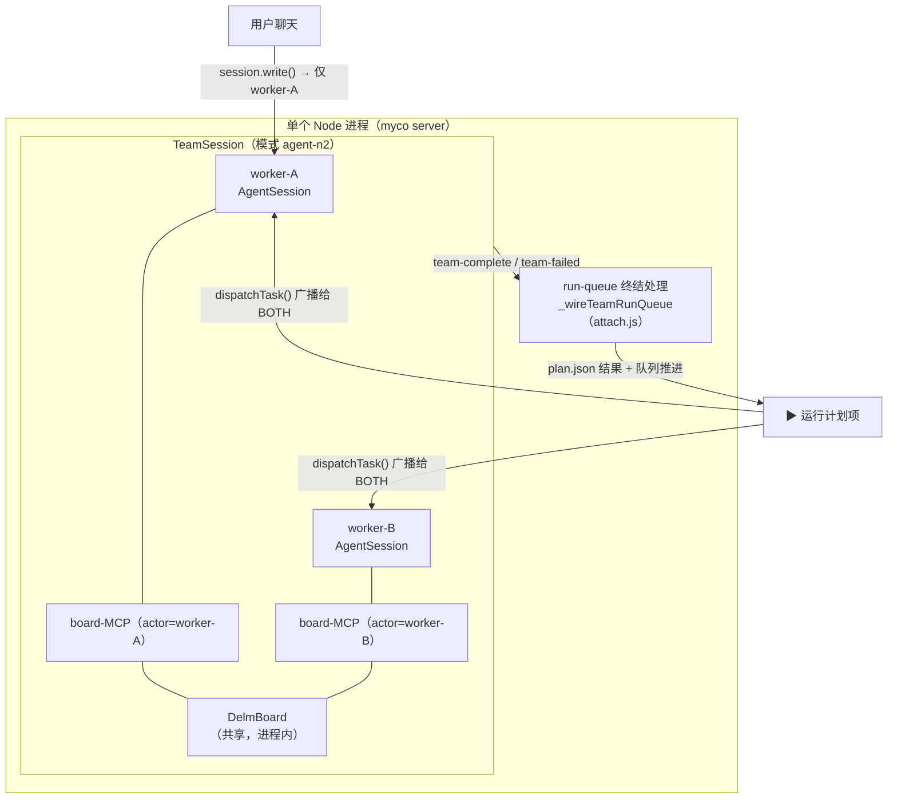
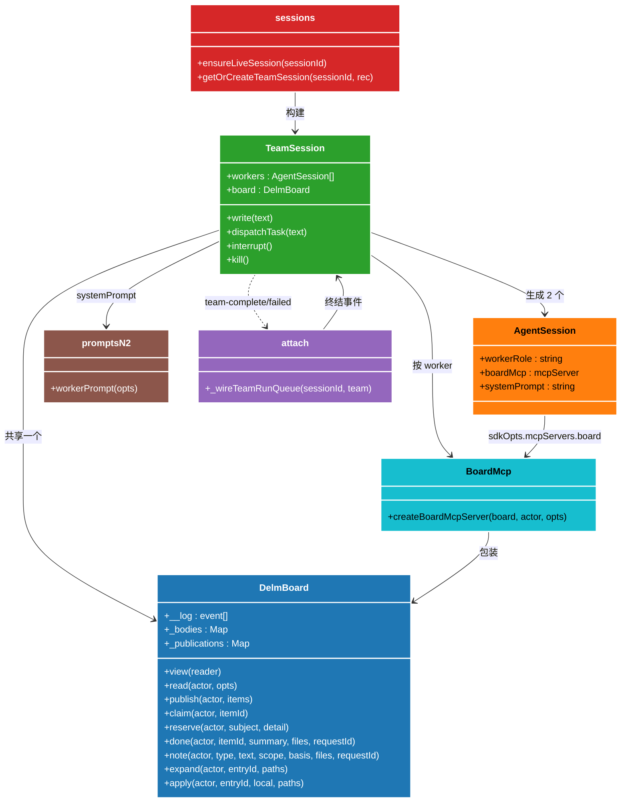
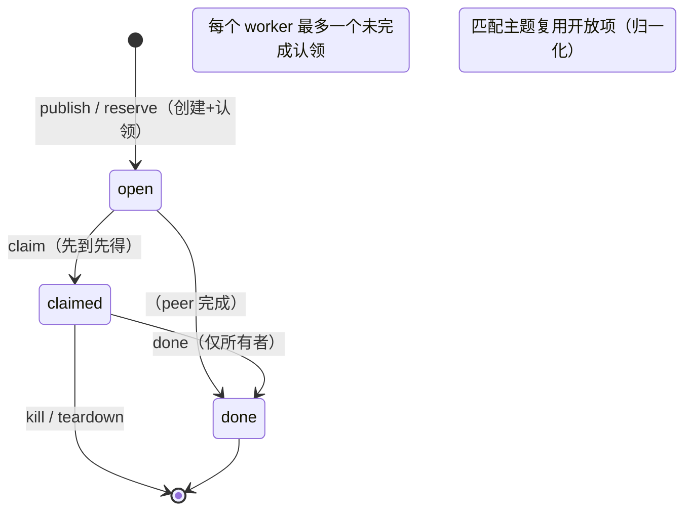
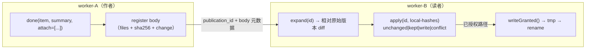
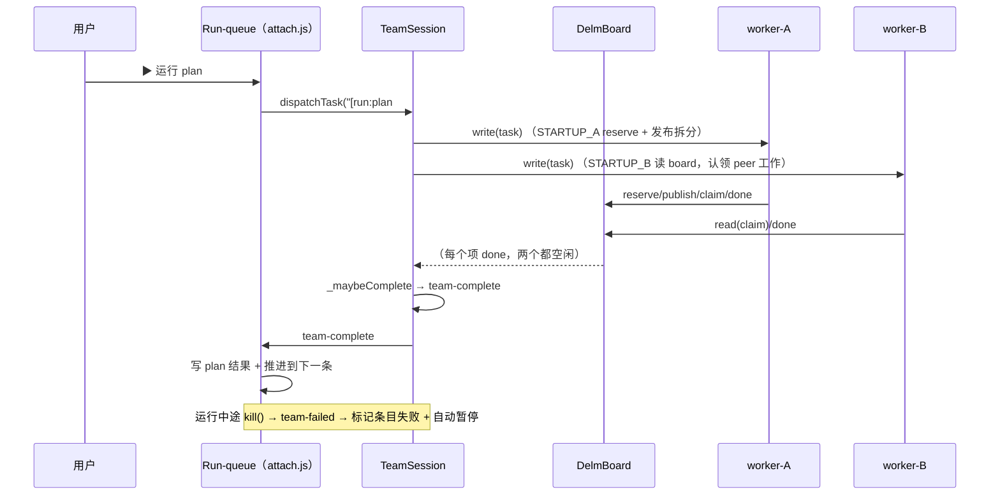

# myco — Delm n=2 双 worker 团队（agent-n2）

> 状态：**已在工作区，尚未提交。** 整个特性都位于 `server/src/board.js`、
> `board-mcp.js`、`team-session.js`、`prompts-n2.js`，以及对
> `agent-session.js` / `attach.js` / `sessions.js` 的注入式改动，外加三个测试
> （`board`、`team-session`、`team-runqueue`）。三个测试均单独通过；提交前仍需
> 通过完整的 `./test/test.sh` 门槛检查。

## 核心思想（Thesis）

一个 **myco 会话** 正常情况下只运行一个 agent（`AgentSession`，模式 `agent`）。
Delm n=2 升级让一个会话能够在**单个 Node 进程内运行两个 agent**（模式
`agent-n2`），它们分工处理同一任务，并通过一个共享、结构化的介质——**board
（看板）**——交换发现与进度，而不是通过聊天对话。

这是对 **Delm** 双 worker PyPI 基准测试框架
（`Delm/board/shared_context.py` + `protected_board.py` + `prompts/prompts_n2.py`）
的移植/适配。关键变化是 myco **全部在进程内运行**：没有 HTTP 看板、没有 shell
包装、也没有子进程——两个 `AgentSession` 通过一个共享的内存 `DelmBoard` 对象
协同，每个 worker 通过自己的**按 worker 划分的 board MCP server**（暴露
`mcp__board__*` 工具）访问该对象。

为什么要两个 worker 加一个 board，而不是一个 agent？两个互补的 scope
（`STARTUP_A` 负责 reserve + 发布拆分出来的工作；`STARTUP_B` 认领 peer 的工作）
能缩短到完整交付的墙钟时间，并沉淀出经过交叉校验的发现（`FACT`/`FAIL` 笔记）。
board 让这种协作**结构化且可审计**——每一步都是一条 append-only 事件——因此
崩溃或重新 attach 时都能回放发生了什么。

## 设计公理（Design axioms）

1. **board 是两个 worker 之间唯一的连接。** worker-A 与 worker-B 共享文件系统
   （`cwd`），但绝不互相聊天；所有协调——谁做什么、发现了什么、什么已完成——
   都存在于 board 的事件日志里。
2. **append-only 事件日志 + 派生视图。** board 从不改写历史。队列
   （`item → claim → done`）、笔记（`FACT`/`FAIL`）、状态、会话状态全部通过回放
   日志**派生**得到。读者视图是增量的：首次读取为全量，之后只显示自该读者上次
   被服务的读取以来发生变化的内容。
3. **跨作者文件保护是强制性的。** 因为两个 worker 编辑同一工作区，`apply` 会
   拒绝覆盖有分歧的本地编辑或更新的 peer 版本。每个路径的判定：
   `unchanged` / `kept` / `write` / `conflict`。
4. **与单 agent 相同的事件面。** `TeamSession` 发出相同的
   `agent-event` / `chat` / `state-update` / `exit` / `idle` 事件（每个都带
   `worker` 标记），因此 WS/聊天管道把团队当成一个会话对待。
5. **进程内 = 无轮询循环。** 等待读取使用 `EventEmitter` 唤醒，而不是 Delm 的
   0.25 秒轮询，仍受 `WAIT_CAP_SECONDS`（25 秒）约束。

---

## 组件地图

| 文件 | 职责 |
|---|---|
| `server/src/board.js` | `DelmBoard` —— 进程内共享上下文 + 受保护看板。append-only 日志、派生的队列/笔记/状态、文件冲突保护、JSONL 持久化 |
| `server/src/board-mcp.js` | `createBoardMcpServer(board, actor)` —— 按 worker 的 SDK MCP server，暴露 `mcp__board__*` 工具；在闭包中绑定该 worker 的 `actor`；直接读写共享工作区以支持 attach/apply |
| `server/src/team-session.js` | `TeamSession` —— 拥有两个 `AgentSession` + 一个 `DelmBoard`；聊天→worker-A，运行→两者；按 `worker` 标记 + 团队级序号来转发事件；触发 team-complete/team-failed |
| `server/src/prompts-n2.js` | `workerPrompt({task, actor, roster, workspace})` —— `STARTUP_A`/`STARTUP_B` 编排 + `QUEUE_POLICY` + `BOARD_COMMANDS` + `WAITING`，忠实于 Delm `prompts_n2.py` |
| `server/src/agent-session.js` | **注入**：`workerRole`/`boardMcp`/`systemPrompt` opts；`sdkOpts.mcpServers.board` + `systemPrompt`；按 worker 的 `eventsFile`；`sdkSessions` 恢复；自动放行 `mcp__board__*` 工具。对 n=1 为 null → 行为逐字节一致 |
| `server/src/attach.js` | **注入**：`_wireTeamRunQueue`（team-complete→写结果+推进，team-failed→失败+暂停）；run 分发路由到 `dispatchTask` |
| `server/src/sessions.js` | **注入**：`ensureLiveSession` 处理 `agent-n2`；在 `rec.n2` 或 `MYCO_N2` 时自动升级 `agent`→`agent-n2`；`getOrCreateTeamSession` 构建/复用团队 |

## 模块关系

## board 契约（`board.js`）

### append-only 事件日志

每次交互都会向 `_log` 追加一行 `{sequence, timeNs, actor, kind, payload}`（当
设置了 `persistPath` 时，还会写入一个 JSONL 日志，构造时回放，使 `TeamSession`
能扛过 server 重启）。类型：

| kind | 含义 | 是否唤醒等待者 |
|---|---|---|
| `item` | 发布了一个开放队列项 | ✓ |
| `claim` | 某个 worker 认领了一个项 | ✓ |
| `done` | 一个已认领项完成（可附带 body） | ✓ |
| `note` | 一条 `FACT`/`FAIL` 发现 | ✓ |
| `body` | 在 done/note 出版物后面注册的文件 | ✓ |
| `status` | 一行简短的变化问题/范围说明 | — |
| `session` | worker `running` / `ended` 迁移 | ✓（peer `ended` 结束等待） |
| `read` / `wait` / `expand` / `apply*` | 读者侧簿记 | — |

### 派生状态、增量视图

`queueState()` 把 `item`/`claim`/`done` 回放成
`{id, subject, detail, state, owner, summary, publication_id}`。`view()` 汇入
当前状态、会话状态，以及队列项和笔记附带的文件元数据。

`served(actor, via, full)`：
- 首次视图（或 `full`）为全量；
- 后续视图丢弃自该 actor 上次被服务读取以来未变化的内容，并将**活跃且未变化**
  的项**压缩**成"身份 + 状态 + 所有者"；
- 在 `read`/`wait` 时还会列出每个未 done 的项（未变化的被压缩），这样 worker
  永远不会漏掉进行中的工作。

`read(actor, {waitSeconds, target})` 阻塞（异步），直到 peer 发布一个
`WAKE_KINDS` 事件、某个 peer 的会话结束、`target` 项出现，或超过
`WAIT_CAP_SECONDS`（25 秒）。超时返回一个**不推进读者游标的空壳**（与 Delm
一致），因此下一次读取会重新观察到一切。

### 队列生命周期

- `publish(actor, items)` —— 添加开放项（不认领）；匹配主题复用已有开放项。
- `reserve(actor, subject, detail)` —— 如果 worker 的认领槽空闲，则原子地
  创建+认领一个 scope；返回 `won`/`created`/`owner`。
- `claim(actor, itemId)` —— 先到先得；认领失败则返回 owner；强制"每 worker 最
  多一个未完成认领"。
- `done(actor, itemId, summary, files, requestId)` —— 只有持有该认领的 worker
  才能完成；通过确定性 `request_id` 指纹实现幂等。

### 出版物、笔记与跨作者文件

`done`/`note` 会用 `recordPublication` 注册一个**出版物**，peer 通过
`resolvePublicationId` 解析它的 id。`done`/`note` 可以附带文件（`register` →
`body`），peer 用以下方式检查：

- `expand(actor, entryId, paths)` —— 相对任务原始版本的 diff
  （`--- original/` / `+++ author/`）；新文件或给出 `paths` 时给出完整内容。
- `apply(actor, entryId, local, paths)` —— 在冲突保护下，把 peer 文件复制到
  本地副本。

`apply` 判定矩阵（`local` = 路径 → 当前 sha256）：

| 本地副本状态 | 判定 |
|---|---|
| 与传入内容一致 | `unchanged` |
| 更旧的 peer 版本（自本 body 注册后已被取代） | `kept` |
| 缺失，或与原始版本一致，或为更旧/已知的 peer 副本 | `write` |
| 有分歧的本地编辑 / 更新的 peer 版本 | `conflict`（不写入任何内容） |

## Board MCP（`board-mcp.js`）

为**每个 worker** 创建一/个 board-MCP server（`createBoardMcpServer(board,
actor, {cwd})`），因此在闭包中捕获 `actor`，而所有创建的工具共享同一个
`DelmBoard` 实例。SDK `createSdkMcpServer` 把工具接成 `mcp__board__read` /
`...status` / `...publish` / `...claim` / `...reserve` / `...done` / `...note` /
`...expand` / `...apply`，全部 `alwaysLoad: true` 且**自动放行**
（`agent-session.js` 放行任意 `mcp__board__*` 工具，镜像已有的 `mcp__myco__`
内部工具例外）。

与 Delm 的 shell 通道不同，`apply` 和 attach 无需另行"当前文件哈希"往返：该
server 在进程内运行，因此直接读写 worker 的共享工作区（attach 用
`readAttach`，apply 用 `localHashes` + `writeGranted` —— 先写临时文件再改名 +
保留执行位，且始终停留在工作区或 `/tmp` 内）。

## Worker 编排（`prompts-n2.js`）

`workerPrompt({task, actor, roster, workspace})` 由以下部分构建系统提示：
- `STARTUP_A`（roster 索引 0 —— worker-A）：检查、确立初始拆分、保留自己的
  scope、发布可操作且不重叠的 peer 工作。
- `STARTUP_B`（worker-B）：探查入口点/环境，把初始建队工作留给 worker-A，
  在项可用时认领它们。
- `QUEUE_POLICY`：项只用于必要实现、缺陷修复，或某个具体未解问题——**不是**
  验证/测试/评审类空转。
- `BOARD_COMMANDS`：`mcp__board__*` 工具指南（无 shell `context.sh`）。
- `WAITING`：做有用的独立工作；只为某个具体需要的输入而等待；绝不 sleep/轮询；
  绝不等一个已结束的 peer。

该文本是规范 `Delm/prompts/prompts_n2.py` 的一份自包含、幂等的内联副本（可用
`DELM_PROMPTS_N2` 覆盖）；加载时检查参考文件是否仍存在，若缺失则记一条警告——
但运行时对 Delm 树**没有硬依赖**。

## TeamSession（`team-session.js`）

生命周期：构造时在 `_spawnWorker` 中生成两个 `AgentSession`，每个都接上自己的
board-MCP、自己的 `STARTUP_*` 系统提示、以及自己的 `eventsFile`
（`events-workerA.jsonl` / `events-workerB.jsonl`，这样两个 worker 绝不交错日志
行）。它们共享同一个持久化到 `_myco_/board.jsonl` 的 `DelmBoard`。`_relay` 给
每个 worker 事件打上 `worker` 标记 + 团队级单调递增的 `workerSeq`，并追加到
5000 事件回放 `buffer`，因此重新 attach 和聊天面板看到的是一个会话，其跨设备
排序键在两条 worker 流之间保持一致。

| 事件 / 方法 | 行为 |
|---|---|
| `write(text)` | 实时用户聊天 → **仅 worker-A** |
| `dispatchTask(text)` | 一个 run-queue 任务 → 通过 `write` 广播给**两个** worker |
| `interrupt()` / `kill()` | 广播给两个 worker；`kill` 停止 board，若运行进行中则发出 `team-failed` |
| `idle`（每 worker） | 清除该 worker 的 `_busy` 标志，然后 `_maybeComplete` |
| **`team-complete`** | 当 board 子队列非空、每个项均为 `done`、且两个 worker 都空闲时触发 —— 运行成功的终结信号 |
| **`team-failed`** | 运行中途从 `kill()` 触发；通知 run-queue 将该条目标记为失败 + 自动暂停 |

## 注入点（`agent-n2` 管道）

### `agent-session.js`
- 新 opts：`workerRole`、`boardMcp`、`systemPrompt`，外加 `eventsFile`。对普通
  会话全部默认为 null/undefined，因此 `sdkOpts` 与 n=1 逐字节一致。
- 仅当设置时才注入 `sdkOpts.mcpServers = { ...sdkOpts.mcpServers, board:
  this.boardMcp }` 和 `sdkOpts.systemPrompt = this.systemPrompt`。
- 每个 worker 的 `sdkSessionId` 存到 `rec.sdkSessions[workerRole]` 上，用于跨
  重启恢复。
- `_eventsFileBase` 在初始化与 CWD 更新两处都遵循按 worker 的 `eventsFile`。
- `PreToolUse` 自动放行任意 `mcp__board__*` 工具（内部协作）。

### `attach.js`
- `_wireTeamRunQueue(sessionId, team)` —— 每个团队一次：`team-complete` →
  合成 `turn_result success`，`_stampPlanItemRunOutcome`，然后 `_advanceRunQueue`
  （与单 agent 监听器相同的 plan.json 评论 + 队列推进）；`team-failed` → 用
  `error` 结果 `_advanceRunQueue`，使运行条目被标记为失败 + 队列自动暂停。
- `handleChatPostfixes` —— 团队上（`mode === 'agent-n2'`，非 assistant 用户）的
  `[run:…]` 分发调用 `session.dispatchTask(input)`，而不是
  `session.write(input)`。

### `sessions.js`
- `ensureLiveSession` 把 `agent-n2` 当作合法的 agent 变体（绝不迁移它），当
  `rec.n2 === true` 或设置了 `process.env.MYCO_N2` 时自动升级 `agent` →
  `agent-n2`（仅在新的一次重新拉起时，因此在连着的客户端下绝不会把进行中的单
  agent 会话换掉），并把 `agent-n2` 路由到 `getOrCreateTeamSession`。
- `getOrCreateTeamSession(sessionId, rec)` —— 懒构建/复用 `TeamSession`，替换
  任何过期的单 agent 会话，持久化按 worker 的 `sdkSessions`，并接好 run-queue
  终结处理。

## Run-queue 终结流程

---

## 测试与纪律

三个测试支撑该特性，均被 `./test/test.sh` 的 `test/*.test.js` glob 自动发现：

- `test/board.test.js`（11 例）—— 队列语义、增量视图、等待读取、apply 冲突
  矩阵、`done` 幂等、`FILE_LIMITS`。
- `test/team-session.test.js`（5 例）—— 两 worker 共享一个 board、正确的
  STARTUP 提示、聊天→worker-A、dispatchTask→两者、team-complete 触发。
- `test/team-runqueue.test.js`（5 例）—— `getOrCreateTeamSession` 锁定模式 +
  持久化 `sdkSessions`、run 分发广播、team-complete 写结果 + 推进、team-failed
  失败 + 暂停。

触碰该路径时需保持绿的回归面：`_wireTeamRunQueue`、`getOrCreateTeamSession`、
`sdkOpts.mcpServers`、`agent-n2` 迁移守卫，以及按 worker 的 `eventsFile` 路由。

## 下一步（未提交）

1. 针对工作区跑完**完整 `./test/test.sh`** 门槛检查。
2. 决定默认路径：按会话 opts（`rec.n2`）vs 全局 `MYCO_N2`，以及改它的客户端
   交互方式。
3. 按 Pre-Commit 纪律，把该特性（源码 + 测试）作为一个逻辑变更提交。
