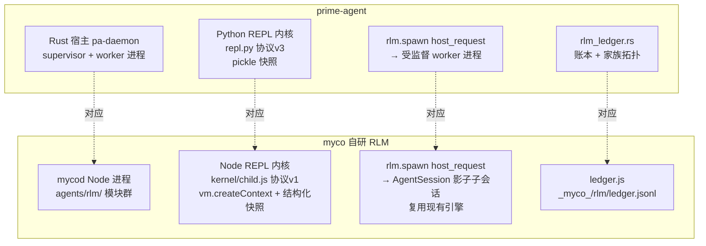
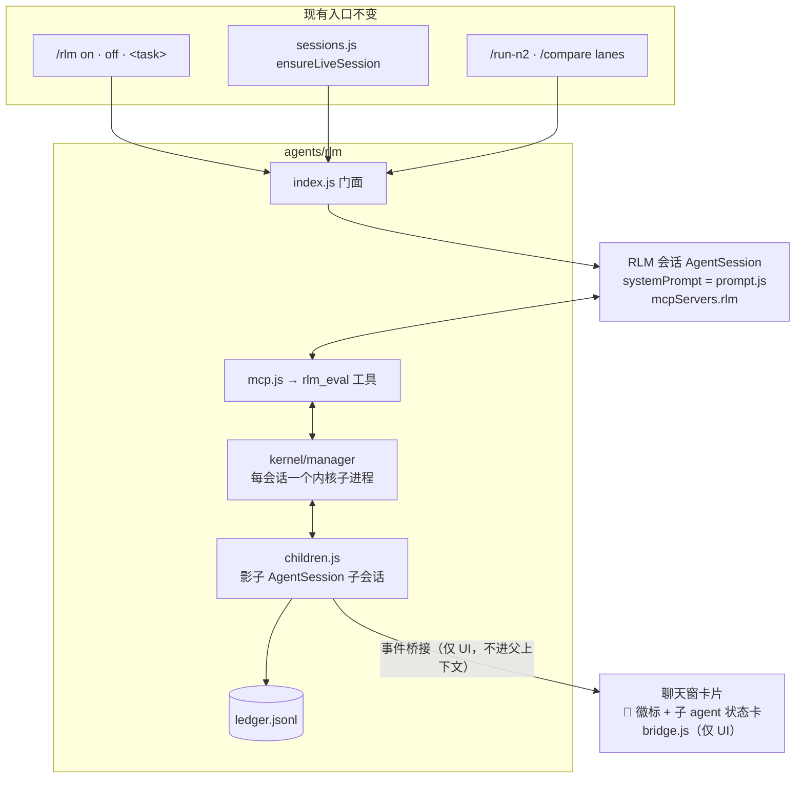

# myco RLM 核心技术自研设计（v1）

> 设计日期：2026-10-21
> 参考实现：prime-agent v0.10.0（本仓库，Rust 宿主 + Python RLM 运行时）
> 参考分析：`/data/s00791175/Delm/mycoFile/prime.md`
> 目标仓库：`/data/s00791175/Delm/mycoFile/myco-1014`（myco，Node + claude-agent-sdk）
> 新代码落点：`server/src/agents/rlm/`

---

## 0. 背景与动机

myco 现有的 RLM 实现（delm-10）是一个**提示词级验证实现**：约 200 行代码，
把 Prime Intellect 的 RLM 两原则写成行为契约 systemPrompt 注入 SDK，核心技术
（上下文管理、递归 sub-agent）完全委托给 claude SDK 的原生能力。

**现状的两个根本局限：**

1. **RLM 行为是"软"的** —— 没有代码强制的上下文预算、递归深度约束、子 agent
   函数签名。模型不遵守协议时，`/rlm on` 和普通会话看不出区别。
2. **功能面不完整** —— `/rlm on` 在 agent-n2 会话下被忽略；`/run-n2` lane 不读
   `rec.rlm`；RLM 模式开启与否在界面上没有明显标识。

本设计把 RLM 重构为**硬实现**：自研持久 REPL 内核（prompt-as-a-variable 的
代码化落地）+ 程序化子 agent 调用（rlm.spawn/collect 的运行时保证），并补齐
功能面与 UI 标识。

---

## 1. prime-agent 核心机制分析（自研的蓝本）

prime-agent 的 RLM 之所以是"硬实现"，靠的是四个真实机制（不是提示词）：

| # | 机制 | 代码位置 | 本质 |
|---|------|---------|------|
| 1 | **持久 REPL 内核** | `prime-agent-runtime/src/rlm/repl.py`（协议 v3，NDJSON over fd0 / 私有 fd1 dup） | 模型写的代码 cell 跑在一个跨 cell 存活的 `__main__` 命名空间里 → 上下文真的变成变量 |
| 2 | **host_request 通道** | `repl.py` `host_request()` → Rust 宿主（`pa-core/src/kernel/`） | 内核里的 Python 代码能同步调用宿主能力（spawn 子 agent 等），async round-trip，`host_reply` 按同一 id 回填 |
| 3 | **rlm.spawn / collect** | `rlm/__init__.py` shim + `pa-daemon/src/rlm_children.rs` | 子 agent 是真实的受监督 daemon 会话（独立 worker 进程）；spawn 返回句柄、collect 收结果——函数调用语义由运行时保证 |
| 4 | **spawn 账本 + 家族拓扑** | `pa-daemon/src/rlm_ledger.rs`（append-only JSONL，32 MiB / 100k 条上限） | parent/child 边、深度、名字持久化；passivation 后 roster 仍可见；`ParentIdentity.rlm_depth` 递归深度硬约束 |

**外围机制**（建立在前四块之上，可分期后补）：

- **Factory 状态机**（`factory.py`，5278 行）：声明式 DAG → machine 编译，
  `FactoryExecutor` 通过 `rlm.spawn`/`rlm.collect` 执行；失败策略
  fail_fast / continue / escalate；约束 MAX_NODES=1024, MAX_RETRIES=10,
  MAX_PARALLEL=64。
- **Continual Harness / /refine**（`harness.py` + `pa-core/src/refinement/`）：
  prompt / memory / skill / subagent / factory 五种组件的持久 CRUD +
  小步增量自改进（提案 / 应用 / 回滚）。
- **快照/恢复**：pickle 序列化命名空间（magic header `PRIME-AGENT-KERNEL-SNAPSHOT-V2`），
  快照 256 MiB、单变量 16 MiB、结果文本 1 MiB 上限。
- **通道分离**（`repl.md` 协议文档的精髓）：事件走 fd 1 的**私有 dup**（在任何
  代码跑之前创建）；真实 fd 1/2 重定向进管道由 pump 线程读回，作为
  `stdout`/`stderr` 事件——用户代码的 print 永远不可能污染协议帧。

---

## 2. myco 现状与机制映射

### 2.1 myco 现有 RLM（将被重构掉的）

| 组成 | 文件 | 作用 |
|---|---|---|
| RLM 提示词 | `server/src/prompts-rlm.js` | 两原则协议文本，作为 SDK systemPrompt 注入 |
| spawn 包装 | `server/src/rlm-session.js` | `spawnRlmAgent`（换 systemPrompt）+ `startRlmLane`（一次性 lane + 事件桥接） |
| respawn 分支 | `server/src/sessions.js:1332` | `rec.rlm === true` 时主会话用 RLM 提示词 respawn；**排在 agent-n2 分支之后 → n2 会话下被忽略** |
| 命令入口 | `server/src/slashcmds.js:2867` | `/rlm` 状态 / `on\|off` 开关 / `<task>` lane |
| 前端 | `web/public/app.js:7637` | lane 卡片 🧠 徽标；`state.rlmMode` 存了但没渲染 |

### 2.2 机制映射（prime → myco）



**关键取舍 —— 子 agent 不另起 OS 进程。** prime-agent 每个 worker 是独立
OS 进程（Rust supervisor 监督、退避重启）；myco 的 `AgentSession` 已经是隔离的
SDK 会话（独立 transcript、独立事件流、可被 reaper 杀、事件日志独立落盘），
进程级隔离的边际收益不大，**进程内 spawn + 账本**已满足"真子 agent"语义
（句柄、深度、收集、可观测 roster）。这是与 prime 最大的结构差异，其余机制
1:1 移植。

**关键取舍 —— 快照不用 pickle。** Node 无 pickle 等价物，用结构化序列化：
可 JSON 化变量直接序列化；对象保留原型描述（类名 + 方法名列表）；不可序列化
变量记 `__unserializable__` 占位。上限对齐 prime 精神：快照 64 MiB、单变量
4 MiB，超限裁剪并计数上报。

---

## 3. 目录设计

```
server/src/agents/rlm/
├── index.js            # 门面：spawnRlmAgent / startRlmLane / onRlmLaneTerminal
│                       #   保持旧 require('./rlm-session') 的签名兼容（旧模块
│                       #   转发到这里后删除，static guard 防回归）
├── prompt.js           # RLM 契约提示词（重写：教内核 API 而非抽象原则）
├── kernel/
│   ├── protocol.md     # 协议 v1 文档（对齐 prime repl.md 的写法）
│   ├── child.js        # 内核子进程入口 `node child.js`（≈ repl.py）
│   ├── manager.js      # ReplKernelManager：spawn/handshake/execute/interrupt/
│                       #   snapshot/restore/shutdown 生命周期（≈ pa-core kernel/manager）
│   └── snapshot.js     # 命名空间快照/恢复（结构化序列化 + 大小裁剪）
├── host.js             # host_request 路由器：内核请求 → 服务器能力分发
├── children.js         # rlm.spawn/collect/list/delete 的服务器端实现：
│                       #   影子 AgentSession 子会话 + 深度控制 + 收集语义
├── ledger.js           # spawn 账本（append-only JSONL + 家族拓扑重建）
├── factory.js          # 状态机编排（Phase 3）
├── bridge.js           # lane 事件桥接迁入（原 rlm-session startRlmLane 逻辑）；
│                       #   子 agent 事件只喂 UI，绝不进父的 LLM 上下文
└── mcp.js              # MCP 服务器：向 claude 暴露 rlm_eval 等工具
```

迁移规则：`server/src/rlm-session.js` + `server/src/prompts-rlm.js` 整体迁入
并删除；`sessions.js` / `slashcmds.js` / `compare-lanes.js` 的 require 改指
`agents/rlm`。`run_static_checks` 加 guard：`require('./rlm-session')` 与
`require('./prompts-rlm')` 不得再出现。

---

## 4. 核心组件设计

### 4.1 REPL 内核（prompt-as-a-variable 的硬实现）

**进程模型**：每 RLM 会话一个 Node 子进程 `node kernel/child.js`，
`child_process.spawn` + stdio pipe。

**协议通道**（照抄 prime 的通道分离设计——这是 repl.md 最精妙的部分）：

- **请求**：fd 0（stdin），NDJSON，一行一个请求对象；reader 线程接管后
  fd 0 重绑 `/dev/null`；
- **事件**：启动时**先**在 fd 1 上 `dup` 出私有协议 fd，**再**把真实 fd 1/2
  重定向进管道，pump 线程把字节作为 `stdout`/`stderr` 事件发——用户代码的
  `console.log` / 原生 write 永远不可能污染协议帧；
- **握手**：启动即发 `{"event":"ready","protocol":1,"node":"..."}`，无 banner。

**协议 v1 请求集**（prime 9 个裁剪到 7 个）：

| 请求 | 字段 | 语义 |
|---|---|---|
| `execute` | `{id, code}` | 在持久命名空间执行；async 包装支持 top-level await |
| `interrupt` | `{}` | SIGINT 语义；无 reply |
| `snapshot` | `{id, path, maxVarBytes}` | 命名空间落盘 |
| `restore` | `{id, path}` | 恢复 |
| `list_names` | `{id}` | 列出命名空间变量 |
| `host_reply` | `{id, data}` | 回应 host_request |
| `shutdown` | `{}` | flush 快照 + teardown |

**事件集**：`ready` / `stdout` / `stderr` / `result`（尾表达式 repr，cap 1 MiB，
值绑 `_`）/ `error` / `host_request` / `done`（每个带 id 的请求恰好一个，
永远在该请求其它事件之后）。

**命名空间**（≈ prime 的 `__main__`）：

```js
vm.createContext({
  console, require, Buffer, process,      // 受限子集（cwd/env，无 exit）
  rlm: hostShim,                          // spawn/collect/listSubagents/... （§4.2）
  state: {},                              // 约定的状态摘要变量
})
```

`state` 是 RLM 契约的核心：提示词要求 agent 把 `state.task / state.done /
state.next / state.blockers` 写成代码变量，每轮从 `state` 启动而不是从
transcript 重推导。**SDK 自动压缩丢细节时，`state` 变量还在内核进程里**——
这是对 SDK compaction 的结构性优势。

**快照时机**：respawn 前、lane 结束前、每 N 轮；进程退出 hook flush
（对应 prime `shutdown_all_live_kernels`）。恢复路径：`resumeSdkSessionId`
（transcript）+ `kernel.restore(snapshot)`（工作变量）双恢复。

### 4.2 host_request 通道 + rlm.* API（子 agent = 函数调用的硬实现）

内核命名空间注入 `rlm` shim（对齐 prime `rlm/__init__.py` 的 API 面，JS 化）：

```js
// 内核里 claude 写的代码可以直接用：
const h = await rlm.spawn('grep 全仓库找 X 的引用', { name: 'finder', model: null });
const done = await rlm.collect([h.rlmChildId], { timeoutMs: 0 });  // 阻塞收答案
rlm.listSubagents();
rlm.deleteSubagent(id);
rlm.progressNote('...');
```

每个调用 = `host_request` round-trip：内核发
`{"event":"host_request","id","data":{type:"rlm.run",...}}` → manager 转给
`host.js` 路由器 → 按 type 分发到 `children.js` 等 → `host_reply` 回填同一
id 的 future。**参数校验在宿主侧**（对应 prime `rlm_runtime.rs` 的
normalize_* 系列：name ≤64 字符、thinking/model 枚举校验）——子 agent 调用
从此有类型化参数、awaitable 句柄、可编程 collect 策略，不再依赖模型自觉。

**`children.js` — spawn 的服务器端：**

- 子会话 = `spawnAgent('<sessionId>-rlm-c<seq>', {
    cwd,
    eventsFile: '_myco_/rlm/<run>/events-<name>.jsonl',
    autonomousPermission: true,          // 后台子 agent 不许挂权限菜单
  })`；
- **深度控制**（prime `ParentIdentity.rlm_depth`）：子会话 systemPrompt 附带
  `RLM_DEPTH=k, MAX=3`；k ≥ MAX 时该子会话内核的 `rlm.spawn` 直接抛
  `DepthLimitError` —— **递归深度是运行时硬约束**；
- **collect 折叠语义**：取子会话最后一条 `assistant_text`（或 `turn_result`
  摘要）作为 answer 返回——**只收答案，不收 transcript**。子 agent 的事件
  走 `bridge.js` 进聊天窗 UI（带 🧠 徽标），但**绝不进父 agent 的 LLM 上下文**。

### 4.3 spawn 账本（`ledger.js`）

`<cwd>/_myco_/rlm/ledger.jsonl`，append-only。事件类型：
`spawn` / `rename` / `delete(reason: user | parent_teardown | gc)`，
每行携带 `parentSessionId, childSessionId, name, depth, ts`。

- 上限对齐 prime：32 MiB / 100k 条，超限头部截断；
- **家族拓扑从账本重建**而非从会话文件推导——服务器重启后
  `rlm.listSubagents()` 依然完整；被 reaper 杀掉的子会话在 roster 上可见
  （状态 `error`）。

### 4.4 RLM 提示词重写（`prompt.js`）

旧提示词教抽象原则；新提示词教**具体 API**（对齐 prime 系统提示的
core / usage / guidelines 分层，prime.md §6）：

```
[core]  你有一个持久 Node 内核。把工作状态写成代码变量
        （state.task / state.done / state.next / state.blockers），
        用 rlm_eval 工具执行 cell。命名空间跨轮存活、可 snapshot。
[usage] 非平凡子任务必须走 rlm.spawn（返回句柄）+ rlm.collect（收答案）；
        禁止把子任务全文粘进上下文；递归深度上限 3（运行时强制）。
[guide] 何时 spawn vs 自己做；state 摘要维护节奏；超时/失败重试策略；
        内核非沙箱——破坏性命令照走权限流程。
```

claude 通过 **MCP 工具 `rlm_eval(code)`** 执行 cell：`mcp.js` 注入
`sdkOpts.mcpServers.rlm`（复用 myco-mcp.js 的模式），工具 input schema 即
参数校验层。

### 4.5 整体架构



---

## 5. 功能面补齐（与自研并行的需求项）

### 5.1 `/rlm on` / `/rlm off` 对 run-n2 和普通对话都生效

**目标行为矩阵：**

| 场景 | `/rlm on` | `/rlm off` |
|---|---|---|
| 单 agent 普通对话 | RLM 引擎 respawn（现状已支持，重构后为完整内核版） | 普通路径（现状） |
| agent-n2 会话普通对话 | worker 提示词 = STARTUP_A/B + RLM overlay | 纯 STARTUP_A/B（现状） |
| `/run-n2 <task>` lane | lane 读 `rec.rlm`，带 RLM overlay | 纯 STARTUP_A/B（现状） |
| `/rlm <task>` | 不变（显式 RLM lane） | 不变 |

**实现（提示词 overlay，非内核引入——n2 worker 暂不配内核，P2 之后再评估）：**

```js
// prompt.js 新增
function rlmN2Addendum() {
  return `
## RLM overlay (session-level)
- PRECEDENCE: board coordination contract WINS on conflicts. RLM governs
  HOW you manage context and decompose sub-work, not the team protocol.
- Keep a compact state summary; work from summary + durable files
  (board rows, plan.json), not the transcript.
- Decompose mechanical/research sub-work into sub-agents. Board-claimed
  work stays yours — do not delegate across the board.
`;
}
```

接线三处：

1. `team-session.js` — 构造函数收 `opts.rlm`，`_spawnWorker` 里
   `systemPrompt: workerPrompt(...) + (this.rlm ? rlmN2Addendum() : '')`；
2. `sessions.js getOrCreateTeamSession` — 把 `rec.rlm` 传给 TeamSession
   （消除现在"n2 分支先 return、rlm 被忽略"的缺陷）；
3. `slashcmds.js runN2CompareLanes` — 读 `rec.rlm` 传给 `startN2Lane` /
   `startSingleLane`（single lane 在 rlm 时改调 `spawnRlmAgent`，`/compare`
   得到公平对比维度）。

**生效时机语义：** 普通对话 / n2 会话 = 下次 respawn 生效（不打断在跑的
turn）；`/run-n2` lane = 立即生效（lane 每次现起，读当次 `rec.rlm`）。
`/rlm on` 的回复文案写明这一点。

`/rlm off` 零新增逻辑：`rec.rlm = false` 后所有路径回到各自原有逻辑。

### 5.2 界面明显标识

由 `state.rlmMode` 驱动（补齐"存了没渲染"的缺口），三个可见层级：

1. **聊天窗顶栏常驻 chip**（最显眼）：rlm on 时显示高亮 `🧠 RLM` pill，
   off 时隐藏。数据源两条：
   - 初始 attach：attach.js 初始状态帧加 `rlm: !!rec.rlm`
     （现在只有 toggle 广播，刷新/换会话后丢失）；
   - 实时：现有 `rlm-mode-changed` 帧已写入 `state.rlmMode`，handler 加
     一行 `_updateRlmBadge()`。
2. **侧边栏会话卡片徽标**：`index.js` `/sessions` payload 每项加
   `s.rlm = !!(rec && rec.rlm)`；`app.js` 会话卡片渲染处（busy/queue 徽标旁）
   加 `<span class="rlm-badge">🧠 RLM</span>` —— 不打开会话也能看出哪些
   会话开了 RLM。
3. **输入框 placeholder**（加分项）：rlm on 时 composer placeholder 加
   `(RLM 模式)` 后缀。

样式：`styles.css` 加 `.rlm-badge`（紫/蓝底，区别于 busy 绿、queue 灰）。

---

## 6. 分期落地

| 期 | 内容 | 量级 | 里程碑 |
|---|---|---|---|
| **P1** | 目录迁移 + 门面 + 协议 v1 内核（execute / interrupt / list_names / snapshot / restore）+ rlm_eval MCP + 提示词重写 + 单测 | 内核 ~400 行 + 周边 ~300 行 | 内核 round-trip 可用，`/rlm on` 会话经 rlm_eval 跑 cell，快照跨进程存活 |
| **P2** | host.js + children.js（spawn / collect / 深度限制）+ ledger.js + UI 子 agent 状态卡 + §5 功能面（n2 overlay、lane 读 rec.rlm、UI 标识） | ~400 行 | spawn→collect 闭环，账本重建 roster，深度硬约束生效 |
| **P3** | factory.js 状态机（DAG→machine 编译、fail_fast/continue/escalate、MAX_NODES=1024） | ~600 行（可对 factory.py 逐段移植） | 声明式编排可用 |
| **P4** | harness CRUD + /refine 自改进（五种组件类型 + 提案/回滚） | ~500 行 | 持续自改进闭环 |

P1+P2 = "核心技术自研"的最小完整闭环（**持久命名空间 + 程序化子 agent
调用**）；P3/P4 是编排层，可后补。

---

## 7. 测试计划（遵守 myco §10 稳定性纪律）

| 测试 | 形式 | 断言 |
|---|---|---|
| `test/rlm-kernel.test.js` | 真实内核子进程 | 轮询握手（不 sleep）；execute round-trip；top-level await；快照→杀进程→重启→restore 变量存活；大量 `console.log` 后协议帧仍可解析（通道分离） |
| `test/rlm-children.test.js` | mock SDK spawnAgent | spawn 写账本；深度 ≥3 抛 DepthLimitError；collect 只折叠 answer 摘要，不折叠 transcript |
| `test/rlm-ledger.test.js` | 纯函数 | 账本重建家族拓扑；32 MiB/100k 截断行为 |
| `test/rlm-n2-overlay.test.js` | 单测 | n2 respawn 消费 rec.rlm；run-n2 lane 读 rec.rlm；off 回归纯 STARTUP |
| `test/rlm-ui.test.js`（扩展） | static + DOM shape | /sessions payload 含 rlm；attach 初始帧含 rlm；chip 渲染函数存在且被 toggle handler 调用 |
| static guards | 进 `run_static_checks` | ① `require('./rlm-session')`/`require('./prompts-rlm')` 不得出现（迁移完成 guard）；② 协议版本常量在 protocol.md 与 child.js 两处一致；③ rlmN2Addendum 输出含 "WINS on conflicts"（优先级声明防丢） |
| 收尾 | 全量 `./test/test.sh` | 现有 rlm / n2 / compare / chat-persistence 套件全绿 |

测试纪律：每个测试独立端口/临时目录（`free_port` + `mktemp -d`）；子进程
readiness 用轮询（cap 15s）不用 `sleep`；断言消息写明契约；单个测试
sub-second standalone。

---

## 8. 风险与对策

| # | 风险 | 对策 |
|---|---|---|
| 1 | **内核子进程生命周期**：长驻子进程泄漏 / 僵尸 | 挂进现有 teardown 路径：`session.on('close')` → `manager.shutdown()`；进程退出 hook flush 快照（对应 prime `shutdown_all_live_kernels`）；reaper 杀会话时同步杀内核 |
| 2 | **`vm` 非安全边界**：内核跑模型生成的代码 | 模型本身已有 Bash 权限，非新攻击面；但提示词声明"内核非沙箱，破坏性命令照走权限流程"；rlm_eval 保留 canUseTool 钩子 |
| 3 | **与 SDK 自动 compaction 的关系** | SDK 压缩摘要 transcript，命名空间不受影响（在内核进程里）——结构性优势：压缩丢细节时 `state` 变量还在 |
| 4 | **stdout 大流量**（pump 线程、帧 caps） | 对齐 prime caps：result 1 MiB、host_request payload 16 MiB、单变量 4 MiB、快照 64 MiB；超限裁剪 + 截断标记 |
| 5 | **n2 overlay 与 board 协议冲突** | addendum 显式声明 PRECEDENCE（board wins）+ static guard 锁住该声明 |
| 6 | **回滚** | P1/P2 各自独立 commit；`/rlm off` 即运行时回退；目录迁移单独一个 commit，revert 成本 = 1 commit |

---

## 9. 与 prime-agent 的差异清单（总结）

| 维度 | prime-agent | myco 自研 |
|---|---|---|
| 宿主语言 | Rust（pa-daemon supervisor + worker 进程） | Node（mycod 进程内） |
| 内核语言 | CPython（`python -m rlm.repl`） | Node（`node kernel/child.js`，vm 模块） |
| 子 agent 隔离 | 独立 OS 进程，supervisor 监督退避重启 | 进程内影子 AgentSession（SDK 会话隔离 + reaper + 独立事件日志） |
| 快照格式 | pickle + magic header V2 | 结构化 JSON + 原型描述 + `__unserializable__` 占位 |
| 协议版本 | v3（9 请求类型） | v1（7 请求类型，bash_activity/mcp_status 后补） |
| 递归深度 | `ParentIdentity.rlm_depth` + max_depth | 同样机制，深度 3，内核侧抛 DepthLimitError |
| 账本 | rlm_ledger.rs，32 MiB / 100k | ledger.js，同上限 |
| LLM 供应商 | pa-ai 多 provider + 模型目录 | claude-agent-sdk（复用现有 AgentSession） |
| UI | ratatui 终端 TUI | myco web 聊天窗（🧠 徽标 + 子 agent 卡片，bridge 仅 UI） |
| Factory / Harness | 已实现（5278 行 / 1381 行） | P3 / P4 分期后补 |

---

## 附录 A：协议 v1 帧格式草案

```jsonc
// 请求（stdin，NDJSON）
{"type":"execute","id":"c1","code":"state.task = 'find refs'"}
{"type":"snapshot","id":"c2","path":".snap.json","maxVarBytes":4194304}
{"type":"restore","id":"c3","path":".snap.json"}
{"type":"list_names","id":"c4"}
{"type":"interrupt"}
{"type":"host_reply","id":"h7","data":{"status":"ok","result":{...}}}
{"type":"shutdown"}

// 事件（私有协议 fd）
{"event":"ready","protocol":1,"node":"v22.x"}
{"event":"result","id":"c1","text":"'find refs'"}
{"event":"stdout","id":"c1","text":"..."}          // id=null 表示无主字节
{"event":"host_request","id":"h7","data":{"type":"rlm.run","prompt":"...","kwargs":{...}}}
{"event":"error","id":"c1","ename":"ReferenceError","evalue":"...","traceback":[...]}
{"event":"done","id":"c1","status":"ok"}           // 每 id'd 请求恰一个，永远最后
```

## 附录 B：宿主侧 host_request 路由表

| `data.type` | 处理 | 返回 |
|---|---|---|
| `rlm.run` | `children.js` spawn 影子 AgentSession | `{rlmChildId, name, sessionDir}` |
| `rlm.collect` | 等待子会话 terminal 事件，折叠 answer | `[{rlmChildId, status, answerPreview, durationMs}]` |
| `rlm.list_subagents` | ledger 重建 roster + live 状态合并 | `RLMSubagent[]` |
| `rlm.delete_subagent` | 杀子会话 + 账本 delete(reason=user) | 删除前快照行 |
| `rlm.progress_note` | 透传到聊天窗（bridge，仅 UI） | `{ok:true}` |
| `rlm.find_models` | 读 gateways 模型目录 | 模型匹配列表 |
