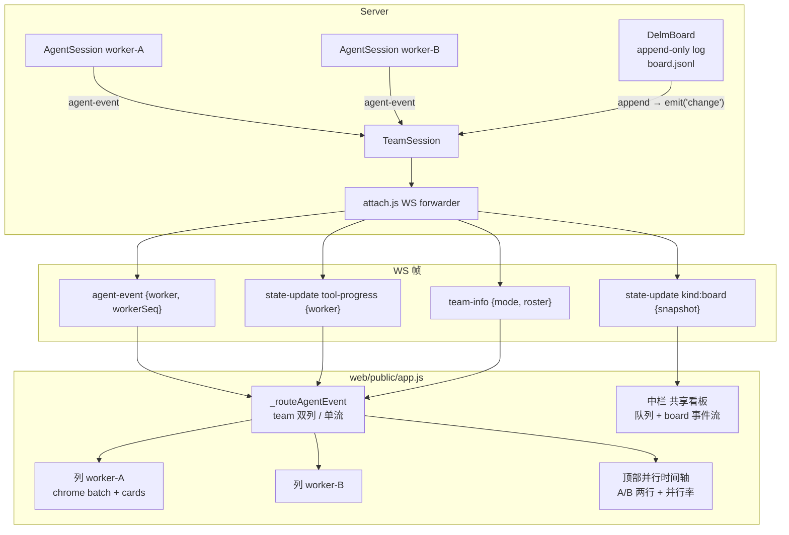
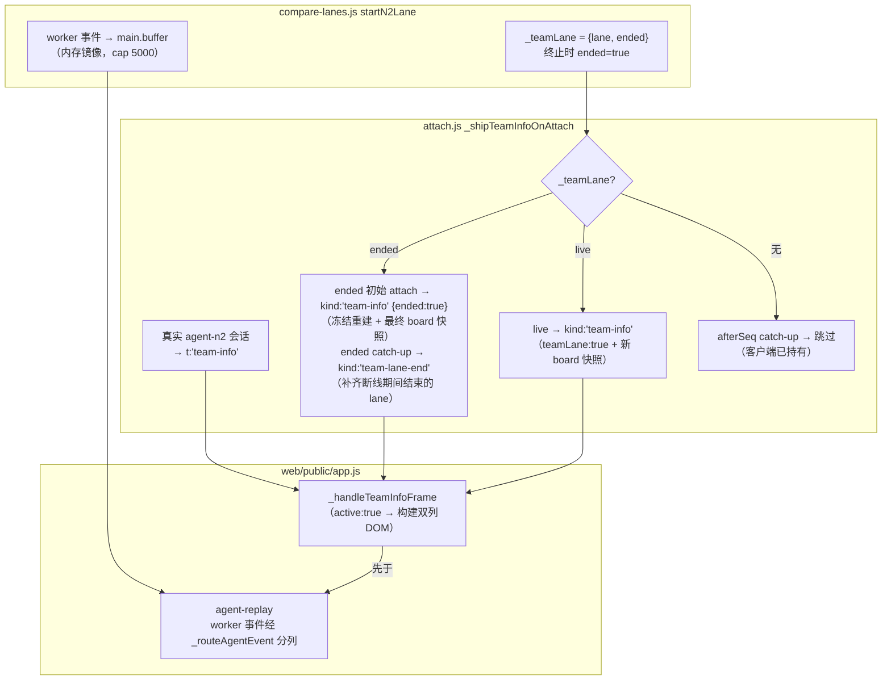
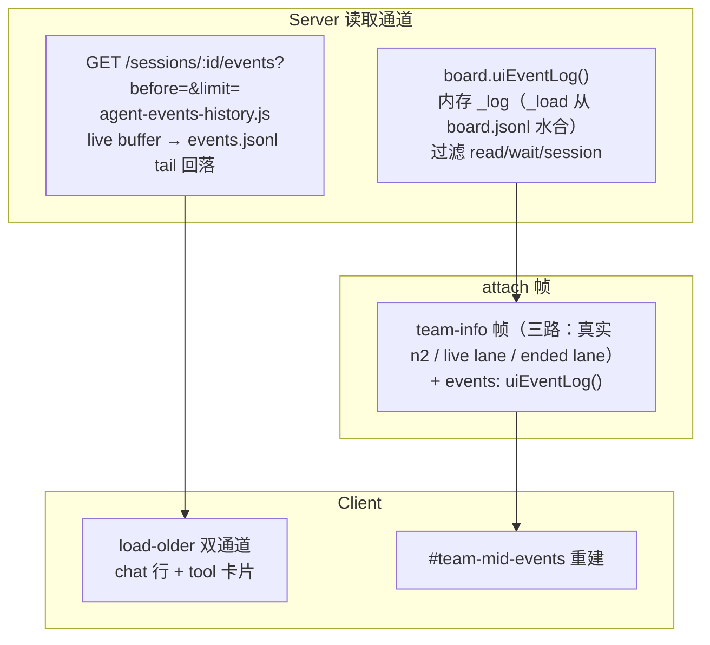
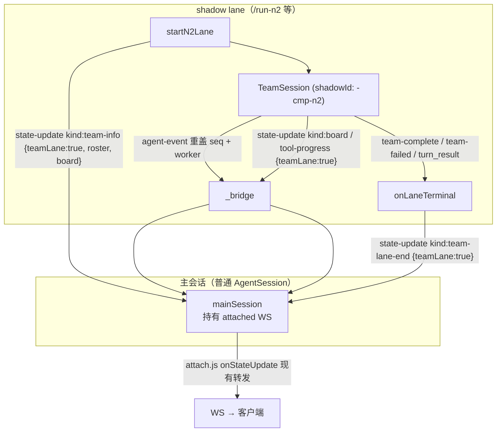

# Team Session 双列协同视图（team-split-view）

> 状态：P1–P3 已实施（2026-10-19）；shadow-lane 接入已完成。
> 用户决策：**默认双列 + 可切回单流**；时间精度用现有毫秒级 `ts`，不做更细粒度。

## 1. 背景与问题

`agent-n2`（Delm 双 worker）模式下，一个 TeamSession 在单进程内驱动
worker-A / worker-B 两个 `AgentSession`，二者只通过共享 `DelmBoard`
协同（[team-session.js](../../server/src/team-session.js)、
[board.js](../../server/src/board.js)）。

当前 UI 把两个 worker 的事件**全部混排在同一个 `#chat-messages` 流**里，
只靠一个小徽章（蓝 A / 橙 B）区分。三个可观测性缺口：

1. **看不出谁在干什么** —— 两个 worker 的 tool 调用 / 文本交织，认知负担高。
2. **看不出并行度** —— A、B 同时干活时无法直观对照时间区间。
3. **看不出交互与依赖** —— board 的 publish / claim / done / note / apply
   是唯一协同通道，但 UI 从不读取 board，认领关系、冲突全部不可见。

## 2. 目标

- worker-A、worker-B 的活动**分列展示**，默认双列。
- **并行执行**一眼可见：列间横向对齐的时间条 + 并行率。
- **交互/依赖**一眼可见：中栏共享看板（子任务队列 + owner）、claim
  连线、apply 冲突高亮。
- 可随时**切回单流**（现状渲染，worker 徽章保留）。

## 3. 总体架构



关键原则：**服务器是唯一事实源**（沿用 chat 持久化契约）；客户端不落任何
本地状态，attach / 重连后从 replay + 快照完整重建；`meta.seq` 顺序契约
不变（`_resortChatPaneByTs` 仍然管辖单流模式）。

## 4. 服务器端改动

### 4.1 board.js — 变更事件

`DelmBoard.append()` 在现有 `emit('wake')` 之外，对**所有** kind 追加
`emit('change', { sequence, actor, kind, payload })`。`read` / `wait` 这类
高频读事件对 UI 无意义，TeamSession 转发时过滤，board 层保持简单。

### 4.2 team-session.js — worker 标签修复 + board 广播

1. **修复 tool-progress 丢 worker 标签**（现状 bug）：`_wireWorkers` 里
   `w.on('state-update', …)` 转发时补 `worker: actor`，payload 变为
   `{ kind:'tool-progress', open:[…], worker }`。前端按 worker 分列存放，
   不再互相覆盖。
2. **board → `state-update kind:'board'`**：构造时
   `this.board.on('change', …)`，过滤掉 `read` / `wait` / `session`，
   其余转发为 `{ kind:'board', event:{sequence, timeNs, actor, kind, payload},
   snapshot:{ queue, notes, status, sessions } }`。`snapshot` 用
   `board.view(null)` 派生（去掉 `reader` 字段的轻量视图），客户端拿到
   即可全量重绘中栏，无需自己维护增量状态机。
3. **`team-info` 帧**：attach 时客户端需要立刻知道"这是 team 会话"，
   不能等第一个带 `worker` 的事件。TeamSession 暴露 `mode='agent-n2'`
   已有，attach.js 在 `_attachAgentWebSocket` 检测
   `session.mode === 'agent-n2'` 时先发
   `{ t:'team-info', mode, roster, board:{ queue, notes, status, sessions } }`。

### 4.3 attach.js — attach 下发

`_attachAgentWebSocket` 在现有 replay / chat-history 之外：

- `session.mode === 'agent-n2'` → 发 `team-info`（含 board 快照）。
- 后续 `state-update` 帧由现有 `onStateUpdate` 原样转发（board 快照 +
  修复后的 tool-progress 都走这条通道，无新增监听）。

### 4.4 index.js — HTTP 端点（回放/调试用）

`GET /sessions/:id/board`：鉴权同其他 session 路由；返回
`{ queue, notes, status, sessions, sequence }`。为未 attach 的客户端
（手机、只读复盘）提供 board 快照拉取。实时更新仍走 WS。

## 5. 前端改动（web/public/app.js + styles.css）

### 5.1 布局与切换

- `state.teamView = { active:false, mode:'split', roster:[], board:null,
  colEvents:{ 'worker-A':[], 'worker-B':[] } }`。
- **team 模式检测**：收到 `team-info` 帧 → `active:true`，构建双列 DOM。
  会话切换时 `_resetUiForNewSession` 重置。
- **DOM 结构**（插入 `#chatpane`，`#chat-messages` 与双列容器互斥显示）：

```html
<div id="team-split" class="team-split" hidden>
  <div class="team-toolbar">
    <button id="team-toggle-split">双列</button>
    <button id="team-toggle-stream">单流</button>
    <span id="team-parallel-rate">并行率 62%</span>
  </div>
  <div class="team-parallel-bar" id="team-parallel-bar"></div>  <!-- P2 -->
  <div class="team-columns">
    <section class="team-col" data-worker="worker-A">
      <header>worker-A · <span class="team-col-status">…</span> · 认领:…</header>
      <div class="team-col-body"></div>
    </section>
    <section class="team-col" data-worker="worker-B">…</section>
    <aside class="team-mid" id="team-mid">
      <!-- 队列条 + board 事件流 -->
    </aside>
  </div>
</div>
```

- **默认双列**；`team-toggle-stream` 切回单流时：双列容器 `hidden`，
  `#chat-messages` 显示，已缓存的 `colEvents` 不丢——切回双列时从缓存
  重建（不重新拉 replay）。偏好存 `localStorage.teamViewMode`。
- **窄屏 fallback**：`@media (max-width: 900px)` 自动降级为单流 + 徽章
  （CSS 切换 + JS 检测，同方案确认稿）。

### 5.2 事件路由 `_routeAgentEvent(ev)`

`_appendAgentEvent` 入口最前（`compareLane` 分支之后）插入：

```
if (state.teamView.active && ev.worker) → 双列分支，不再走单流渲染
if (state.teamView.active && !ev.worker) → 单流渲染（用户输入、系统提示照旧）
```

双列分支复用现有渲染原语：

- 每列一个 `pane`（`.team-col-body`），chrome 批次折叠逻辑直接复用
  `_isChromeEvent` / `_appendToChromeBatch` / `_finishChromeBatch`——
  它们已经按 `dataset.worker` 感知，天然兼容。
- 列内滚动独立，`wasAtBottom` 检测按列计算；`triggerScroll` 滚对应列。
- `assistant_text` 连续合并逻辑同单流，按列内 `lastSeq` 判定。
- 无 `worker` 的事件（用户 chat、系统 note）**只进单流容器**；切到双列
  时它们仍可见于单流视图。chat bubble 由 `chat` 帧路径渲染，不经此路由。

### 5.3 列头状态行

每列 header 三段：

- **忙/闲**：`state-update tool-progress {worker}` 的 `open[]` —— 有条目
  显示 `⚙ Bash · 47s`（取第一条 + 计数），空则 `● idle`。
- **当前认领**：board snapshot `queue` 中 `state==='claimed' && owner===
  该worker` 的 item subject。
- **最新 board status**：`status[]` 里该 actor 的 `text`（worker 通过
  `mcp__board__status` 上报的一行状态）。

### 5.4 中栏共享看板（P1 简版 → P3 完整）

- **队列条**：board snapshot 的 `queue` 渲染为紧凑列表——
  `state` 图标（`○ open` / `◐ claimed` / `✓ done`）+ subject + owner
  色块。点击展开 detail。
- **board 事件流**：`state-update kind:'board'` 的 `event`（publish/
  claim/done/note/apply…）按序追加为小卡片，附 actor 色点。`apply`
  事件展开可见 `decisions`（unchanged/kept/write/conflict）。
- **默认折叠计数**：笔记密集时只显示 `FACT ×3 · FAIL ×1`，点击展开。

### 5.5 P2 — 并行时间轴 + 并行率

- `#team-parallel-bar`：两行（A/B）水平时间条，用每 worker 缓存的
  `colEvents` 里 `tool_use.ts → 对应 tool_result.ts` 区间画色块。
- **对齐基线**：两行共用同一时间窗（`min(首事件 ts)` → `now`），
  横向重叠即并行。窗口按列内最早事件动态扩展。
- **并行率**：`并行区间 ∪ / 窗口总长`，每 5s 重算（随 tool 事件增量
  更新即可，无需定时器）。
- 精度：毫秒级 `ts`，不细分。

### 5.6 P3 — 依赖连线 + 冲突高亮

- 中栏队列条目与列内 claim 卡片（worker 的 `mcp__board__claim`
  tool_use 事件）建 DOM 引用；hover 队列条目时给两端元素加
  `.team-link-hi` 类（CSS outline 高亮）。**用 hover 高亮替代 SVG 连线**
  ——DOM 跨三栏画线脆弱且滚动不同步，hover 语义等价、实现稳。
- `apply` 事件 `applied:false`（存在 conflict）→ 中栏卡片红色边框，
  两列对应文件的最近 tool_use 卡片加闪烁提示。

## 6. 数据契约（帧形状）

```js
// attach 时一次性
{ t:'team-info', mode:'agent-n2', roster:['worker-A','worker-B'],
  board:{ queue:[…], notes:[…], status:[…], sessions:[…], sequence } }

// shadow lane 启动时（/run-n2 · /compare n2 腿 · 队列 ◓），经主会话
// state-update 通道（attach.js onStateUpdate 前转，帧形状同上 + 两个附加键）
{ t:'state-update', kind:'team-info', mode:'agent-n2', teamLane:true,
  roster:['worker-A','worker-B'], board:{…} }

// shadow lane 终止时（live 帧）— 客户端冻结视图，不销毁
{ t:'state-update', kind:'team-lane-end', teamLane:true }

// ended lane 的初始 attach（刷新/二设备在跑完之后进来）— 重建冻结视图
{ t:'state-update', kind:'team-info', mode:'agent-n2', teamLane:true,
  ended:true, roster:[…], board:{最终快照} }

// 每次 board append（过滤 read/wait/session 后；lane 路径多一个 teamLane:true）
{ t:'state-update', kind:'board',
  event:{ sequence, timeNs, actor, kind, payload },
  snapshot:{ queue, notes, status, sessions } }

// 修复后的 tool-progress（带 worker）
{ t:'state-update', kind:'tool-progress', open:[…], worker:'worker-A' }

// HTTP
GET /sessions/:id/board → { queue, notes, status, sessions, sequence }
```

`agent-event` 帧不变（`worker` / `workerSeq` 已有）。

## 7. 会话切换 / 重连 / 刷新（reattach 握手）

- 切换会话：`_resetUiForNewSession` 清 `state.teamView`，双列容器销毁。
- 重连：`?afterSeq=N` 增量补发照旧；board 全量 snapshot 每次都随
  `team-info` / `board` 帧下发（幂等重绘），无需增量对账——board 事件
  量级小（子任务数十条），全量快照成本可忽略。
- `agent-replay` wipe-and-rebuild：双列模式下 replay 事件同样经
  `_routeAgentEvent` 分列，wipe 作用于两列容器 + 中栏事件流。

### 7.1 刷新后按钮消失的根因与修复（reattach 握手）

**症状**：刷新页面或切走再切回会话后，双列/单流按钮（整个 `#team-split`
容器）不再出现。

**根因**（三个叠加）：

1. shadow lane 的 `team-info` 是启动瞬间的一次性实时帧——刷新后没人
   补发；主会话是普通单 agent 会话，attach.js 的 agent-n2 分支不命中。
2. `_bridge` 转发事件用裸 `mainSession.emit()`，绕过了
   `AgentSession._emit` 的 `buffer.push`——刷新后 agent-replay 里连
   worker 事件都回不来。
3. 顺序 bug：attach 时 `_shipAgentReplay` 先于 `team-info` 下发，replay
   的 worker 事件到达时 `state.teamView.active` 仍为 false，全部流进
   单流渲染；后到的 team-info 只能建出两列**空**列。

**修复**（reattach 握手，三条腿）：



- [compare-lanes.js](../../server/src/compare-lanes.js) `_bridge`：team
  lane 的 worker 事件在重盖主 seq 的同一 listener 里镜像进
  `mainSession.buffer`（内存 ring，cap 5000，与 `_emit` 同规格）**并**
  经 `_persistEventToDisk` 落盘主会话 events.jsonl——服务器重启后
  hydrate 读回，冻结视图的 run 历史不丢（shadow 自己的完整日志仍在
  compare 目录）。
- `startN2Lane` 在主会话上记录 `_teamLane = { lane, ended, roster }`；
  终止回调把 `ended` 置 true。
- [attach.js](../../server/src/attach.js) `_shipTeamInfoOnAttach(session,
  ws, sessionId, afterSeq)`：owner + viewer 两条 attach 路径都在
  **`_shipAgentReplay` 之前**调用。分四种情况：
  - 真实 agent-n2 会话 + 初始 attach → `t:'team-info'`（board 快照）；
  - live lane + 初始 attach → `state-update kind:'team-info'`
    （teamLane:true + 新快照）→ 刷新后双列视图恢复；
  - ended lane + 初始 attach → `state-update kind:'team-info'`
    （teamLane:true + **ended:true** + 最终 board 快照）→ 客户端冻结
    重建双列，随后 agent-replay 回放**已持久化的 run 历史**（bridge 落盘
    主会话 events.jsonl）填回两列；
  - catch-up（afterSeq）→ live 情况跳过（客户端断线前已收到 info，DOM
    仍在），ended 情况发 `team-lane-end`（那是它唯一可能错过的状态转移）。
- 客户端 `agent-replay` wipe 扩展：team 视图激活时，**两列 body** 一并
  wipe，replay 事件经 `_routeAgentEvent` 重新分列（防止重连重复渲染）。
  中栏事件流（`#team-mid-events`）**不**在 wipe 之列——replay 流里没有
  board 事件，该 feed 由 team-info 帧的 `events` 历史（§7.2）负责
  重建；wipe 它会刚回填就被抹掉。
- 客户端 `_routeAgentEvent` 单流模式修复：切回单流后 worker 事件
  **同时**进缓存 + 单流渲染（带 worker 徽章），不再被吞——原实现与
  其注释宣称的行为相反。

### 7.2 刷新后历史内容消失：持久历史的读取通道（refresh-history-backfill）

**症状**（三个同根表现）：
1. 单流会话刷新后，16 KB replay 窗口之外的**命令/结果步骤**全没了
   （数据还在 session.buffer + events.jsonl，客户端没有读取路径）；
2. /run-n2 刷新后共享看板中栏的**过程事件流**（发布/认领/完成卡片）
   空白——那些是一次性实时帧，没人回放；
3. lane 结束后切走再切回，看板永久不可见。

**根因**：live 帧是一次性的，磁盘上有全量（events.jsonl / board.jsonl）
但**没有任何按需读取端点**——与 Claude Code 的差异正在这里：CC 把
整个 project JSONL 加载进内存懒渲染；web 客户端不能这么做，等价的
翻译是"全量在服务端、懒分页到客户端"。

**修复**（三条读取通道）：



- **[agent-events-history.js](../../server/src/agent-events-history.js)**
  `agentEventsWindow(sessionId, {before, limit}, deps)`：live
  `session.buffer` 优先（含 bridge 镜像的 lane 事件），无 live 则读
  `events.jsonl` 尾 5000 行（reaper 杀掉 / 重启后仍可翻页）。窗口
  oldest→newest，`{events, total, hasMore}` 与 `/chat/history` 同
  形状。`GET /sessions/:id/events`（viewer 门禁）暴露之。
- **[board.js](../../server/src/board.js) `uiEventLog()`**：与
  `_relayBoardChange` 同过滤器（去 read/wait/session）的完整 UI 事件
  序列；attach 的 `_shipTeamInfoOnAttach` 三路帧都携带
  （`_laneUiEventLog` 对 dead-lane 安全——DelmBoard 从 board.jsonl
  水合，lane 死了对象还在）。
- **客户端 `_fetchOlderAgentEvents`**：load-older 时与 chat 行回填
  并发触发；游标 = 已渲染卡片最小 `data-seq`；对已渲染 seq 去重
  （重连 replay 重叠）；detached fragment 渲染（临时 swap
  `_ensureAgentLogPane`，零滚动/HUD 副作用）后 prepend +
  `_resortChatPaneByTs`（契约 §4）；`state._eventsHasMore` 让按钮在
  chat 追平后仍存活，`_resetUiForNewSession` 时复位。
- 回归锁定：`test/refresh-history-backfill.test.js`（12 cases）+
  test.sh 接入。

## 8. Shadow-lane 接入（/run-n2 · /compare n2 腿 · 队列 ◓ 按钮）

P1 的 `team-info` 只在**真实 agent-n2 会话 attach** 时下发。但
`/run-n2`、`/compare` 的 n2 腿、run-queue 的 `◓ agent-n2` 走的是
**shadow lane** 架构（[compare-lanes.js](../../server/src/compare-lanes.js)）：
主会话仍是普通单 agent 会话，第二个独立 TeamSession 在后台执行，事件经
`_bridge` 转发。这些路径原本**不会**触发双列视图。已接入：

### 8.1 服务器端（compare-lanes.js）



- `_bridge` 对带 `boardSnapshot` 的 executor（即 TeamSession）新增
  `state-update` 转发：所有 lane 的 board / tool-progress 帧打上
  `teamLane:true` 后 re-emit 给主会话，主会话由 attach.js 现有
  `onStateUpdate` 前转器照常下发——**不新增 WS 监听**。
- `startN2Lane` 启动即发 `state-update kind:'team-info'`
  （`teamLane:true` + roster + 初始 board 快照），与 attach 帧
  **同一形状**，客户端单一代码路径进入双列模式。
- lane 到达终止态（`turn_result` / `iteration_aborted` / `fatal` /
  `team-complete` / `team-failed`）→ 发
  `state-update kind:'team-lane-end' {teamLane:true}`，客户端**冻结**
  双列视图（`team-split-ended` 类 + `■ 已结束` 徽章，列内容/看板/缓存
  全保留），下次 `/run-n2` 的 `team-info resetCache` 才清列。
- **run 历史持久化（frozen-view fix）**：`_bridge` 对 `/run-n2`
  （lane falsy）的 **worker 事件**在同一个重盖 seq 的 listener 里
  `buffer.push(out)` + `_persistEventToDisk(out)`——镜像的是重盖主 seq
  后的副本（`workerSeq` 剥离），不是原始 ev。三个旧 bug 随之修掉：
  ① `?afterSeq=N` 补发不再把镜像事件过滤掉；② 初始 replay 排序不再
  被 worker 本地 seq 污染；③ **服务器重启不再丢 run 历史**（镜像落盘
  主会话 events.jsonl，hydrate 读回 buffer）。

### 8.2 客户端差异（teamLane 标志）

| | 真实 agent-n2 会话 | shadow lane（teamLane:true） |
|---|---|---|
| 进入双列 | attach 时 `t:'team-info'` 帧 | `state-update kind:'team-info'`（新跑 `resetCache:true` 清列；ended 重宣**不** resetCache） |
| 生命周期 | 会话存续期，跨多次运行 | 单次运行，`team-lane-end` **冻结**；下次 `/run-n2` resetCache 才清 |
| board 快照 | attach + 每次 board 帧 | 同左（经 bridge 转发） |
| tool-progress worker 标签 | 有（team-session.js 修复） | 有（同一 TeamSession 代码路径） |
| 刷新后（run 进行中） | team-info → replay 重建双列 | 同左（live lane 重宣 + 镜像事件回放） |
| 刷新后（run 已结束） | 不适用（会话级双列常驻） | `team-info {ended:true}` → 冻结重建，replay 回放已持久化的 run 历史 |

- `_handleTeamInfoFrame`：`teamLane` 记录来源；`resetCache` 时清
  `colEvents` / `openTools` / 中栏事件流（lane 的每次 `/run-n2` 都是
  新跑，不能叠加上一次的事件）；`ended` 落入
  `state.teamView.laneEnded`（冻结态徽章 + DOM 重建时补
  `team-split-ended` 类）。
- `_handleTeamLaneEnd`：仅 `teamLane` 时**冻结**——清 `openTools`
  （死 lane 不显示忙态）、列头换 `■ 已结束`、DOM 加
  `team-split-ended`；**不清缓存、不拆容器**。真实 agent-n2 会话若
  同时跑 lane，其自身双列视图不受 lane 结束影响。
- **单流模式回切入口**：切回单流后整个 `#team-split` 容器（含工具栏）
  一起隐藏，会没有按钮切回双列。补一个浮动 pill
  （`#team-float-toggle`，钉在 `#chatpane` 右上），仅在
  `active && mode==='stream'` 时可见。

### 8.3 已知边界

- `/compare` 双列 overlay（`compareLane` 标签）与 team 双列是**两个
  独立表面**：`_routeAgentEvent` 对 `ev.compareLane` 的事件让行，
  compare overlay 照旧自渲染。`/compare` 的 n2 腿会先进 team 双列、
  跑完 `team-lane-end` 退下，随后 overlay 展示对比结论。
- lane 结束后主会话仍可发普通事件；`team-lane-end` 只清 team 视图，
  不动主时间线。

## 9. 测试计划

| 层 | 测试 | 断言 |
|---|---|---|
| server 单测 | `test/team-split-view.test.js`（10 cases） | board emit('change') 形状；TeamSession tool-progress 带 worker；board state-update 转发 + 过滤 read/wait；boardSnapshot 无 reader 副作用；`startN2Lane` 发 team-info + bridge board/tool-progress 帧；lane 终止发 team-lane-end；**镜像**——worker 事件重盖主 seq + `workerSeq` 剥离 + 落盘（`_persistEventToDisk`）、无 worker 事件跳过；**reattach**——`_teamLane` 记录 + ended 翻转、`_shipTeamInfoOnAttach` live 重宣 / ended 初始 attach 发 `team-info{ended:true}` / ended catch-up 发 `team-lane-end` / live catch-up 跳过 / 普通会话不发 |
| 静态检查 | test.sh run_static_checks | app.js 含 `_routeAgentEvent` / `_handleTeamInfoFrame` / `laneEnded` / `kind === 'board'` 分支；styles.css 含 `team-split` + `team-split-ended`；attach.js 含 team-info 下发 + `ended: true`；index.js 含 `/sessions/:id/board`；compare-lanes.js 含重盖镜像（`buffer.push(out)` + `_persistEventToDisk(out)`）+ `_teamLane`；attach.js 两条路径 team-info **先于** agent-replay（awk 顺序守卫） |
| 回归 | 既有 `team-session.test.js` / `team-runqueue.test.js` / `slash-n2-compare.test.js` | 保持绿 |
| 全量 | `./test/test.sh` | 提交前全绿 |

## 10. 分阶段交付

- **P1**：server 三项（board change、team 转发、team-info + 端点）+
  前端双列布局 + 事件路由 + 列头状态 + 中栏队列条 + 单流切换。
- **P2**：并行时间轴 + 并行率。
- **P3**：board 事件流完整卡片 + hover 依赖高亮 + 冲突高亮。

每阶段结束跑全量 `./test/test.sh`。
