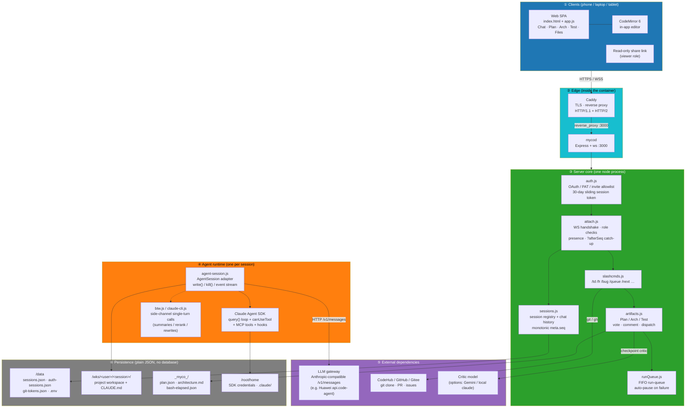
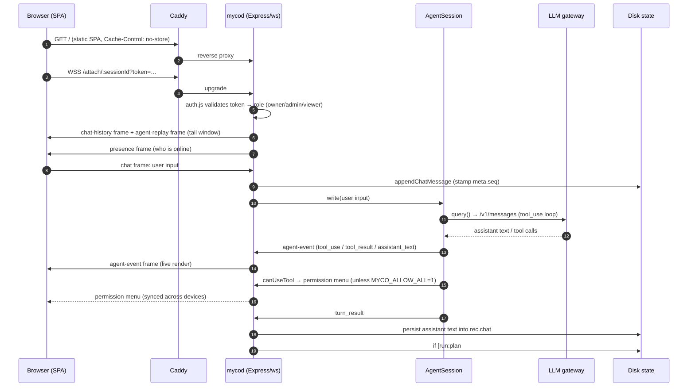
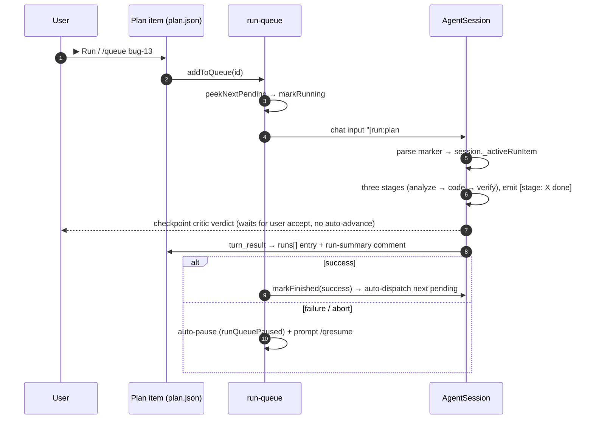
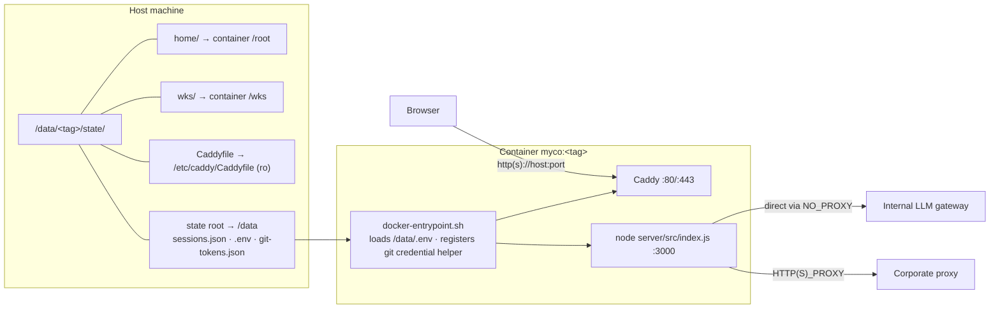

# myco Architecture Overview (English)

> A high-level map for introducing the project. For detailed design see
> `architecture.md`; for per-file responsibilities see
> `docs/arch/overrall/code-arch.md`.

## In one sentence

myco is a **single Node process (`mycod`)** web application: Express serves the
HTTP API and the static SPA, `ws` carries the live `/attach/:session` channel,
and each *session* is an `AgentSession` instance embedding the Anthropic Agent
SDK that drives one autonomous coding agent. Caddy sits in front for TLS and
reverse proxying. All state is **JSON files on disk** (a global `/data` area
plus per-session `_myco_/` project memory inside the workspace), so swapping
containers or hosts never loses data.

---

## 1. System map — request path, orchestration, state

---

## 2. Lifecycle of one human → agent conversation

---

## 3. Plan dispatch and the run-queue

---

## 4. Deployment shape and mount layout

**Key conventions**

- **No Docker volumes, only bind mounts** — every file is visible on the host
  and backup is `tar` of one directory.
- **Containers do not inherit the host `/etc/hosts`** — internal domains must be
  injected with `--add-host`.
- **Internal addresses go direct via `no_proxy`**; only outbound internet traffic
  uses the corporate proxy.
- **`.env` is read once at boot** — edit it, then `docker restart`.

---

## 5. Roles and permissions

| Role | How acquired | Can drive agent | Can mutate plan | Can edit files |
|---|---|---|---|---|
| Owner | Created the session | ✓ | ✓ | ✓ |
| Admin | `/admin <login>` by the owner | ✓ | ✓ | ✓ |
| Read-only viewer | Share link / not on the session allowlist | — | partial (file items, vote, comment, `@mention`) | — |

`MYCO_ALLOW_ALL=1` makes the agent skip all tool permission prompts (explicit
deny rules still win). Convenient for a single-user test box; turn it off for
multi-user use.

---

## 6. Design points worth telling an audience

1. **State is files.** No database, no queue broker. `sessions.json` is the
   session truth, `_myco_/plan.json` is the project truth, and `git clone`
   is the whole onboarding step.
2. **One process, many sessions.** Each agent session is an in-process
   `AgentSession` talking to the SDK over a structured event stream. Sessions
   are isolated (own workspace, own chat history).
3. **Pluggable agent backend.** `AgentSession` is the only integration boundary;
   adding the OpenAI Agents SDK is one adapter (`fr-52`).
4. **Human in the loop.** Three stages (analyze / code / verify) with a
   checkpoint critic and explicit user acceptance — no auto-advance; permission
   prompts on by default.
5. **Cross-device consistency.** The server is the single source of truth;
   clients render by `meta.seq`, and reconnects catch up losslessly via
   `?afterSeq=N`.
