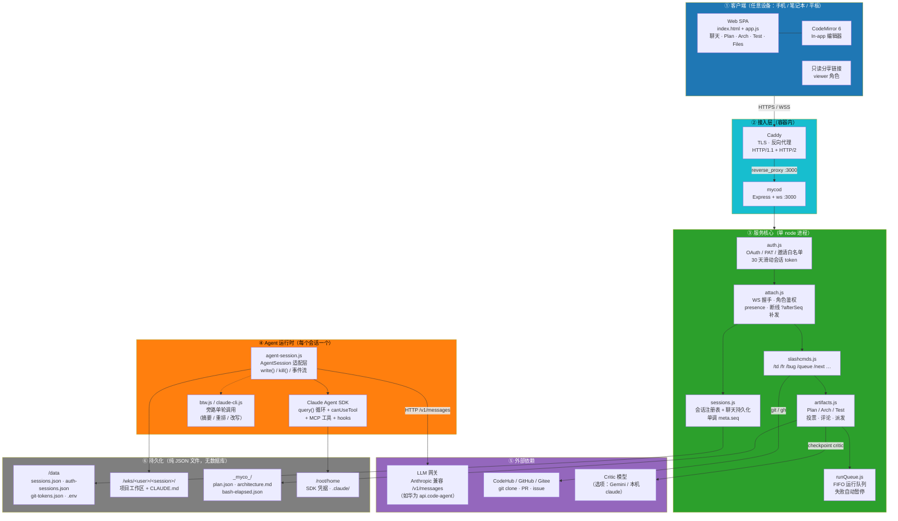
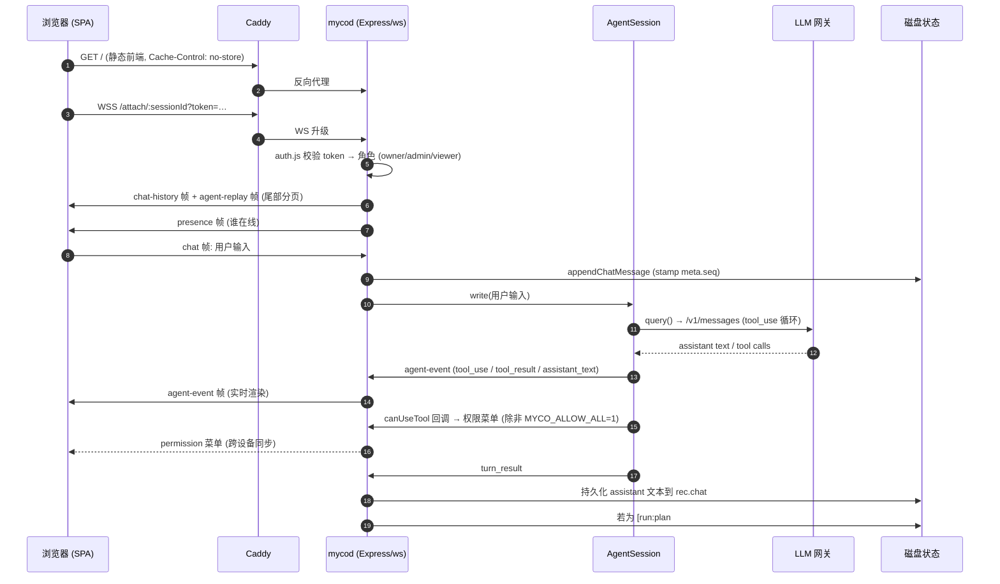
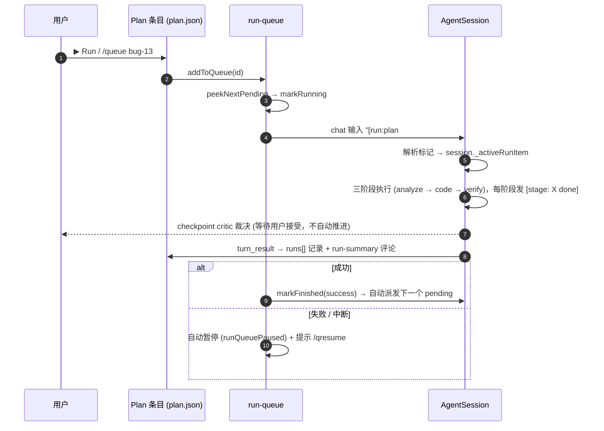
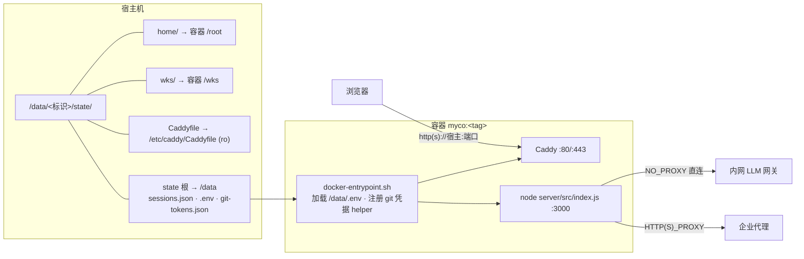

# myco 架构图（中文版）

> 面向介绍用途的总体架构概览。详细设计见 `architecture.md`，
> 单文件职责见 `docs/arch/overrall/code-arch.md`。

## 一句话概括

myco 是一个 **单 Node 进程（mycod）** 的 Web 应用：Express 承载 HTTP 与静态前端，
`ws` 承载 `/attach/:session` 实时通道；每个「会话」是一个 `AgentSession` 实例，
内嵌 Anthropic Agent SDK 驱动一个自主编码 agent；Caddy 在前端做 TLS/反向代理。
所有状态都是**磁盘上的 JSON 文件**（`/data` 全局态 + 每个会话工作区的 `_myco_/` 项目记忆），
因此换容器、换机器都不丢数据。

---

## 1. 总体架构（请求流 + 调度 + 状态）

---

## 2. 一次「人会话说 agent」的生命周期

---

## 3. Plan 派发与运行队列

---

## 4. 部署形态与挂载布局

**关键约定**

- **无 Docker volume，全部 bind mount**：宿主机上每个文件都能看到、能 tar 备份。
- **容器内不继承宿主 `/etc/hosts`**，内网域名必须用 `--add-host` 注入。
- **内网地址走 `no_proxy` 直连**，外部流量走企业代理。
- `.env` 只在启动时读一次，改完要 `docker restart`。

---

## 5. 权限与角色

| 角色 | 获取方式 | 驱动 agent | 改 Plan | 改文件 |
|---|---|---|---|---|
| Owner | 创建会话的人 | ✓ | ✓ | ✓ |
| Admin | Owner 用 `/admin <login>` 授权 | ✓ | ✓ | ✓ |
| Read-only viewer | 分享链接 / 不在会话白名单 | — | 部分（提案、投票、评论、`@mention`） | — |

`MYCO_ALLOW_ALL=1` 会让 agent 跳过所有工具权限确认（deny 规则仍生效），
适合容器化测试环境；面向多人时建议关闭。

---

## 6. 设计要点（介绍时可以直接讲的几条）

1. **状态即文件** —— 没有数据库、没有队列中间件。`sessions.json` 是会话真相，
   项目文件即项目真相，`git clone` 就等于完成团队交接。
2. **单进程、多会话** —— 每个 agent 会话是进程内一个 `AgentSession`，
   通过 SDK 的事件流与服务器通信；session 之间互不干扰（各自工作区、各自聊天记录）。
3. **agent 后端可插拔** —— `AgentSession` 是唯一集成边界，
   换 OpenAI Agents SDK 只需加一个适配器（`fr-52`）。
4. **人在环上** —— 三阶段（analyze / code / verify）+ checkpoint critic + 显式接受，
   不自动推进；权限确认默认开启。
5. **跨设备一致** —— 服务器是唯一真相，客户端只按 `meta.seq` 渲染，
   断线用 `?afterSeq=N` 无损补发。
