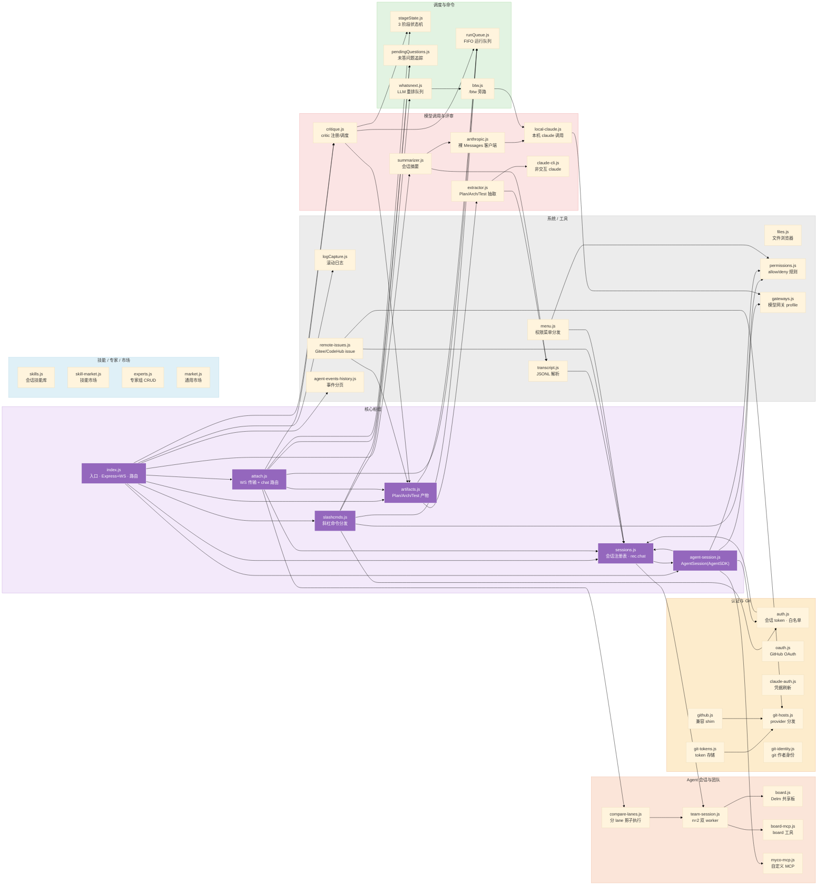

# myco 代码架构 — server/src 逐文件职责与依赖

> 形态：**单 Node 进程（mycod）**，Express 提供 HTTP、ws 提供 WebSocket `/attach`
> 会话流；每个会话由 `@anthropic-ai/claude-agent-sdk` 驱动一个 Agent 实例。
> 数据流：浏览器（任意设备）→ Caddy(80/443) → `index.js`(Express+WS) →
> `attach.js` /attach 握手 → `sessions.js` 注册 → `agent-session.js`(AgentSession)
> 驱动 SDK → 华为网关 `/v1/messages`。持久化全在 `/data`（sessions.json）+
> 每个会话 `/wks/<user>/<sid>/_myco_/`。

## 每个文件作用一览

| 文件 | 作用 |
|---|---|
| **index.js** | 服务器入口：启动加载 `.env`，装配全部 Express 路由 + WS，口子 auth/sessions/plan/logs/chat |
| **attach.js** | WS 传输 + 聊天路由：`/attach/:sid` 握手、断线 `?afterSeq=N` 补发、`handleChatMessage` 分发、`[run:plan#X]` 结果回绑 |
| **sessions.js** | 会话注册表 + 持久化（`sessions.json` rec：chat/buffer/artifacts）、`spawnSession`、`getChatHistory`、单调 `seq` |
| **agent-session.js** | AgentSession 适配层：封装 SDK `query()`，暴露 `.write()/.kill()/.emit()`，挂 canUseTool 权限，写 events.jsonl |
| **team-session.js** | TeamSession（Delm n=2 双 worker）：一次 run 派发 worker-A/B 并行，经共享 DelmBoard 协调 |
| **compare-lanes.js** | 分 lane：用 shadow 影子执行器对同面板跑第二条执行流，事件桥回主 WS（打 `compareLane` 标） |
| **agent-events-history.js** | agent 事件分页补数据：`GET /sessions/:id/events` 的 load-older 后端（live buffer → 磁盘 JSONL 兜底） |
| **slashcmds.js** | 斜杠命令分发器：`/td /fr /bug /queue /run /task /skip /setpat /critic` 等，每 handler 回聊天气泡 |
| **artifacts.js** | Plan/Arch/Test 产物路由：抽取、勾选/quorum 触发 dispatch、结果回写 runs[]/comments[] |
| **runQueue.js** | FIFO 运行队列（`rec.runQueue`）：peek/markRunning/markFinished，失败自动暂停 |
| **stageState.js** | 每 plan 项的 3 阶段状态机（analyze/code/verify ↔ in_progress/awaiting_verdict/awaiting_accept） |
| **whatsnext.js** | "下一步"优先级队列：启发式挑 TOP20 + 单轮 LLM 重排，2h 缓存 |
| **pendingQuestions.js** | 未答复用户问题追踪 + 失败自动重派（有界重试） |
| **btw.js** | `/btw` 旁路：起一次 `claude -p` 子进程应答聊天 |
| **auth.js** | 会话 token 签发/校验 + GitHub 邀请白名单（`allowed-github-users.txt`） |
| **oauth.js** | GitHub OAuth `/auth/github/{start,callback}` 助手 |
| **claude-auth.js** | 聊天内刷新 Claude 订阅凭据（`claude auth login`），无需 ssh 进容器 |
| **git-tokens.js** | 按 (myco-user, provider/owner/repo) 存 git token（`git-tokens.json`，0600） |
| **git-hosts.js** | provider 感知 Git 主机分发（GitHub/Gitee）：detectHost/createIssue/fetchUser |
| **github.js** | 兼容旧 API 的 shim，包一层新 `git-hosts` 分发器 |
| **git-identity.js** | 从 session 属主生成 git 作者身份（noreply 邮箱约定，防泄露真实邮箱） |
| **anthropic.js** | 裸 HTTPS Messages-API 客户端（无 SDK），供 summarizer/extractor，失败返回 null |
| **claude-cli.js** | 非交互式 Claude 调用（基于 SDK，供 Plan/Arch/Test 抽取器） |
| **local-claude.js** | "走本机 claude" 的一次性调用封装，可选叠加自定义网关 profile |
| **gemini.js** | Gemini API 薄封装（critic 的 provider 之一） |
| **critique.js** | critic 注册表/调度：选 critic 类型、读 prompts、凑 verdict；三阶段门禁 |
| **extractor.js** | 用 LLM 从 JSONL 转录抽取 Plan/Arch/Test 产物 |
| **summarizer.js** | 会话摘要（读 transcript → anthropic 调用） |
| **experts.js** | 专家组 CRUD：由多个 skill 定义 named 专家，`/run-team` 映射到 worker |
| **files.js** | 会话文件浏览器（纯模块、路径越界防护、错误码映射） |
| **transcript.js** | JSONL transcript 读取/解析/监听（查看器对话视图 + extractor/summarizer 数据源） |
| **skills.js** | 会话技能库（`.claude/skills/`）选择/上传/导入，支持 symlink |
| **skill-market.js** | 技能市场：跨用户共享 store + 删除码安全策略（timingSafeEqual） |
| **market.js** | 通用市场：层叠 expert/team/mcp 市场 + personal/store 分层 + 发布 |
| **menu.js** | 权限菜单分发（PTY 时代遗留的 `/decide` 广播，auto allow/deny） |
| **permissions.js** | 会话级 allow/deny 规则（`Bash(git)` 这类模式） |
| **myco-mcp.js** | 自定义 MCP 工具（如 `add_plan_items`），每 AgentSession 一个实例 |
| **board.js** | Delm 共享板（进程内）：append-only 事件日志，queue/claim/done/note，双 worker 唯一协调通道 |
| **board-mcp.js** | 把 board 暴露成 MCP 工具（read/publish/claim/done…），每 worker 一个实例 |
| **gateways.js** | 每用户模型网关 profile（baseUrl/authToken/model，`gateways.json` 0600） |
| **logCapture.js** | 滚动日志缓冲（容量 5000），喂 `GET /logs` + `/loop` 诊断 |
| **remote-issues.js** | 远程 issue 同步（/feature /bug 上报 GitHub/Gitee/CodeHub） |
| **text-utils.js** | 纯文本小工具（零依赖，供 btw/prompts 构建用） |
| **prompts-n2.js / prompts-n2-shared.js / prompts-team.js** | n=2 团队系统提示词（忠于 Delm `prompts_n2.py`） |
| **agents/rlm/** | RLM 多智能体子系统（host/harness/kernel/children/mcp 等，另一套 multi-agent 设计） |
| **critics/** | critic 具体实现 + `prompts/`（stage 提示词 md）+ `specialties/`（general/test-validity/perf-security 分面） |
| **mcp/** | MCP 服务端（`mcp-server.js`、`builtin-servers.js`、mcp `market.js`） |
| **INTERACTION_RULES.md** | 交互规则文档（非代码） |

## 分组速查

### ① 核心枢纽（被大量模块依赖）
| 文件 | 职责 |
|---|---|
| **index.js** | 入口。启动时加载 `.env`，装配全部 Express 路由 + WS，口子：auth/sessions/plan/logs/chat。 |
| **attach.js** | WS 传输 + chat 路由。`/attach/:sid` 握手、断线 `?afterSeq=N` 补发、`handleChatMessage` 把聊天/run 分发给 AgentSession、`[run:plan#X]` 回绑。 |
| **sessions.js** | 会话注册表 + 持久化（`sessions.json` 的 rec：chat/buffer/artifacts），`spawnSession`、`getChatHistory`、`appendChatMessage`、单调 `seq`。 |
| **artifacts.js** | Plan/Arch/Test 产物路由：抽取、勾选触发 dispatch、结果回写 runs[]/comments[]。 |
| **slashcmds.js** | `/td /fr /bug /queue /run /task /skip /setpat /critic` 等命令分发器。 |
| **agent-session.js** | AgentSession 适配层：包装 SDK `query()`，暴露 `.write()/.kill()/.emit()`；挂 `canUseTool` 权限。 |

### ② 认证与 Git
`auth.js`（token+白名单）、`oauth.js`（GitHub OAuth）、`claude-auth.js`（聊天内刷凭据）、`git-tokens.js`（token 存储）、`git-hosts.js`（provider 分发）、`github.js`（兼容 shim）、`git-identity.js`（git 作者身份）。

### ③ Agent 会话与团队
`team-session.js`（n=2 双 worker）、`compare-lanes.js`（分 lane 影子执行）、`board.js`（Delm 共享板，双 worker 唯一协调通道）、`board-mcp.js`（board 工具）、`myco-mcp.js`（自定义 MCP 工具，如 add_plan_items）。

### ④ 模型调用与评审
`critique.js`（critic 注册/调度，三阶段门禁）+ `critics/`（实现 + prompts + specialties 分面）、`anthropic.js`（裸客户端）、`local-claude.js`（本机 claude）、`claude-cli.js`、`extractor.js`（产物抽取）、`summarizer.js`（摘要）。

### ⑤ 调度与命令
`runQueue.js`（FIFO 队列，失败自动暂停）、`stageState.js`（analyze/code/verify 状态机）、`whatsnext.js`（TOP20 启发式 + LLM 重排）、`pendingQuestions.js`（未答问题追踪）、`btw.js`（旁路单轮调用）。

### ⑥ 技能 / 专家 / 市场
`skills.js`（会话技能库，支持 symlink）、`skill-market.js`（跨用户技能市场+删除码安全）、`experts.js`（专家组 CRUD）、`market.js`（层叠 expert/team/mcp 市场）。

### ⑦ 系统 / 工具
`files.js`（文件浏览器）、`transcript.js`（JSONL 解析）、`permissions.js`（allow/deny 规则）、`gateways.js`（每用户模型网关 profile）、`logCapture.js`（滚动日志）、`remote-issues.js`（远程 issue 同步）、`agent-events-history.js`（事件分页）、`text-utils.js`（纯文本工具）、`mcp/`（MCP 服务端）。

## 依赖要点

- **循环依赖**：`sessions → attach → sessions`、`sessions → artifacts → sessions`、`attach ↔ slashcmds`。`slashcmds.js` 头部注释说明：`sessions.js` 通过 `Object.assign` 在 `module.exports` 之后才补 API，因此 require 时解构会拿到 `undefined`——消费方必须懒访问 `sessionsMod.xxx`。
- **extractor/summarizer** 都依赖 `transcript.js`（读 JSONL）与 `sessions.js`，是"从历史转录里再派生产物"的两条只读旁路。
- **agent-session.js** 是 AgentSDK 的唯一适配点：依赖 `permissions.js`（权限）、`gateways.js`（网关 profile）、`myco-mcp.js`/`mcp/mcp-server.js`（工具），并写 `sessions.js` 持久化。
- **Delm n=2** 一组自成体系：`team-session` → `board`/`board-mcp`/`prompts-*`，与主会话只通过 `sessions.js` + `compare-lanes.js` 交界。
