# myco 整体架构

```mermaid
---
config:
  theme: base
  themeVariables:
    edgeLabelBackground: "#374151"
    edgeLabelColor: "#ffffff"
    tertiaryTextColor: "#ffffff"
    textColor: "#1a1a1a"
    primaryTextColor: "#333333"
  themeCSS:
    '.edgeLabel, .edgeLabel p': 'color: #ffffff !important; background-color: #374151 !important;'
  flowchart:
    htmlLabels: true
---
%% 左右两大块：左侧=请求流（纵向），右侧=调度与状态（纵向）
%% 服务核心拆分：③ 接入与会话（左）、⑥ 调度与命令（右）
flowchart LR

    %% ========== 左侧：请求流 ==========
    subgraph Left["请求流"]
        direction TB

        subgraph Client["① 客户端"]
            direction LR
            SPA["Web SPA<br/>聊天 · Plan · Arch · Test · Files"]
            Editor["CodeMirror 6 编辑器"]
            SPA --- Editor
        end

        subgraph Edge["② 接入层｜K8s Pod hostNetwork 252"]
            direction LR
            Caddy["Caddy<br/>TLS / 反向代理 / 静态<br/>宿主 80/443"]
            Mycod["mycod Node<br/>Express + WS :3000"]
            Caddy --> Mycod
        end

        subgraph CoreA["③ 服务核心 · 接入与会话"]
            direction TB
            Auth["Auth<br/>GitHub OAuth + 白名单<br/>token 30d TTL"]
            Attach["Attach WS<br/>角色 + 断线补发"]
            Sessions["Sessions<br/>会话持久化"]
            Auth --> Attach --> Sessions
        end

        subgraph AgentRT["④ Agent 会话（per session）"]
            direction TB
            AS["AgentSession 适配层"]
            SDK["Claude Agent SDK<br/>循环调用 + MCP"]
            BTW["btw 旁路单轮调用"]
            AS --> SDK
            AS --> BTW
        end

        subgraph External["⑤ 外部服务"]
            direction LR
            Anthro["兼容 Anthropic LLM 后端"]
            GH["CodeHub / GitHub"]
            Anthro --- GH
        end

        %% 左侧内部连线（请求流）
        SPA -- "**HTTPS/WSS**<br/>/attach/:sid" --> Caddy
        Caddy --> Mycod
        Mycod --> Auth
        Auth --> Attach
        Attach --> AS
        AS --> SDK
        SDK -- "**/v1/messages**" --> Anthro
        Auth --> GH
    end

    %% ========== 右侧：调度与状态 ==========
    subgraph Right["调度与状态"]
        direction TB

        subgraph CoreB["⑥ 服务核心 · 调度与命令"]
            direction TB
            Slash["Slash 命令<br/>/td /fr /bug /queue"]
            Artifacts["Artifacts<br/>_myco_ 产物 · vote / run"]
            RunQ["RunQueue FIFO<br/>任务调度"]
            WhatsNext["WhatsNext<br/>LLM 重排 · 2h 缓存"]
            Menu["权限 & canUseTool"]
            LogCap["LogCapture<br/>滚动日志"]
            Slash --> Artifacts --> RunQ
            Artifacts --> WhatsNext
        end

        subgraph State["⑦ 状态层｜JSON 文件｜Local PV /data"]
            direction TB
            StateDir[("MYCO_STATE_DIR<br/>会话 / 认证配置")]
            Wks["工作区 /wks<br/>源码 + CLAUDE.md"]
            MycoDir["_myco_<br/>项目记忆 · git 跟踪"]
            Wks --- MycoDir
        end

        %% 右侧内部连线
        Artifacts --> MycoDir
    end

    %% ========== 跨块连线（左 ⇄ 右） ==========
    Mycod --> LogCap
    RunQ -- "**handleChatMessage**" --> AS
    AS --> Menu
    Sessions --> StateDir
    SDK --> Wks

    %% ========== 样式 ==========
    style Left fill:none,stroke-dasharray:4 4,stroke:#b0b0b0
    style Right fill:none,stroke-dasharray:4 4,stroke:#b0b0b0
    style CoreA fill:#d8efd4,color:#333,stroke:#a9d8a2,stroke-width:1px
    style CoreB fill:#d8efd4,color:#333,stroke:#a9d8a2,stroke-width:1px
    style Client fill:#cfe7f9,color:#333,stroke:#9ec9e8,stroke-width:1px
    style Edge fill:#e6dcf2,color:#333,stroke:#c5aedc,stroke-width:1px
    style AgentRT fill:#fde3cd,color:#333,stroke:#f2bd93,stroke-width:1px
    style State fill:#ecdcd6,color:#333,stroke:#d3b5a9,stroke-width:1px
    style External fill:#e8e8e8,color:#333,stroke:#c0c0c0,stroke-width:1px
```

## 状态与部署说明

- `/data`（含 `wks/`、`.env`、Caddyfile ConfigMap）来自 252 上的 **Local PV**。
- 部署形态（K8s）：**单 Pod**（nodeSelector → master 252，hostNetwork）。
- Caddy 监听宿主 **80/443** → 容器内 mycod **:3000**。
